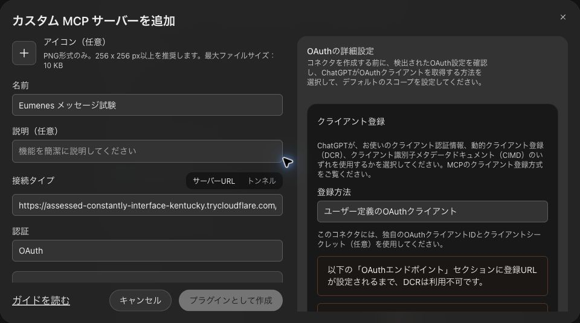

# Eumenesとdotsの接続とメッセージ送受信

更新: 2026-10-25。

Eumenes は依頼、許可する範囲、質問、結果を保存する。dots はその依頼を受け取り、登録した Codex プロジェクトの Session を調整する。文章・資料・調査・実装を同じ契約で扱い、依頼の意味と委任先の選択は会話の LLM に委ねる。

製品側の処理と隔離試験を実装した。実 dots で公開 HTTPS・OAuth・Events・依頼取得・進捗とブロッカーの返却を確認した。**新規 Session と成果返却の受入は未完了**。詳細は [実接続の検証記録](../spec/verification/dots-integration/live-acceptance-2026-10-11.md)。以前の [単体 MVP](../spec/verification/dots-mvp/acceptance-2026-10-10.md) の成功と、今回の製品統合の検証は区別する。

<!-- dots-manual:start -->
## セバスチャンを手動で接続する

この手順では、ChatGPTの「セバスチャン」にEumenesを接続し、Eumenesから送ったメッセージへの返答と要約を受け取ります。ブラウザ操作は利用者、接続のローカル承認と3往復の確認はこのCodexチャットが担当します。

2026年10月25日の試験では、OAuth接続、セバスチャン本人による返答・要約の3往復、再起動後の保存、購読更新後の追加1往復を確認しました。[実接続の受入記録](../spec/verification/dots-messaging-2026-10-25/live-acceptance.md)。接続済みの場合は作成を繰り返さず、Eumenesの **dots メッセージ** で今回の接続先を選び、下部の **dotsへのメッセージ** から送信します。

**今回の試験接続は 2026年10月25日 16:40:28 JST まで有効です。** 期限後や認証サービスを起動し直した後は、この欄の値をそのまま使わず、Eumenesの接続案内を更新してください。恒久運用の認証サービスではありません。

### 1 使用するプロファイルを確認する

1. Braveの **ugnoguchi** プロファイルを使います。
2. [ChatGPTのホーム](https://chatgpt.com/)を開き、左側に **セバスチャン** が表示されることを確認します。
3. 同じプロファイルで、別タブに [Eumenes](http://127.0.0.1:5173/)を開きます。

`ugnoguchigxp` は今回の接続に使いません。セバスチャンが見えない場合は、ChatGPTのアカウント・ワークスペースを確認してから先に進みます。

### 2 Eumenesの接続案内を表示する

1. Eumenes上部の **アーティファクトを開く** を押します。
2. **dots メッセージ** を選びます。
3. **接続先** で **セバスチャン（実接続試験・2時間）** を選びます。
4. **ChatGPTとの接続** にMCPサーバーURLと公開クライアントIDが表示されます。

今回のメッセージ連携は有効化済みです。**メッセージ連携を解除** は押さずに、そのまま進みます。現在の「dots 側で監視を開始・更新してください。」は、後の手順で監視登録すると変わります。

### 3 ChatGPTでカスタムMCPサーバーを追加する

1. 同じBraveプロファイルで [ChatGPTのプラグイン](https://chatgpt.com/plugins)を開きます。
2. 右上の **追加** → **カスタム MCP サーバーを追加** を選びます。
3. 次のように入力します。

| 画面の項目 | 入力・選択する値 |
| --- | --- |
| 名前 | `Eumenes メッセージ試験` |
| 説明・アイコン | 任意。空欄で構いません |
| 接続タイプ | **サーバーURL** |
| 認証 | **OAuth** |

**サーバーURL** に、次を貼り付けます。Eumenesのアーティファクトにも同じ値が表示されます。

```text
https://assessed-constantly-interface-kentucky.trycloudflare.com/mcp/dots/dots-messages-20261025
```

URLの検出が終わるまで待ち、**OAuthの詳細設定** を開きます。



### 4 OAuthの詳細設定を入力する

| 画面の項目 | 入力・選択する値 |
| --- | --- |
| 登録方法 | **ユーザー定義のOAuthクライアント** |
| OAuth クライアント ID | 下の公開クライアントID |
| OAuth クライアントシークレット | **空欄** |
| トークンエンドポイントの認証方法 | **none** |
| デフォルトのスコープ | **dots:read、dots:report、dots:events の3つをすべてON** |
| 基本スコープ | 空欄 |
| OIDCを有効にする | **OFF**。自動でONになっていた場合もOFFにします |

公開クライアントID:

```text
eumenes-chatgpt-2c1f5be8-8299-46b7-b19a-8b609b8324fe
```

今回の認証サービスはOAuthの接続を提供します。OIDCのメールアドレス取得用エンドポイントは提供していないため、OIDCは無効にします。Eumenesの管理トークンや署名鍵を入力する箇所はありません。

自動検出された次の値も確認します。値が合っていれば変更しません。

| 項目 | 期待する値 |
| --- | --- |
| コールバック URL | `https://chatgpt.com/connector_platform_oauth_redirect` |
| 認可URL | `https://assessed-constantly-interface-kentucky.trycloudflare.com/auth` |
| トークンURL | `https://assessed-constantly-interface-kentucky.trycloudflare.com/token` |
| 認可サーバーのベースURL | `https://assessed-constantly-interface-kentucky.trycloudflare.com` |
| リソース識別子 | 上で入力したMCPサーバーURLと完全に同じ |

コールバックや接続先が異なる場合は、その画面のままこのチャットへ知らせてください。登録方法をDCRやCIMDへ切り替える必要はありません。

### 5 プラグインを作成し、認証を開始する

1. 設定と許可する内容を確認し、**理解したうえで続けます** にチェックを入れます。
2. **プラグインとして作成** を押します。
3. 作成後に認証画面が開くか確認します。作成と認証は別の段階です。認証画面が開かない場合は、作成したプラグインを開き、表示されている接続・認証の操作へ進みます。操作が見つからない場合は、表示されている画面名をこのチャットへ知らせてください。未確認のボタン名を探したり、プラグインを追加で作ったりする必要はありません。
4. ブラウザに **このPCで接続を承認してください** と表示されたら、その画面を開いたままにします。
5. **このCodexチャットに「承認待ちになりました」と返信してください。ここが最初の引継ぎ地点です。**

**PCの通知や、承認ボタンのある別ウィンドウが自動で出る仕組みではありません。** 今回の試験用認証では、ブラウザの「このPCで接続を承認してください」は待ち状態を示す案内です。CodexがこのPC内の承認要求を確認し、接続先・クライアント・許可範囲を照合して処理します。利用者がローカル承認APIを開いたり、承認用の秘密をブラウザへ貼り付けたりする必要はありません。待ち画面は数秒ごとに更新されます。

ログインと同意で承認待ちが2回表示される場合があります。画面が切り替わって再び待ち状態になった場合も、このチャットへ知らせてください。承認要求の期限は5分なので、期限切れになった場合は認証を開始し直します。プラグインを何個も作り直す必要はありません。

### 6 プラグインのツールとイベントを確認する

認証後、作成した **Eumenes メッセージ試験** を開きます。利用に必要なインストールや接続の操作が表示されている場合は完了します。

少なくとも次の項目が検出されていることを確認します。

| 種類 | 名前 |
| --- | --- |
| ツール | `list_pending_commands` |
| ツール | `get_command` |
| ツール | `claim_command` |
| ツール | `submit_message_reply` |
| イベント | `command.available` |

これらがない場合は、プラグインのツール・イベントを再スキャンします。再スキャンの操作が見つからない場合やエラーが出た場合は、ここで止めて表示内容をこのチャットへ知らせてください。

### 7 セバスチャンに監視を依頼する

1. [ChatGPTのホーム](https://chatgpt.com/)に戻り、左側の **セバスチャン** を開きます。
2. **Eumenes メッセージ試験** を利用することを明示して、次の文をセバスチャンへ送ります。入力欄で `@` によるプラグイン選択が表示される場合は、同じ名前のプラグインを選びます。

```text
Eumenes メッセージ試験プラグインの command.available を、queue_id=eumenes-dots で監視してください。

通知を受けたら、連携手順に従ってメッセージを取得・claimし、返答と累積要約を submit_message_reply でEumenesへ保存してください。

要約はこの連携で渡された本文と文脈だけを対象にし、他の会話や連携前の履歴を含めないでください。作業用Sessionや定期ポーリングは作らず、個々の返答後も購読を維持してください。
```

これは監視開始の指示です。セバスチャンが「監視します」と答えたことだけでは、購読登録の成功とは扱いません。

### 8 Eumenesで監視登録を確認する

1. Eumenesの **dots メッセージ** に戻り、**状態を更新** を押します。
2. **dots 側で監視を開始・更新してください。** という表示が消え、**初回の返答で接続を確認します** と表示されることを確認します。
3. このチャットに **「監視登録まで完了しました」** と返信してください。

ここまで終わったら、Codexが非機密の試験メッセージを3往復送ります。利用者が手で同じ試験文を重ねて送る必要はありません。

### 9 3往復の結果を確認する

試験内容は、架空の予定を次の順で更新するものです。

1. 日曜の午後、場所は図書館。
2. 場所を公園へ変更。
3. 持ち物に青いノートを追加。

各送信に対して、Eumenesに **dots の返答** と折りたたみ表示の **dots の要約** が保存されることを確認します。3回目の要約が、日曜の午後・公園・青いノートを踏まえていることも確認します。セバスチャンの返答をCodexが代理作成することはありません。

| Eumenesの表示 | 意味・次の操作 |
| --- | --- |
| 初回の返答で接続を確認します | 購読登録は済み、実際の返答はまだ未確認 |
| 受付済み／通知受付済み | 返答待ち。まだ往復成功ではありません |
| dots が取得・返答を待っています | セバスチャン側で処理中 |
| 返答受信 | 返答がEumenesへ保存された状態。要約も開いて確認します |
| 期限切れ／失敗 | 追加送信を重ねず、このチャットへ状態を知らせます |

### 途中で困ったとき

| 状況 | 対応 |
| --- | --- |
| セバスチャンが見えない | Braveの `ugnoguchi` とChatGPTのアカウント・ワークスペースを確認する |
| OAuthの詳細設定が使えない／検出に失敗する | MCP URLの末尾まで正しく貼り付けたか、認証サービスの期限内かを確認する |
| PCに承認通知・承認ボタンが出ない | 自動通知は出ません。まずプラグイン作成と認証開始を行い、ブラウザに「このPCで接続を承認してください」が出たら、このチャットに知らせます |
| プラグインとして作成が押せない | クライアントIDの入力と「理解したうえで続けます」のチェックを確認します。OIDCはOFFにします |
| `invalid_client` | 公開クライアントIDがEumenesの案内と一致するか確認する。シークレットは空欄、認証方法はnone |
| `invalid_scope` | OIDCをOFF、3つのdotsスコープをONにする |
| コールバックに関するエラー | 上のコールバックURLと一致するか確認し、このチャットへ知らせる |
| 認証できたのに送信できない | セバスチャンでの監視開始と、Eumenesの「状態を更新」を確認する |
| 本日16:40を過ぎた／URLが開かない | 新しい試験接続の準備をこのチャットへ依頼し、古い入力値を再利用しない |

参考: [OpenAIのカスタムMCP接続手順](https://developers.openai.com/api/docs/guides/custom-mcp-server#how-to-use)、[MCP Eventsの購読と確認手順](https://developers.openai.com/plugins/build/mcp-events#test-in-chatgpt)。上の画面項目は2026年10月25日に、個人用プロファイルの実画面で確認しました。
<!-- dots-manual:end -->

## 設定して使う

Web の dots 設定画面（従来の設定ページの「Codexへの委任」）は削除した。以下の登録は `/api/dots` の API で行う。

1. 接続を保存する。
2. Codex で返された実際のプロジェクト ID とホスト ID を登録する。ローカル／クラウドの実行場所、許可操作、使用する担当の版も選ぶ。
3. 必要なら `PUT /api/capabilities/dots-packages` で役割と手順を保存し、プロジェクトの担当にその版を指定する。標準の調整担当も利用できる。
4. dots 側に MCP を登録し、`command.available` の受信を有効にする。受信登録の API は購読の有効期限を返す。購読が有効でも、仕事の実行成功を意味しない。
5. 会話で依頼するか、API から目的・完了条件・Session 数の上限を指定する。APIからの依頼の実行期限は2時間。会話の LLM は保存済みプロジェクトと許可操作から選び、対象が不明な場合は確認する。
6. dots の質問に回答すると、同じタスクに answer コマンドを追加する。元の許可範囲は広がらない。完了・失敗・次の作業なしの報告は元の会話にも届く。API から作った作業の結果は作業詳細の API で確認する。

「一時停止」「取消」は停止要求を保存する。dots が全 Session の停止を報告するまで「停止確認待ち」となる。本文削除後も、停止に必要な識別子を保持する。Eumenes 自身が Codex の Session を直接強制停止する API は実装していない。

停止コマンドの24時間の期限が切れた場合は、maintenance が同じコマンドと lease のまま期限を更新して再配送する。Session 数の許可を減らした後も、既存の全 Session の停止確認は受け付ける。無効化した接続でも停止待ちが残る間は受信登録を更新できる。

### 同じ PC の Codex から接続する

OAuth を設定していない接続には、作成時に一度だけ専用のローカルトークンを表示する。Codex の MCP 接続設定に `http://127.0.0.1:8787/mcp/dots/<接続ID>` と、このトークンの Bearer ヘッダーを登録する。API のポートを変更している場合は実際のポートを使う。

このトークンは接続ごとに生成し、保存するのはハッシュだけ。Eumenes 全体の管理トークンを MCP に渡さない。トークンを紛失した場合は新しい接続を作り、プロジェクトを新しい参照として登録する。既存の接続のトークンを再表示・再発行する機能は今回含めていない。

ローカル接続は loopback の HTTP に限定する。転送を示すヘッダーがある要求を拒否する。Codex 側のローカル MCP 登録だけでは、クラウドの dots に対する Events 受信登録は完了しない。

作業の履歴があるローカル接続は OAuth へ変更できない。未開始の依頼や、実行前に取り消して本文が残っている依頼も対象となる。別の認証所有者へ依頼本文を引き継がないため、新しい接続を作成する。

### 外部の dots から接続する

公開 HTTPS と既存の OAuth 認証サービスを用意し、接続設定に次の値を保存する。

| 値 | 用途 |
| --- | --- |
| 発行元 `issuer` | トークンの `iss` と一致する認証サービス |
| 公開鍵 `jwksUrl` | HTTPS の JWKS。署名の検証に使用 |
| 公開 MCP URL `resource` | トークンの `aud` と一致する対象 URL |
| ユーザー識別子 `subject` | この接続の所有者の `sub` |

アクセストークンは署名付き JWT とし、`exp`、`iat`、`iss`、`aud`、`sub` を必須とする。署名は RS256／ES256／EdDSA、発行から最大1時間、必須 scope は `dots:read dots:report dots:events`。ブラウザや dots に製品の管理トークンを配布しない。

接続の認証所有者を固定するため、保存済みの発行元・対象 URL・ユーザー識別子は変更しない。変更には新しい接続を作る。ローカル接続で既に仕事を登録した場合も、OAuth用には新しい接続を作る。公開鍵 URL は更新できる。

OAuth Authorization Server 自体は外部サービスを使う。認可・コード交換・PKCE・refresh・クライアント登録など、dots が要求する認証フローはそのサービスで提供する。Eumenes は Resource Server として JWT を検証し、未認証応答の `WWW-Authenticate` と次の公開メタデータを返す。

```
/.well-known/oauth-protected-resource/mcp/dots/<接続ID>
/mcp/dots/<接続ID>
```

公開 URL のパスは `/mcp/dots/<接続ID>` にする。設定を保存した後、同じ管理認証環境のシェルから次の入口を起動できる。

```sh
bun scripts/dots-gateway.ts <接続ID>
```

gateway は保存済み接続設定を API から取得し、既定で `127.0.0.1:8799` に待ち受ける。既存の TLS リバースプロキシをこの入口へ接続する。MCP とメタデータの2つのパスだけを転送し、`/api` や Cookie は転送しない。転送済みの印を必ず付けるため、ローカル専用トークンを公開接続に流用できない。`EUMENES_URL` と `EUMENES_DOTS_GATEWAY_PORT` でローカルの転送先とポートを指定できる。

恒久運用の HTTPS 証明書、公開 DNS、OAuth サービスの配備は今回の実装に含めていない。単体 MVP の一時公開接続に製品 DB・設定・秘密を接続しない。

この PC での実 dots 受入には、[試験用 OAuth の手順](../scripts/dots-oauth/README.md)を用意した。標準の OAuth 処理は `oidc-provider` に委ね、所有者の承認は非公開の loopback API で行う。専用の HTTPS 経路に必要な認証エンドポイントと一つの MCP 接続だけを公開し、認証サービスは2時間で停止する。鍵・認証状態は永続化しないため、恒久運用には使わない。

### dots 側での監査と購読維持

標準担当の版2 (`package:dots.orchestrate@2`) は、取得した依頼全文・許可範囲、子 Session に渡す指示、実在する Session 参照、追加依頼・再試行の理由、進捗・結果・ブロッカーを dots の会話にも表示する。子作業は人間が Activity または接続先の Codex で開ける native task を使用する。MCP 報告だけを監査表示の成功とは扱わない。権限制約を強制できない場合の停止条件は変更していない。

個々の依頼が終わっても購読は維持する。待機中に dots の定期推論や一覧ポーリングを作らず、通知を受けたとき・明示的な復旧時だけ pending 参照を取得する。更新は ChatGPT 側の `events/subscribe` による refresh を使い、認証と購読の期限は引き続き守る。取消する作業と停止する購読は別である。常時購読の方針によって、試験用認証の2時間期限が延びることはない。

**初回の購読を画面操作なしで開始する公式APIは確認できていない。** 仕様では ChatGPT／dots 側が監視指示を受け、通知先と署名鍵を発行して `events/subscribe` を呼ぶ。Eumenes の MCP に同名の入口があることは、Eumenes から dots の購読を作成できることを意味しない。未登録の通知先を作ったり、停止した購読を送信側だけで復活させたりしない。

既存のプロジェクトは担当版を自動変更しない。新しい担当を使う場合は、backend の起動時 seed 後、設定 API で対象プロジェクトの `capabilityRevisionId` を版2へ変更する。進行中のタスクには元の固定版が残り、設定変更では既存の停止・失効処理が働く。旧版の本文は `SKILL.v1.md` として保持する。

実装・fixture 検証と、実 dots での未完了の受入は [監査試験の記録](../spec/verification/dots-integration/audit-acceptance-2026-10-11.md)に分けて記録する。

## 会話と実行契約

会話 LLM に `delegate_task` の start／inspect／answer／stop と、保存済み対象の参照を提示する。利用者の manual／voice 発話からだけ実行を受け付け、別の会話のタスク参照や、準備後に設定が変わった参照を拒否する。資料や報告の本文を権限に変えない。保存済み受付を再度 LLM に渡すため、受付の説明だけを行う再推論では新しいタスクを作らない。

会話からの依頼は、LLM が整理した作業内容を task.request に保存し、元の発話をコマンドの snapshot.sourceRequest に別途固定する。長い日本語の発話と作業内容を一つの本文へ重ねて保存し、保存上限を超えることを避ける。

`kind: orchestration` は既存 tasks の状態・CAS・期限・質問を使用する。coding の runner、権限、decision budget は別契約として維持する。外部 Events の購読・署名と Session のコマンド台帳だけを dots domain に追加した。

| MCP ツール | 内容 |
| --- | --- |
| `list_pending_commands` | この接続の pending／claimed コマンドの参照。最大100件、cursor で続きを取得 |
| `get_command` | 権限・期限・版を検査した固定スナップショット |
| `claim_command` | UUID lease による実行の取得。別 lease からの二重取得は拒否 |
| `get_task_snapshot` | 最新状態、質問、Session 参照、最後に採用した sourceSequence |
| `report_task` | 進捗・質問・成果・停止・リマインドの構造化報告 |

start／answer／reconcile／stop／reminder は別のコマンド。取得後に状態が変わっても、claim と report の採用時に再度検査する。authorityEpoch、executionGeneration、期限、接続・プロジェクトの版、担当の hash／generation が合わない報告を採用しない。停止時だけ、失効した担当本文を渡さず停止の照合を許可する。

再起動時は未回答質問を維持し、実行中の仕事には reconcile を作る。保存済みの Session を再利用する。Session 作成後にその参照が保存される前に途切れたケースでは、dots が taskId で既存 Session を照合する。照合できなければ質問を報告する。Eumenes が未報告の native Session の存在を独立して確認する機能はない。

### 報告と再試行

報告は UUID の `reportId`、`commandId`、`taskId`、authorityEpoch、executionGeneration、sourceSequence を含める。同じ reportId と同じ内容の再送は保存済み受付を返す。内容が異なる再送は拒否する。

sourceSequence はタスク全体で1ずつ増やす。**順不同のバッファは持たず、欠番を409で拒否する**。通信結果が不明な場合は同じ報告を再送し、欠番では snapshot を取得して保存済み番号を照合してから順番に再送する。日時や本文の意味で重複を推定しない。

- `accepted`／`session_started`／`progress`: 受領・作業中の状態。Session ごとに threadId／projectId／hostId／parentThreadId を報告する。
- `blocked`: questionId、質問文、回答形式、選択肢を付ける。回答を待ち、answer で再開する。
- `completed`: 完了条件と同数の completionChecks を付け、各条件と報告全体に根拠参照を付ける。
- `failed`／`no_next_work`: 失敗または次の許可済み作業がないことを報告する。
- `stopped`: childrenStopped=true と、保存済みの全 Session 参照を付ける。停止不能な子が残る場合は完了扱いにしない。

返却の `verification: dots_reported` は、dots の報告を契約に沿って採用したことを示す。検証結果や native Session の実在を独立に証明した値ではない。Eumenes は他プロジェクト、他ホスト、Session 数の超過、重複所有、取消後の完了報告を拒否する。native の編集・公開・送信などの実操作の制限は Codex 側にも設定する。MCP の検査だけで native の全ツールを制御できるとは扱わない。

Session を開始できる前の blocked／failed も報告できる。完了済みのタスクへ新しい Session を追加することはできない。

## 担当、サブエージェント、Skill

「担当とSkill」の保存で、profile、1〜4個の Skill、既存の dots ツールを束ねた capability package の新しい版を作る。保存時に stateToken を検査し、既存の本文を上書きしない。版・依存・hash・generation の固定と失効検査は既存 capabilities を使う。指示と手順の合計は UTF-8 JSON 表現で14,000バイト以内。

Session 数はタスク grant の上限で管理する。サブエージェントの分け方や役割、使うツールは dots が依頼から判断し、全子 Session の参照を報告する。Eumenes は特定の語句ごとに「調査」「実装」へ振り分けるコードを追加していない。既存チャットへ続行指示を送る場合は、その参照と操作権限が明示されている必要がある。

前のタスクの Session を続行する場合は、同じ接続・登録プロジェクトで、grant.sessionRefs と continue_session を明示する。前の作業が終了または一時停止している必要があり、同じ Session を複数の実行中タスクで使うことは拒否する。タスクごとの Session 紐付けを保存するため、旧タスクの保持期限や本文削除で新しいタスクの参照は消えない。

MCP は `skills/list`／`skills/get`／`resources/read` で標準の `eumenes-coordinator` Skill を提供し、UTF-8 本文の SHA-256 digest を返す。これは MCP の接続・報告手順で、変更した場合は dots 側のツール／Skill 検出を更新する。保存した担当・Skill はコマンド取得時に渡す実行コンテキストで、native の Skill インストールそのものではない。

## 登録済み予定からのリマインド

予定は利用者が Codex 側で作る。Eumenes でタスクの「登録済みのリマインドを紐付ける」にその予定 ID を登録すると、専用の reminder commandId と7日間の報告期限を発行する。画面に表示する指示を、その Codex 予定へ渡す。

管理 API は `POST /api/dots/tasks/<taskId>/schedules` に `{ "scheduleRef": "予定ID" }` を送り、`{ taskId, scheduleRef, commandId, expiresAt }` を受け取る。予定の実在を Eumenes から照会する機能はない。利用者が登録した識別子を結び付ける操作である。

各予定実行では現在の snapshot を取得し、同じ reminder コマンドと lease を使う。report_task の kind=reminder と reminder={scheduleRef, occurrenceRef} を付ける。同じ occurrenceRef は二度通知しない。作業が完了し、元の実行期限が過ぎても期限内のリマインドは受け付ける。リマインドの権限で新規 Session を開始・再開できない。取消・本文削除・接続やプロジェクト設定の変更後は旧リマインドを拒否する。

質問への回答と再起動だけでは予定の紐付けを失効させない。一時停止後の再開などで権限が変わった場合は、同じ予定IDを明示的に紐付け直すと、新しい reminder コマンドを返す。

今回、利用者の Codex 予定は作成・変更していない。Eumenes の60秒ごとの maintenance は期限・失効の照合であり、次に着手する仕事を選ぶための LLM は動かさない。

## 保存と配送の制限

- 接続8件、プロジェクト64件、担当 package32件。
- コマンドは通常3840件まで。停止用に256件を残し、総数4096件まで。
- 通常報告は各タスク1000件まで。停止確認はその件数制限とは別に受け付ける。
- summary、facts、limitations、evidenceRefs の合計は UTF-8 JSON 表現で12,000バイト以内。日本語を含む報告も共通の保存上限に収まるよう、MCP の契約で検査する。
- dots のコマンド・報告・会話受付の本文は合計64 MiB。通常処理は56 MiBまでとし、停止用に8 MiBを残す。担当の revision は別の64 MiB上限を持つ。
- tasks の既存保存期限・本文削除を dots 台帳と報告にも適用する。削除後に元本文や担当のスナップショットを再公開しない。

Webhook に本文を載せず、command_id と queue_id のみを送る。challenge 検証、署名、暗号化した secret 保存、60秒の旧新署名の併用、HTTP 応答サイズ・時間制限、公開 HTTPS と DNS／接続先の検査を行う。同じ callback と secret の確認を10分キャッシュする。購読期限は認証した JWT の失効時刻も超えない。

JWT の exp が長く設定されていても、購読期限は iat から最大1時間までに制限する。

Queue が満杯でもコマンドを保存し、60秒ごとの maintenance で配送登録を再試行する。停止要求の保存を配送待ちで取り消さない。Queue で最大5回配送を再試行し、同じ配送の eventId を保持する。HTTP 2xx は受信確認であり、仕事の受領・完了の証明ではない。再購読では pending 参照を再配送できる。lease を時間だけで他者へ自動譲渡せず、二重実行を避ける。

## 検証と次の受入

隔離した一時 DB とテスト用認証情報で、会話からの受付、固定版の失効、MCP の実要求、署名付き Events、質問・回答・再開・完了・取消、再起動、リマインド重複、保存容量と停止を試験した。ブラウザ試験は実 backend と画面を使い、Session 自体と報告内容は fixture である。

```sh
bun run verify -- --domain dots
bun test api/domains/dots api/application/work/dots-tasks.test.ts api/application/work/dots-review.test.ts api/application/work/dots-dialogue.test.ts api/application/work/dots-http.test.ts scripts/dots-gateway.test.ts packages/dots-mcp/test
```

実 dots の製品受入には、認証付きの公開 MCP 接続と対象プロジェクトの登録が必要。接続後に、新規 Session、ブロッカー、回答後の同一 Session の再開、成果と根拠、no_next_work、取消後の全子停止、再起動時の照合、予定からの一回のリマインドを確認する。これらを確認するまで、製品接続の完成とは記録しない。

参照: [実装計画](../spec/.archived/dots-toolchain-agent-skill-implementation-plan-2026-10-10.md)、[MCP server](https://developers.openai.com/plugins/build/mcp-server)、[MCP Events](https://developers.openai.com/plugins/build/mcp-events)、[OAuth](https://developers.openai.com/plugins/build/auth)。


## メッセージと要約の往復

通常の往復用に `artifact:dots.messaging@1`（「dots メッセージ」）を追加した。接続先を選び、メッセージ連携を有効にする。OAuth接続全体の有効・無効や既存の作業許可とは別の設定で、接続本体のrevisionを変更しない。

対象dotが既存Eventsで監視登録した後、本文を明示的に送る。dotは `kind: message` を取得・claimし、`submit_message_reply` に返答と累積要約を返す。通常の往復ではproject・task・Codex Sessionを作成しない。要約は渡された連携後のやり取りを対象とし、画面の全履歴取得には使わない。

同じメッセージ会話の未解決送信は1件まで。通知のHTTP 2xxは「通知受付」であり、返答を保存した時点で「返答受信」に変わる。失効した購読では新規送信を受け付けず下書きを残す。通信結果が不明な間は同じ本文・同じrequestIdで照合し、別IDで自動再送しない。取消・連携解除は以後の返却採用を止める操作で、dotの推論が停止した証明ではない。

本文は完了・取消・失効から7日、本文なしのreceiptと再送照合は30日保持する。元の発言の削除・訂正は派生する要約と後続snapshotにも反映する。返答は会話にも「dots の返答」、要約は「dots の要約」と出所を付けて保存する。

メッセージ用手順は `skill:dots.messaging@1`。既存委任の `dots.orchestrate@1`・`@2` は自動変更しない。現在の実装・固定検証と、全体gate・実dots・サーバー反映の未完了事項は[設計書§15](../spec/dots-messaging-design-and-plan-2026-10-25.md#15-実装と検証の記録)を参照する。


## 保存した設定からの作業委任

「dotsの仕事」と「dotsの設定」を既存のアーティファクト領域から開く。会話の `delegate_project` は登録された受付担当 `package:dots.request@2` を使い、既存の長時間タスクへ依頼を保存する。会話の受付期限と外部作業の期限は分ける。旧固定runtimeからの新規受付は閉じ、保存済みtaskの閲覧と停止を維持する。

設定はSQLiteのdots domainへ保存する。登録済みの接続と作業先、受付の有効・無効、時間・Session数上限、結果の会話表示を選び、「設定の変更をすべて適用」で保存する。再起動や再seedで無効化を戻さない。接続・作業先の新規登録は既存の設定操作を使う。

外部担当は `package:dots.orchestrate@4`。保存済みプロジェクトの担当版を起動時に自動変更しない。「作業先の担当と手順」で対象の担当版を明示的に選ぶ。担当変更による実行中taskの失効・停止は既存規則に従う。

「仕事一覧」ボタンの浮動一覧から対象を選ぶ。要約・成果・依頼内容、確認質問への回答、一時停止・取消を同じ領域で操作する。依頼保存と実Session開始、停止要求と停止確認は別の表示とする。会話への結果表示を無効にしても、保存済みの報告は仕事画面から確認できる。

追加の常設受付サーバーは用意しない。Eumenes稼働中にdotsへ依頼を渡し、受領済みの仕事と結果はChatGPT側で確認する。PC停止中に使えないローカル資源は使えると扱わない。Eumenesへの起動時自動回収は未実装なので、同期スイッチは置かない。後から要約を戻す方式は別途確認する。未実装の自動回収を前提にして、現行の報告期限や取消検査を緩めない。

以前の追加サーバー計画とその準備コードは撤回・削除した。`dots/0006-remove-unused-work-settings` は不要な設定だけを除き、他の設定とrevisionを保持する。[現行設計](../spec/dots-permanent-delegation-design-and-plan-2026-10-25.md)と[削除・検証記録](../spec/dots-no-relay-cleanup-2026-10-25.md)を参照する。
