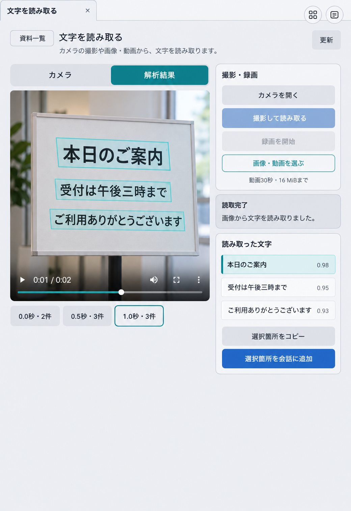
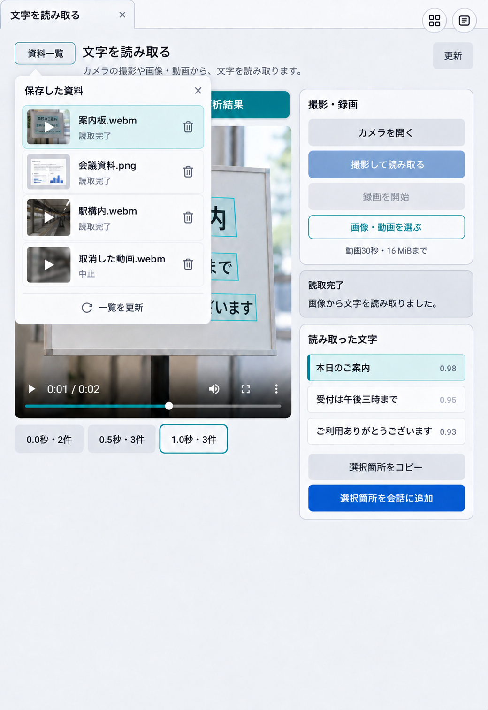

# OCR アーティファクトの画面設計

状態: 画面案を基に実装済み。[固定試験と未実施項目](../verification/ocr-2026-10-14/README.md)は別記録。2026年10月14日。

OCRで読み取った原文を、元の画像・動画と照らして確認し、必要な箇所だけコピーまたは会話へ追加できる画面とする。保存済み資料の一覧・再表示・削除は、既存の「図を描く・編集する」と「映っている物を調べる」の操作に揃える。接続・入力上限・結果の正本は[Eumenes Excalidraw OCR OpenCV 連携の共通資料](https://chatgpt.com/space/page_e38fb71deba88191bcefebcaa046ea60)。登録と実行は[データドリブン形式の手順](../../docs/toolchain-extension.md)に従う。

画面案からOCR API接続、DB、画面部品を実装した。以下の画像は実装前に作った配置案であり、実際のファイル選択はアイコンボタンに変更した。PDFの直接解析、原文の自動修正・要約、新しい認証方式、物体認識全体の共通化は対象外とする。

## 画面案





画像は配置と操作の案であり、表示中の文字・時刻・confidenceはサンプルである。製品の表示文言は以下の契約を正本とする。

## 主画面の契約

- タブと見出しは「文字を読み取る」。左上の「資料一覧」から保存済み資料を選び、右上の「更新」で最新状態を読み直す。初回は保存済みの最新資料を表示し、資料がなければ撮影・ファイル選択を案内する。
- 左側に元画像または動画を表示する。画像のpolygonは元画像のpixel座標を表示倍率へ変換して重ねる。動画は保存されたframeの時刻を選ぶと実際の動画位置を移し、その時刻の文字とpolygonへ切り替える。該当しない時刻に古いpolygonを残さない。
- 右側には撮影・録画、読み上げ名付きアイコンボタンによるファイル選択、受付・解析状態、読み取った原文の行を置く。カメラは明示操作で開き、資料切替・画面終了時に解放する。JPEG・PNG・WebP、MP4・MOV・WebMを扱い、16 MiB、動画30秒の上限を伝える。PDFの直接入力は出さない。
- 結果は上流の`text`と`lines`を原文のまま示す。行を選ぶと対応するpolygonを強調し、複数行を選べる。「選択箇所をコピー」「選択箇所を会話に追加」は選択がある場合に有効にする。全文を扱う操作は選択操作と区別する。動画からの会話追加には時刻、資料ID、行とpolygonを含める。
- confidenceは参考値として小さく表示し、「正答率」や確率と呼ばない。判読しづらい箇所を利用者が原本と比較できるよう、元資料を常に参照可能にする。要約・誤字訂正はOCR結果の自動処理に含めない。
- 「準備中」「解析中」「完了」「中止」「取消確認中」「混雑」「形式・容量不一致」「接続失敗」「受付未確認」を区別する。通信断後は保存済み受付ID・上流job IDから照合し、解析POSTを新規IDで自動再送しない。

## 履歴の契約

- 「資料一覧」は主画面に重なる小さなメニューとし、資料名、画像・動画のサムネイル、状態を新しい順に表示する。録画中は開けない。メニューはEscape、閉じるボタン、外側のクリックで閉じ、フォーカスを入口へ戻す。
- 選択すると、認可済みの保存原本と結果を再取得して同じ画面に戻す。再表示のためにOCRを再実行しない。処理中の資料も保存済み状態から復帰し、必要な状態照会だけを続ける。ブラウザ再読み込みやbackend再起動後にも一覧から開ける。
- 完了・失敗・中止済み資料だけ削除可能とし、確認を要する。解析中は先に取消を求める。表示中の資料を削除した場合は次の保存済み資料へ移り、なければ空の入力画面へ戻る。削除は原本とOCR結果を対象とし、既に会話へ追加した発話を勝手に消さない。確認文には、削除後にその会話から原本を再表示できなくなることを示す。
- 履歴はEumenesが認可した利用者・会話の範囲で取得する。上流のtoken単位ownerや24時間保存に依存しない。更新・選択・削除では対象ID、版、所有者を再確認し、対象変更後の遅い結果を現在の表示へ採用しない。

## データ駆動の接続

表示定義は版付きartifactのJSONとし、元媒体・OCR本文・Blob URL・credentialを入れない。標準variantは、同じ認可済みsourceを使う元資料viewと操作・結果viewを共通OpenUIの`layout`で組み合わせる。狭い幅では縦に並ぶ。両viewはDesignSystemのpropsとeventで動き、業務APIを直接呼ばない。

物体認識画面の単一viewをそのまま増やす案より、原本と結果を別の登録viewにする案を採る。同じsourceのまま配置variantを変えられ、元資料と行結果を別画面にも再利用できるためである。撮影・録画の既存部品は再利用し、OCRと物体認識を統合する新しい業務frameworkは作らない。

```json
{"view":"layout","direction":"grid","children":[{"view":"ocr-media","source":"ocr"},{"view":"ocr-panel","source":"ocr"}]}
```

`ocr-media`と`ocr-panel`は登録済みのviewである。Fileは保存JSONで表現せず、共通runtimeの`uploadFile` bridgeから認証済みOCR受付APIへ渡す。資料選択・動画seek・行選択はlocal action、コピーはブラウザのClipboard操作、取消・削除・会話取り込みは登録済みWeb adapterから認証済みOCR APIを使う。会話のopen/read/cancelは登録backend adapterを使う。保存状態とreceiptはOCR domainが所有し、Webは表示snapshotを作る。

会話用のprofile・Skill・tool・package・toolchainと、UI用のbinding・artifactを同じbundleで版付き登録する。既存のcommand担当がprofile、Skill、登録済みtool schemaをSystemContextとして読み、利用者の依頼と認可済み資料をデータとして受け取る。新しい常駐サブエージェントは設けない。

## 受入条件

1. 画像と動画を送信し、行選択と原本polygon、動画時刻が一致する。コピーと会話追加には選択した原文と資料参照が残る。
2. 資料一覧で選択・再表示・更新・確認付き削除ができ、再表示で解析POSTが増えない。実行中の削除、別利用者の取得・取消・削除を拒否する。
3. 通信断、取消、設定変更、資料切替、backend再起動後も状態が整合し、遅い応答や二重送信で別資料の結果を上書きしない。
4. bundle検査、domainとadapterの部分試験、会話・Artifact結合、固定ブラウザ試験を通す。自然言語UI受入は目的・判定基準を先に凍結し、画面操作と保存状態の両方で判定する。fixture、実gateway、MacBook実カメラの結果を分けて記録する。
