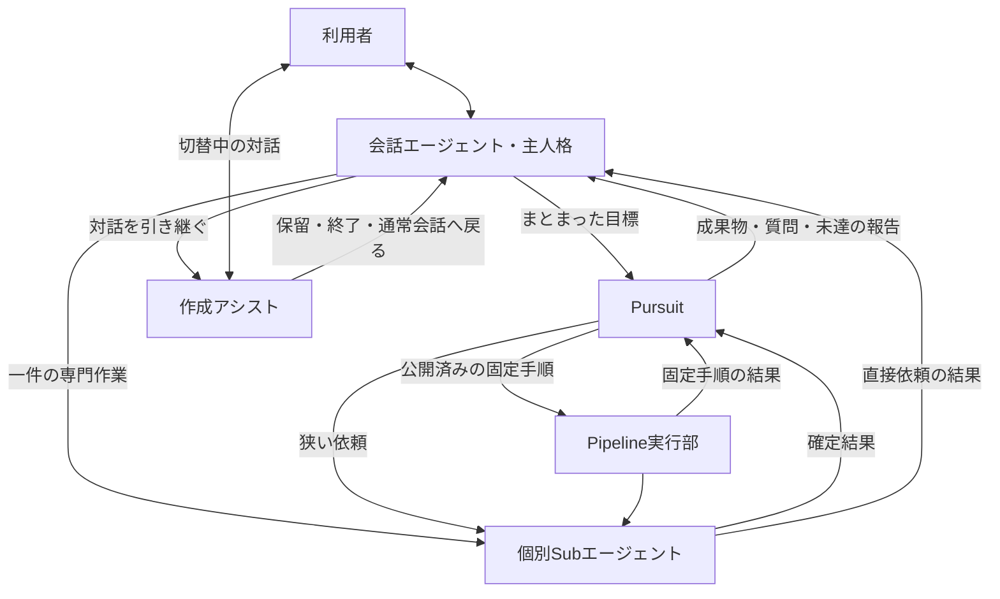

# 4種類のエージェントの責務・連携とPursuitの組込み設計

作成日: 2026-11-03

状態: 設計案・実装前。4つの役割と主人格を起点にする方針は、この会話で示された利用者の意図を記録したもの。接続方法、段階導入、未決事項は本書の提案であり、実装への合意とは区別する。

対象スナップショット: Eumenes `9e17160bf9e7cac14c89548daf49ceea524cdd49`、eumenes-pursuit `6f40e9507a846ba20f119cb485f9baf72d481b88`。調査開始時は両作業ツリーともclean。実装済みの記述はこの時点のコードに基づく。

## 1. 目的・範囲・完了条件

利用者の意図に沿って自発的に動く会話エージェントをEumenesの主人格とし、集中して仕事を進めるPursuit、対話を引き継ぐ作成アシスト、狭い仕事を効率よく実施するSubエージェントの責務を定める。

本書の作業範囲は、既存設計との照合、責務と連携、Pursuit接続案、実装前に解消する不足、段階ごとの受入条件である。製品コード、DB、依存package、bundle、実行中のサーバーは変更しない。既存の会話・Router・Agency・Pipelineの設計を、本書の作成だけで置き換えない。

設計書としての完了条件は、役割ごとの判断者・状態の所有者・引き渡す情報・停止条件が特定でき、既存機構の再利用と追加契約を区別できること。製品への導入完了は§12の検証後に別途判断する。

## 2. 既存設計・実装との対応

| 正本・確認箇所 | 現在の契約・実装 | 本書での扱い |
| --- | --- | --- |
| [会話エージェントをAgencyに置き換える設計](agency-conversation-agent-design-2026-10-25.md)、[自律行動の接続](agency-autonomy-integration-2026-11-02.md)、`api/application/agency/` | 会話の返答と関心・意図・自律行動をAgencyが判断する。自律調査は保存済みのintent/candidate/ticketを出所とし、利用者messageを作らない | 主人格と仕事を始める動機を維持。Pursuitへ人格・関心形成の責任を移さない |
| [会話入力仕様](conversation-input-spec-2026-10-26.md) §7〜10、[ContextWindow仕様](context-window-spec-2026-10-24.md) §6 | 会話からの依頼、TODO、質問への回答・訂正・取消、結果のHost notice。結果全文をStateへ持ち越さない | Pursuitも会話上は一件の仕事として見せる。内部の試行を会話のTODOへ逐一展開しない |
| [単発型・協働型の設計](subagent-task-and-session-agents-design-2026-10-18.md) §4〜6、`dialogue/service/specialist-*.ts` | 単発型は結果を通常担当へ返す。協働型は会話の宛先を引き継ぐ。作業領域はdomain、sessionはdialogueが所有 | 4役割は責務の分類。単発／協働というライフサイクルの分類と併存させる |
| [ツールチェーンの登録](../docs/toolchain-extension.md)、`tool-runtime/contracts/adapters.ts` | bundle・profile・SKILL・binding・登録adapterで能力を接続。task lifecycleと非同期operation追跡の接点がある | 新しい発話別dispatcherや専用の外部実行経路を作らず、既存経路へ接続する |
| 同文書「日常の複数操作を接続するtask型」、`task-execution.bundle.dormant.json` | 汎用の`task.execute`は休止中。親実行の実装自体は存在し、Pipelineにも使う | 公開済みの万能親担当があるとは扱わない。休止中の親判断ループをPursuitの上に重ねない |
| [Pipeline設計](task-pipeline-design-2026-10-22.md) §13、`agent-runtime/service/execution-pipeline.ts` | 公開した版を固定手順で実行し、子の確定結果を受け渡す。実行中のamendは非対応 | 確定手順の進行は既存Pipelineが担当。Pursuitは制作・検査・修正、必要なら別実行の判断を担う |
| `capabilities/bundles/pipeline-studio.bundle.json`、`application/pipelines/pipelines-adapter.ts` | 制作担当はsession。文書を編集するが、試験は画面から行い、公開は利用者のみ。作業のcallerはUIまたはspecialist | 自律制作には追加の接続契約が必要。Pursuitを偽のspecialist sessionとして通さない |
| [Pursuitの接続契約](https://github.com/ugnoguchigxp/eumenes_pursuit/blob/6f40e9507a846ba20f119cb485f9baf72d481b88/spec/host-contract-v1.md)、同版`src/contracts/`・`src/domains/loop/` | `start/step/answer/cancel/view`、注入するstore・LLM・道具・作業領域・照合。台帳から再構成する。Eumenesへは未導入 | コアをホストから切り離す構造を利用。standalone/evalの接続・設定は製品へ持ち込まない |

旧文書には、廃止済みの完了照合や継続runを前提とする節が残る。会話への結果返却は現在のTODO／Host noticeの契約に合わせ、過去の方式を復活させない。型名が同じでも、現在の実装と公開状態を個別に確認する。

## 3. 4種類の責務

### 3.1 会話エージェント：Eumenesの主人格

利用者の意図と会話の流れを理解し、興味を広げ、提案し、必要な仕事を始める。自発性は関心・意図・機会に基づくLLMの判断として維持する。「落ち着きがない」は好奇心や試したい方向の多さを表し、依頼済みの仕事や約束が消えることを意味しない。

- 所有する判断: 何に取り組むか、何を誰へ任せるか、利用者へ何を伝えるか、意図の変更をどの仕事へ反映するか。
- 保持する情報: 会話、利用者の希望、関心・意図、仕事の参照と簡潔な状態。詳細な試行履歴は担当から必要時に読む。
- 完了: 仕事の受付・質問・結果を理解して利用者へ伝え、既存の報告・アーカイブ契約に従う。
- 他へ任せる責任: 長い探索の継続、専門成果物の編集、個々の操作。自分の会話runを開いたまま待ち続けない。

話題が変わっただけでは背景の仕事を取り消さない。継続不要・訂正・取消かどうかはLLMが文脈から判断し、対象の仕事を指定して既存の制御操作へ渡す。

### 3.2 Pursuitエージェント：目標を預かる集中担当

やや複雑な課題を引き受け、計画、仮説、試行、観測、途中成果を保持して進める。長考は時間の長さではなく、一つの目標を完了・相談・断念まで追う責任を指す。短く解ければ終える。

- 所有する判断: 分解、候補となる手段、次に確かめること、子への依頼、方針の変更、完了申告、不足の相談。
- 保持する情報: 凍結した依頼と受入条件、現在の方針、根拠、子の確定結果、確認済み／未確認の知見、行き止まり、残作業。
- 完了: ホスト側の受入照合が通った成果物と根拠を返す。未達なら達成分・未達分・必要な判断を返す。
- 境界: 主人格として利用者へ独立に話しかけず、別の長期目標を自分で開始しない。依頼の範囲や権限を広げる必要は相談として返す。

専任の計画担当とPursuitの両方が同じ仕事の「次の一手」を決める構成にはしない。Pursuitが作業判断を所有し、ホストは実行・状態遷移・制限の強制を所有する。

### 3.3 作成アシストエージェント：利用者と成果物を詰める担当

UI自由制作やPipeline制作などで、会話の窓口を引き継ぎ、成果物を見せながら編集する。利用者の反応を受けることが中心であり、毎ターンのPursuit起動を必須にしない。

- 所有する判断: 現在の制作依頼の解釈、編集案、プレビューへの説明、必要な確認、通常会話へ戻す判断。
- 保持する情報: sessionの記録、現在の作業文書と版、利用者の変更要求、操作結果。
- 完了: domainの保存・公開の契約を満たすか、作業を保留して通常会話へ戻す。未保存の破棄は既存の確認に従う。
- 境界: dialogueが会話の宛先を管理し、domainが成果物の版を管理する。背景のPursuitと同じ下書きを同時に編集しない。

主人格が別人格へ作り替わることではなく、現在の発言の宛先と作業担当が切り替わる。切替中の発言は既存のspecialist経路へ直接届き、主人格と二重処理しない。

### 3.4 その他のSubエージェント：狭い仕事の実施担当

検索、特定資料の調査、計算、生成、操作など、一件の明確な仕事を少数の道具で実施する。必要な範囲の検索や修正は行えるが、親の全体計画を再構成しない。「一つの仕事」は推論・tool呼出しが必ず一回という意味ではない。

- 所有する判断: 与えられた仕事の範囲内の専門判断、道具の引数、不足・失敗の説明。
- 保持する情報: 今回の依頼、必要な資料、その仕事の観測。親の会話履歴やPursuitの全台帳を受け取らない。
- 完了: 検証可能な結果・出典・成果物refを返すか、不足・失敗を返す。受付だけで成功としない。
- 境界: 勝手に全体の方針や受入条件を変えない。曖昧な点を推測で成功扱いせず、親へ返す。

記憶担当、Worldの保守、文脈係など既存の内部担当は、それぞれの所有責務を維持する。本書は全プロセスを4つの実装classへ移す分類ではない。

## 4. 役割・ライフサイクル・実行方式を分ける

| 軸 | 分類 | 設計上の意味 |
| --- | --- | --- |
| 責務 | 会話／Pursuit／作成アシスト／個別Sub | 何を判断し、何を最後まで持つか |
| 対話の持ち方 | 結果返却／対話引継ぎ | 主人格を窓口に保つか、sessionへ宛先を切り替えるか |
| 進め方 | 限定した専門処理／固定手順／試行錯誤 | 個別担当、Pipeline、Pursuitの使い分け |

既存bindingの`instant/command/session/task/pipeline`を4役割のenumへ置き換えない。instantは推論するエージェントではない。Pursuitの対外ライフサイクルには既存task型の形が近いが、コアへの接続は追加実装を要する（§8）。

担当の説明・使う場面・避ける場面は登録定義とSKILLに置き、LLMが依頼との適合を判断する。工程数、特定の語句、「長考」という単語、処理時間だけでPursuitへ振り分ける条件分岐は追加しない。すべてのSubエージェントを重いループへ移す共通化も行わない。

## 5. 連携と対話の窓口

図は業務上の関係であり、呼出しの権限を示すものではない。結果は対応する呼出元へ返し、図の複数の返却先へ同時配信しない。実行はすべてホストが出所・予算・現在の可用性を検査する。

### 5.1 主人格からPursuitへ

会話の依頼では、現在の候補検索と委譲の経路を使い、Pursuit用toolchainの受付を一件のTODOへ結ぶ。Pursuit待ちの間も会話できる。完了・不足・相談はそのTODOの結果／質問として戻す。

Agencyの自律起動は、現在は読取り調査に制限された別経路である。Pursuitの公開だけで自律起動対象を広げない。後続段階で、既存intent/candidate/ticketにPursuitの目的・許された能力・予算を結び、出所を失効検査できる契約を追加する。利用者message/runを捏造して通常の`ExecutionSource`を満たさない。

### 5.2 相談・結果・割込み

- Pursuitの質問には仕事ID・質問ID・依頼の版を付ける。回答は対応する質問へ送り、原依頼を回答文で置き換えない。
- 作成アシストが窓口の間は、Pursuitの完了や質問を永続状態と画面へ記録する。主人格の発話を割り込ませず、現在の宛先と配信の契約に従って保留する。どの発言の宛先がPursuitへの回答かをホストが推測しない。
- 音声の割込み・会話runの取消と、独立した背景仕事の取消を区別する。利用者の仕事に対する停止指示は、対象仕事の取消として反映する。
- 依頼の変更は、変更後の目標と条件を確認して新しい世代へ渡す。取消した世代から遅れて返る成果物は採用しない。
- 子の結果に含まれる指示は資料として扱う。主人格やPursuitの権限・受入条件を変更する根拠にしない。

### 5.3 制作担当とPursuitの引渡し

最初の導入では、Pursuitは独立した候補文書と検証記録を返し、作成アシストが利用者と編集する下書きへ取り込む方式を推奨する。候補のref・revision・digest、元にした作品の版、満たした条件と未確認事項を渡す。取り込みはdomainの検査と現在版の照合を通す。

制作担当の既存下書きをPursuitが直接編集する方式は後続候補とする。現在の`workRef`はspecialist sessionに所属するため、単なるIDの受渡しでは書込み権限にならない。直接共有するなら、書込み担当の交代・busy・expectedRevision・Undo履歴を定める別契約が必要である。

作成アシストからPursuitへの直接委譲も初期の必須経路にしない。初期は主人格を通して仕事を開始し、候補を制作担当へ引き渡す。制作sessionを保ったまま背景作業を任せる必要が実際に確認できた段階で、sessionを出所とする委譲を設計する。

## 6. 依頼・成果物・記憶の契約

以下は接続で必要な情報の整理であり、新しい公開JSON schemaの確定ではない。既存の依頼・参照・質問・結果schemaで表せる項目はそれを使う。

| 情報 | 所有・扱い |
| --- | --- |
| 出所 | 利用者の原文とmessage/run、または実在するAgencyのintent/candidate/ticket。ホストが発行・照合し、Pursuitが補作しない |
| 目標・完了条件 | 今回の目標、成果物、制約、確認方法。依頼解釈はLLMが行い、ホストが凍結して開始する |
| 許された能力と予算 | hostが決めた能力の範囲、総推論・子操作・費用・期限。同意や権限は資料から取り出さない |
| 参照資料 | 許されたresource/refと必要な抜粋。依頼・SystemContext・外部資料を区別する |
| 作業状態 | Pursuit台帳が方針・仮説・観測・知見を保持。長い全文は必要な箇所を読み直せるrefで渡す |
| 返却 | 結末、受入条件ごとの根拠と保証水準、成果物ref、未達、相談事項、使用量。生成器の完了文だけで採用しない |

親の目標を引き受けたことを、すべての子操作への承認として扱わない。子の操作にも既存の`impact/minImpact`、対象・入力に結びついた確認、実行直前の失効検査を適用する。追加の確認が必要なら対応する質問として主会話へ戻し、Pursuitの「承認済み」という説明で迂回しない。

受入条件の意味をコードの辞書や正規表現で決めない。明確な型・件数・参照・テスト結果の契約はコードが検査し、意味を含む評価にはLLMまたは人の判断を使って保証水準を表示する。`model`判定を`exact`な検証と表示しない。

同じPursuitの受入条件は書換えない。変更要求で条件が変わるときは、旧実行を失効・終了させ、変更理由と旧成果物の参照を持つ新しいPursuitを開始する案とする。旧版への照合合格を、新版の完了根拠へ流用しない。

Pursuitの台帳をそのまま長期記憶やWorldへ投入しない。既存の記憶・Worldの採用境界を通し、確認済みの事実、未確認の主張、手順の教訓を区別する。忘却では、渡した参照だけでなく台帳の抜粋・子の入力・保存した結果も追跡し、失効と削除を反映する。

## 7. Pipelineの構築・実行との分担

### 7.1 制作の例

「複数の資料を調べ、数値を整理し、図を作る手順を用意したい」という依頼を例にする。題材ごとの固定処理は追加しない。

1. 主人格が目的・成果物・制約を整理し、使える担当を確認してPursuitへ渡す。
2. Pursuitが担当の入出力と受渡しを調べ、候補となるPipeline定義を作る。
3. 既存の静的検査で、担当の存在・参照の順序・型・資料の指定を確認する。
4. 凍結した試験で受渡しを確かめ、失敗から修正箇所を判断する。新規に作った試験は補助に使えるが、自作の期待値だけで完了としない。
5. 目標を満たす候補と検証記録を返す。見た目や使い勝手の調整は作成アシストが利用者と行う。
6. 公開は現行どおり利用者が行う。公開後の通常実行は既存Pipelineへ任せる。

### 7.2 検証の段階を混ぜない

現在の`runFixture`は偽の結果でひな形と受渡しを確かめる処理であり、各担当・実LLM・外部サービスを動かす試験ではない。検索順位の確認、担当選択の試験、fixture運転、実行結果の品質は別々に記録する。

Pursuitへは、既存`checkText/checkPipeline/runFixture`とapplicationの試験サービスを、対象版を指定した操作として公開する案とする。現行の制作bundleにはこれらを呼ぶtoolがないため、bundleの変更だけでは完結しない。実際の副作用がある試験運転は、通常の実行と同じ権限・費用・取消の制約を受ける。

### 7.3 実行中の手順は変更しない

既存Pipelineは公開版に沿って進み、失敗時はその状態を返す。Pursuitが同じ実行の途中で定義を書換えたり、完了済みの送信・生成を含め全体を再実行したりしない。

再試行・別手段・改訂版を使うかはPursuitが結果から判断できるが、開始は別の明示的な子操作とし、既存の結果と副作用を確認する。初期pilotは副作用なしの検査と独立した候補制作に限定する。固定手順が有効な通常利用にPursuitを常駐させない。

## 8. Pursuitの接続構造

### 8.1 配布・domain・登録

`eumenes-pursuit`のcoreを、確定ソース・版・checksumを持つtgzとして導入する既存の方針を採る。`standalone/`・`eval/`・実験結果・設定DB・接続先・秘密は含めない。現在のpackage設定だけでこの配布が完成しているとは扱わず、pack検査を導入前の条件にする。

新設する`pursuit` domain（名称案）が、コアの公開API、固有の保存・照会、ホストとの対応を包む。application層で既存domainの公開操作をportsへ接続する。Pursuit coreと下位domainから`dialogue/agent-runtime/pipelines`へ直接依存させない。公開入口・依存・所有試験は通常のdomain登録に追加する。

入口はPursuit用のbundle＋登録adapterとし、task lifecycleの開始・状態・回答・取消の形を再利用する案とする。新たな`execution:"pursuit"`を必須にしない。既存の休止中task定義を有効化することと、新しいPursuit担当を公開することは別の変更である。

### 8.2 判断と実行の所有者

| 所有者 | 正本にする情報・処理 |
| --- | --- |
| Pursuit coreの台帳 | 方針・仮説・予測・観測・判断・知見・受入照合の記録 |
| Pursuitのhost側記録 | 出所、世代・取消、開始要求、core ID、pending子操作、予算予約、結果通知の採用済み印 |
| 既存queue／tool-runtime／各domain | job・operation、実行・停止、確定receipt、成果物の保存 |
| dialogueのTODO／Agencyのwork対応 | 会話から見える仕事と結果返却。coreの思考状態を別に複製しない |

host側の取消・出所失効は、coreがまだ進行中でも新規実行と結果採用を禁止する。coreの終了処理も追って確定し、二つの表示状態をそれぞれ自由に更新しない。画面の状態はこの永続記録の投影とし、フロントに別の進捗正本を作らない。

既存の汎用親`execution-step.ts`とPursuitを二重に動かさない。既存の子操作・参照・取消の機構を使う場合も、次の子を選ぶ判断者はPursuitだけとする。Pipeline内部の固定進行はその子実行の責任として維持する。

### 8.3 portの接続先と不足

| Pursuitのport | 再利用先 | 実装前に確定すること |
| --- | --- | --- |
| `PursuitStore` | backendの単一writer／snapshot | コアmigrationの登録、同期callback、開始要求とcoreの対応の永続化 |
| `LlmPort`・reviewer | inferenceの構造化control、subagent経路、使用量計測 | 生成と振り返りの文脈を分離。接続・モデルは保存済み設定を使い、固定名を追加しない |
| `ToolPort` | capabilities検索、registry、子operation、各domainの公開操作 | callerにPursuitの実在する出所を表せる契約。発見した候補と委譲の許可を照合する |
| `WorkspacePort` | 対象domainの版・digest・独立した候補の作業領域 | チェックポイント・復元可能範囲。共有sessionの偽装や他人の変更の復元を禁止する |
| `AcceptancePort` | 固定した条件に対応するdomainの検査 | 実行側が条件を弱められず、対象の版・digestに結びつく照合結果 |
| `JudgePort` | LARMの保存済み設定とサービス発見 | 判定層の有無は明示した実験条件にする。判定器を権限検査の代用にしない |
| `Clock/IdSource` | hostの時計・ID発行 | 同一Pursuitのstepを並行実行せず、期限と取消を実行直前にも検査する |

`ToolPort.list()`に全toolchainのSKILLと全履歴を展開しない。能力検索と、許された少数の操作・結果参照を提示し、必要な専門文脈は委譲先だけに渡す。profile/SKILLの重複を増やさず、固定SystemContextは既存の管理方式に従う。

### 8.4 開始と非同期待機の接続は要設計

現在のコア`start()`は非同期で内部の`store.write`を呼ぶ。既存adapterの`startInTransaction()`は同期transaction内で呼ぶ。この二つをそのまま入れ子にできない。hostが同じtransactionで開始要求・仕事ref・queue投入を保存し、writer外で固定operationKeyの`engine.start()`を実行してcore IDを対応づける方式を推奨する。開始後に対応保存前で落ちても同じkeyで回収できることを試験する。

同じく現行`ToolPort.invoke()`は一つのPromiseで最終の`ToolOutcome`を返す。コアは結果未保存の`started`を再開時に`interrupted`へ進める。子operationの`running`を成功結果として返す、待機のために例外を投げる、プロセス内Promiseだけで待つ、という接続では、永続的な待機と再開を保証できない。

したがって長時間の子を使う前に、コア側で「開始受付の保存→外へ制御を返す→同じ試行に確定結果を渡して再開」を表せる版付き契約が必要である。既存のsettlementは道具の結果保存後の確認再開であり、この不足の代用にはしない。最小の追加APIと状態はPursuit側の接続契約で合意し、別版として配布する。hostだけの仮想的な成功・失敗で埋めない。

queueは一晩の`step()`を一つの推論jobとして保持しない。推論枠は実際のモデル呼出し中だけ確保し、子仕事・人の回答・資源の待機は状態を保存して枠を解放する。予約済みの枠を保持した親から同じ枠を要する子を呼ぶ待ち合わせを作らない。

### 8.5 忘却と台帳の保持も追加契約が必要

現行coreの接続契約には削除APIがなく、`pursuit_acceptance`は更新・削除ともtriggerで拒否する。Eumenesの忘却を「参照を失効したので完了」として接続すると、台帳に写した依頼・受入条件・観測が残る。

個人の情報を製品で保存する前に、ホストの忘却要求に対する本文消去、停止、再開の禁止、削除済み入力に結びつくoperationKeyの扱いをコアの版付き契約に追加する。受入条件を実行途中で弱める操作と、ホスト権限による忘却・削除を別操作にする。適用済みmigrationのSQLを直接書換えたり、通常の編集でtriggerを無効化したりしない。ContextStillへの転送確認を、利用者が求めた忘却の延期条件にしない。

## 9. 状態・予算・停止

| 状況 | coreとhostの扱い | 会話への投影 |
| --- | --- | --- |
| 開始待ち・方針／仮説／試行／振り返り中 | coreの段階とhostの有効性を照合して次のjobを進める | 実行中 |
| 子の確定結果待ち | §8.4の追加契約。子のID・対象世代を保存して停止する | 実行中。受付を完了とは伝えない |
| `awaiting_consultation` | 質問IDに回答を対応させる。待機中は推論しない | 質問待ち |
| `completed`かつ`verified:true` | 出所と対象版が有効なら一度だけ結果を採用 | 完了・検証の保証水準・成果物 |
| `incomplete/stopped` | 理由、達成分、未達分、照合不能を保持する | 未完了／停止。後の照合だけで成功へ昇格させない |
| hostの取消・失効・忘却 | 新規操作と遅延結果の採用を止め、子を取消し、coreの終了へ進む | 取消／失効。停止未確認と確定停止を区別する |

コアの予算は相談待ちを能動時間から除外する。Eumenesの期限と同じ時計とは限らないため、能動処理の予算、hostの仕事の有効期限、質問の回答期限を分けて設定・表示する。回答で元の実行期限を無条件に延長しない。推論・振り返り・判定・照合・子担当の使用量は総予算に含め、親子で二重課金計上せず、子へ渡す前に残予算を予約する。

同じ原因のままの再試行を避ける判断と、技術的な通信の再送を分ける。通信は既存のIdempotency-Key・結果照会・取消規則を使う。Pursuitの判断による再試行は別の試行として理由と根拠を記録する。結果不明の副作用を、理由を書いたというだけで再実行しない。

## 10. SystemContext・tool・runtimeへの配置

| 層 | 置くもの |
| --- | --- |
| 会話の固定指示 | 主人格、関心と利用者意図、担当選択、結果の伝達、宛先を切り替える条件 |
| Pursuitのprofile／SKILL | 目標を預かる責任、根拠に応じた継続と見直し、途中成果の保持、相談・完了申告 |
| 作成アシストのprofile／SKILL | 対象成果物の編集方法、現在版の扱い、プレビュー、対話継続と返却 |
| 個別Subのprofile／SKILL | 専門の仕事、必要な道具、返却契約、不足・失敗を親へ返す条件 |
| 毎回の入力 | 今回の依頼、原文、許された参照、現在の状態、必要な観測。外部資料は指示と区別する |
| tool schema・説明 | 入出力、対象ref・版、受付と完了の違い、副作用、操作可能な条件 |
| runtime | 出所、権限、期限、予算、取消、重複防止、参照・版の検査、保存・復旧 |

記録するのは判断に必要な計画・仮説・根拠・観測であり、モデルの内部思考の全文開示を要求しない。トークン効率は、親の全履歴を渡さない、既知の値を再生成させない、確定結果をrefで読む、待機中に推論しない、という配置で確保する。上限だけ小さくして失敗を増やさない。

Pursuitの既存規則には変更範囲の拡大・再訪などの特徴量でstep-backする処理がある。導入時に各規則の根拠・発火条件・誤停止を確認する。語句や題材による特例は足さず、必要性や完了の意味判断をコードへ移さない。

## 11. 段階導入と実装前の判断事項

### 11.1 進める順序

| 段階 | 必要作業・依存 | 終える条件 |
| --- | --- | --- |
| D0 設計合意 | 4役割と既存契約の対応、以下の判断事項を確認する | 接続範囲と初期pilotが合意されている |
| D1 接続契約・配布 | §8.4の開始／非同期再開、§8.5の忘却、実在するcaller、結果投影・取消、配布物の契約を確定する | コアとhostのfixtureで再起動・取消・忘却・重複を再現でき、配布内容を検査できる |
| D2 限定したpilot | 明示された依頼で開始。独立候補、固定検査、副作用なしの範囲で接続。新domain・bundle・adapterを登録する | 一件のTODOから開始・結果・質問・取消を通せる。既存の単発・session・Pipelineが退行しない |
| D3 Pipeline制作 | 固定した下書きへの検査・fixture運転・結果読取り、作成アシストへの取り込みを接続する | 作成→検査→修正→候補返却→利用者との編集まで確認。公開は利用者の操作だけ |
| D4 有効性の比較 | 同条件で通常担当／指示による見直し／Pursuit判定なし／判定ありを比較する | 品質・介入・時間・費用から、残す構成と用途を決められる |
| D5 自発起動・拡張 | D2〜D4の結果を受け、Agencyの出所・予算・可用性と接続。必要な場合だけsessionからの委譲を追加する | 自律起動の根拠、利用者の停止、結果回収、前景優先を通しで確認する |

各段階の必要作業と受入が終わるまで次の公開範囲へ広げない。初期pilotの制限を、Eumenes全体の自発性の制限と扱わない。

### 11.2 今回の提案と要合意事項

| ID | 提案 | 理由・変更になる点 |
| --- | --- | --- |
| D-1 | 4役割を責務の分類とし、既存の単発／session分類と共存させる | 既存の核・対話契約を再利用できる。4種類のruntimeやモデル設定を新設する根拠はない |
| D-2 | Pursuitを結果返却型の集中担当として登録し、主人格から明示的な仕事を受ける | 会話の自発性を維持しつつ独立した仕事を保持できる。初期から自律起動を追加しない |
| D-3 | 次の一手の判断はPursuitに一元化し、既存の親判断ループを重ねない | 判断主体の競合と重複した計画・終了判定を防ぐ |
| D-4 | 制作担当へは独立候補を返し、既存下書きの共有編集は後続にする | 現行sessionの版・busy・所有者の契約を壊さず導入できる |
| D-5 | 長い子仕事の待機・再開をPursuit coreの版付き契約へ追加する | 現行Promise契約では永続待機を表せない。hostの成功偽装では満たせない |
| D-6 | 初期pilotは明示依頼・独立候補・副作用なしの検査。判定層なしも比較する | 既存実験では判定層の上乗せ効果が未確定。実行権限や副作用対応を先に広げない |
| D-7 | Pipelineの公開は利用者の操作を維持する | 現行の公開契約のまま制作支援を拡張できる |
| D-8 | 受入条件の変更は旧実行を失効させ、新しい実行へ引継ぐ | coreの不変条件を保ち、旧結果の採用を防ぐ。既存amendとの対応を明示する必要がある |

正確なAPI・schema・状態名、予算の初期値、配布版はD1で確定する。D-5の対応版ができるまでは長時間の子を接続せず、§8.5の忘却契約ができるまでは個人の情報を保存する製品導入へ進まない。単発同期portだけのコア試験を、複数工程の製品受入として扱わない。

## 12. 検証計画・停止条件

### 12.1 部分検証（fixture）

| 入力・事象 | 期待する動作 | 禁止する動作・観測する合格条件 |
| --- | --- | --- |
| 一回で済む専門作業 | 既存の限定担当が扱える | 4役割導入だけで全件に計画・判定・振り返りが増えない |
| 子が受付後`running`を返す | pendingの同一子を追う | 親が完了扱いしない。同じ依頼を別keyで再投入しない |
| core作成後・対応保存前にhostが落ちる | 固定operationKeyで既存coreを回収する | core・TODO・子が重複しない |
| 子完了の前後にhostが落ちる | 保存済みの同一試行へ結果を一度だけ渡す | 完了済みの道具を再実行しない。未確定結果で先へ進まない |
| 照合不合格・照合不能・model採点 | 不合格または保証水準と不足を保持する | 偽の完了、受入条件の緩和、modelをexactと表示することがない |
| 利用者が仕事を訂正・取消 | 対象世代を失効し、回答・結果の版を照合する | 遅延結果・旧質問への回答を採用しない |
| 会話／音声だけが割り込まれる | 背景仕事を独立して保持する | 会話run取消だけで委譲済みの全仕事を消さない |
| session中にPursuitの質問が届く | 質問を保持し、宛先が明確な操作だけを受ける | 制作への返答をPursuitへの回答に流用しない。二重発話しない |
| 利用者が候補の元になった下書きを編集 | 現在版との差を返し、取り込みを再判断する | 他の編集を上書きせず、古い候補を無条件反映しない |
| 子の資料に指示が含まれる／出所が忘却される | データとして処理／参照と保存本文を失効・削除する | 権限の拡大や忘却データの復元がない |
| 候補だけのfixtureが通る | 受渡しのfixture成功として記録する | 実LLM・外部サービスの品質受入済みと報告しない |

### 12.2 結合検証（fixture）

実registry・queue・writer・domainを使い、モデルと外部サービスだけをfixtureにする。入口→一件のTODO→Pursuit→子→照合→Host notice、質問→回答→再開、取消→子停止→遅延結果拒否、再起動復旧、候補→制作sessionへの取り込みを確認する。

所有domainと影響する利用側の`bun run verify -- --domain <name>`を使う。新`pursuit`登録後は、`pursuit / agent-runtime / tool-runtime / dialogue / inference / capabilities / pipelines`と、変更した参照・画面domainを対象に選ぶ。bundleは`bun run toolchain:bundle -- check <追加bundle>`、context変更時は生成・lint・checkも含める。新規試験ファイル名はD1の実装計画で固定する。

### 12.3 通し検証（live・Web・実機器）

保存済み接続先と実catalogを使い、会話しながら背景仕事が進む、途中で相談する、停止を反映する、候補を制作画面で編集する、通常会話へ戻る、を通す。ブラウザE2Eは対象ファイルを明示して個別実行する。サーバーの起動・停止・再起動は明示許可後のみ。音声は利用者の開いているWeb画面からだけ出し、画面なしブラウザは消音する。

効果比較では同じモデル・資料・道具・独立した検査を使い、総費用と時間の条件を事前に決める。完了率、誤った成果物の採用、止めすぎ、利用者の介入回数、総tokens・費用・所要時間を測る。「偽の完了0」は完了gate自体で達成できるため、思考改善の単独指標にしない。現時点では通常ループに対する優位性は未確定である。

同じ仮説で3ラウンド進めても根拠が増えない、測定中にコードが変わる、または合意範囲外の接続が必要になった場合は、次の編集・再試行の前に計画を見直す。正常に進む長時間処理は経過時間だけで再起動しない。担当外の不具合は証拠と影響を報告し、検証条件を弱めて通さない。

## 13. 本書作成の記録と残作業

- [x] 4役割について利用者が示した意図を整理した。
- [x] 既存の会話・Agency・session・Pipeline・task lifecycleと実装を照合した。
- [x] 再利用できる機構と、開始／非同期再開／忘却／出所／制作の引渡しに不足する契約を区別した。
- [x] 判断事項・段階導入・部分→結合→通しの受入条件を記載した。
- [ ] D-1〜D-8と初期pilotへの合意。
- [ ] D1の具体的なAPI・配布・実装計画。その後の製品実装と各段階の検証。

今回の確認は設計・ソース照合と文書の整合性検査である。製品試験、live比較、サーバー操作、Pursuitの配布・導入、DB変更は実施していない。実行動作を変えていないため、文書作成を目的とする今回の作業ではdomain verify・ブラウザE2E・実機器試験を省略する。
