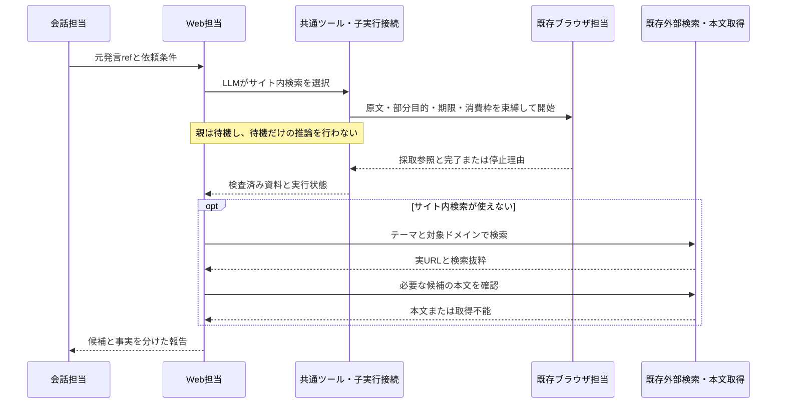

# ブラウザ操作によるサービス内検索と外部検索補完の計画

作成・改訂日: 2026-10-21 JST

状態: **実装・固定試験済み、実ブラウザ受入中。** 実施結果と未達事項は [検証記録](verification/browser-service-search/README.md) に分けて記録する。以下は設計上の契約・完了条件であり、すべての実機試験が成功したことを表さない。

2026-10-21の利用者の補足により、会話入口が `execute_task` を選ぶことは本件の不具合・未達条件としない。複数ツールを利用する入口の選択調整は終了し、検索担当単体のサービス内検索と外部補完を検証する。受入では既存の一時DBの試験環境で担当選択だけを固定し、検索担当・ブラウザ担当の判断、実際の検索・採取・補完・報告は実モデルと既存機構を使う。製品の経路選択を固定する処理や検証専用APIは追加しない。

## 1. 目的と完了条件

指定されたサービスの検索機能を既存ブラウザ担当が観測しながら使い、ログイン・CAPTCHA・接続等で使えなければ既存の外部検索で補完して回答する。検索語、操作対象、絞込み、読む資料、補完への切替、回答の十分性はLLMが判断する。コードは権限、出所、契約、期限、使用量、状態の整合を検証する。

YouTube・X・Instagram・Wikipedia・各種Wikiは受入例で、対応サイトの固定リストではない。サイト別のselector、検索URLテンプレート、語句の分岐、ドメイン辞書は作らない。外部検索でドメインを指定することと、サイト内検索の実施は区別する。

依頼の完了条件はWeb担当が原文から解釈し、最初の依頼条件として保持する。

| 依頼 | 完了に必要なもの |
| --- | --- |
| 動画・投稿・記事の候補を探す | 求められた件数・対象に合う候補の実リンクと出所。内容未確認の候補はその旨を表示する。存在の確認と動画視聴・本文確認を混同しない |
| 記事や投稿の内容・事実を調べる | 対応する本文根拠。検索抜粋だけでは事実を確認済みにしない |
| 候補探しと内容確認の両方 | 候補と事実を分けて返し、それぞれの不足を保持する |

必要件数や必須の確認が残れば部分回答にする。「検索した」「子taskが終了した」だけで完了にしない。外部検索で上記を満たせば調査全体は完了できる。両経路とも使えなければ、試した方法、取得範囲、残った不足を返す。

## 2. 範囲と参照する設計

対象は、Web担当からのブラウザ呼出し、候補/本文の必要箇所の採取、共通機構による終了・取消・結果配送、既存DuckDuckGoによる補完、候補と事実を区別した回答である。

公式API、新しい検索provider、専用ブラウザ、拡張機能の新規開発、Cookie抽出、任意JavaScript、ログインやCAPTCHAの自動突破、投稿・フォロー・購入、動画や画像の新しい認識機能は含めない。日常の複数操作エージェント全体も実装しない。

関連資料:

- [ブラウザのタブ操作](browser-tabs-toolchain-design-2026-10-18.md)、[Script・進捗](browser-script-progress-ui-design-2026-10-20.md)、[現在のブラウザ実装範囲](../docs/browser.md)。
- [単発型・協働型の共通核](subagent-task-and-session-agents-design-2026-10-18.md)、[日常の複数操作計画](everyday-task-agent-implementation-plan-2026-10-21.md)、[同計画の契約・基準](verification/everyday-task-agent/contract-matrix.md)。
- [ツールチェーンの登録](../docs/toolchain-extension.md)、[検証](../docs/toolchain-extension-verification.md)。

## 3. 既存機構との責務分担

| 確認した実装 | 再利用と必要な差分 |
| --- | --- |
| `api/application/browser/browser-task-runner.ts`、`browser-task-tools.ts` | profile・Skill・共通SystemContext、1ジョブ1推論、Script、観測後の操作を維持。調査用packageと採取ツールを登録する |
| `api/domains/browser/service/tasks.ts`、`task-api.ts`、`lifecycle.ts` | task全体の状態、原文・grant・承認・lease・epoch・取消を再利用。呼出し元と終了先、短い期限/推論上限、採取参照を公開契約へ加える |
| `api/domains/tool-runtime/contracts/task-execution.ts` | 共通子実行の開始・状態・質問・取消・結果の型があり、登録adapterと実行handlerの追加も進行中。部分的な実装の存在をbrowserへの接続・検証済みとは扱わない |
| `api/domains/tool-runtime/service/index.ts` | invocation、Source、結果vault、replay・期限・取消を使う。子全体の存続確認を共通接続へ委ねる |
| `api/domains/agent-runtime/service/context.ts`、`evidence-catalog.ts` | 候補一覧、出典metadata、本文抜粋と根拠参照を再利用。候補へホスト発行の参照を加える |
| `api/domains/agent-runtime/service/guided-contract.ts`、`guided-report.ts` | 本文に基づくclaimsの検査を維持。候補だけを返す互換契約を追加する |
| `api/domains/agent-runtime/service/exploration.ts` | 回数・時間の検査を再利用。現在はコードにある上限を、登録packageから解決して凍結する最小差分が必要 |
| `api/domains/web-research/adapters/llm-fetch.ts`、`content-review.ts` | DuckDuckGo、安全なHTTP取得、本文ガードと隔離判定を再利用。取得済み観測を検査する公開入口のみ加える |

### 3.1 共通子実行への接続

受付、実行先ID、現在状態、質問、再開先、取消、元発言の検証、消費予約、終端配送は、日常の複数操作計画でも使う**同じ子実行接続**に置く。`browser.research` はWeb担当へ提示するツールの仮称で、独立した実行エンジンではない。

現在の `ChildExecution` は複数操作の `executionId` を要求する。その値へWeb調査のtask IDを代入せず、共通接続の呼出し元を、ホストが検証する「複数操作の実行・版・手順」または「調査task・invocation・取消世代」として識別できる契約に拡張する。元発言ref、凍結package/binding、開始キー、期限、消費枠の検査は共用する。架空の親実行行や会話runを作らない。

調査経路の関連付けの正本は既存 `tool_invocations` とbrowserが所有する実taskの呼出し元参照。複数操作経路は同計画のstep行を使う。検索専用の受付台帳・配送台帳・状態機械・予算台帳を追加しない。applicationは公開portを接続し、下位domainへ上位domainのSQLを持ち込まない。

P0で共通接続の実装・試験・不足を照合する。未接続の公開操作は共通契約の依存作業として明記し、必要な共有部分だけを接続する。別計画の全体完成を待つことも、検索専用の別実装で代替することも前提にしない。担当外コードの変更や別チャットへの連絡は本計画で行わない。

共通接続は本書の改訂中も別作業で更新されている。P0では接続対象のrevision/commitと公開portの対応表を固定し、その後の共通契約変更で結果が無効になった場合だけ再確認する。改訂中の変更を追い続けることを今回の完了条件にしない。

### 3.2 検索固有の追加

検索用のSkill・登録、観測から候補/本文を採取するツール、既存Sourceへの変換、候補回答の契約、補完を残す予算配分に限定する。検索の意味判断をadapterや取得providerへ移さない。

## 4. 回答までの流れとLLM指示

「サイト内で探す」依頼では、その検索機能を使う。指定URLの一項目確認等は既存HTTP取得も選べる。サービス名の言及だけでブラウザを必須にしない。同じ依頼で確認済みの利用不能な画面へ戻るためだけの再試行はしない。

補完は現在の `web.lookup` と `web.read` を使う。`python3 youtube.com` や `python3 site:youtube.com` はqueryの例で、固定テンプレートではない。LLMがテーマ、対象ドメイン、残った条件から作り、実URLと内容を確認する。ドメインをqueryへ入れただけで全候補が対象に合うとは扱わない。

補完はユーザーが許可した方針であり、そのためだけの再確認は不要。外部検索を明示的に禁止された依頼では行わない。「そのサービスの情報だけ」という対象制約は補完でも保つ。Cookie、認証入力値、非公開本文はqueryへ混ぜない。両経路で不足すれば無制限に再検索せず不足を返す。

| 層 | 置くもの |
| --- | --- |
| Web担当のprofile・Skill | 対象/期間/件数、候補か事実かという完了条件、検索方法、補完、根拠の十分性の判断 |
| ブラウザ担当のprofile・Skill・SystemContext | 引継いだ部分目的を観測しながら実行し、Script・grant・承認・停止規則を守って採取する |
| 実行時context | 原文ref、部分目的、必要件数、試した方法、接続状態、候補/根拠ref、残り時間・回数 |
| schemaとツール説明 | 正確な入力、受付と完了、候補と本文の参照、取得不能と不足の返却 |
| ホスト | 所有者・版・実在する参照・権限・期限・容量・消費・再送・取消の検査 |

各子のSkillやSystemContextを親へ連結し直さず、既存の子のContext組立てで解決する。サイト名や画面文言からホストが手順を選ぶ分岐は作らない。Web担当への追加指示の中心は次のとおり。

> 指定サイトで探す依頼では、そのサイトの検索を使います。使えない場合は理由報告だけで終了せず、テーマと対象ドメインを使う既存外部検索で補完します。結果から検索語、絞込み、読む資料を選びます。補完だけの再確認は不要です。候補リンクと確認済み事実を分け、抜粋だけで本文や動画内容を確認済みとは答えません。必要な件数・確認事項が残れば不足を示します。

## 5. 呼出し・待機・取消の契約

入力は平坦な `question`、`constraints`、任意の `url` / `tabRef`。owner、元発言ref、親invocation、取消世代、凍結package、開始キー、期限、消費枠はホストが束縛する。questionやbriefを原文・許可へ昇格させない。長い原文と短い同意も共通接続の元発言参照から検証する。

保存済みBrave・Bridgeを使い、操作可能タブ、最新観測、quote/grant、Script、lease、URL安全検査を維持する。ページ由来の追加語の入力は従来の承認を通す。承認回避のために原文検査を緩めない。固定の `browser.operate` だけを起動して採取を期待せず、ホストが凍結した調査用packageを既存runnerへ渡せる契約にする。

| 子の状態 | 調査への接続 |
| --- | --- |
| accepted / running | 共通接続がpendingを追跡し、親は推論を解放して待つ |
| completed | 採取結果を検査して親へ戻す。依頼全体の完了はWeb担当が判断 |
| waiting_input / browserのneeds_input | 停止理由と継続refを返す。親invocationをpartialとして確定し、補完を選べるようにする。調査全体を自動で利用者待ちにしない |
| failed / expired | 採取があればpartial、なければfailed。不足を保持して外部検索を選べるようにする |
| indeterminate | 同じ操作を再送しない。不確定を保持し、独立した読取りで補完できるかLLMが判断 |
| cancelled | 親の取消後には資料や回答を採用しない |

複数step jobからなるbrowser task全体を正本に追跡し、最初のjob終了を子の失敗・完了にしない。tool-runtimeから共通の存続確認portへ接続し、browser名の専用分岐や常駐待機jobを作らない。終了配送とreconcileは同じinvocationの一度限りの確定を通す。親付きの一般会話への子終了通知は抑え、直接 `browser_operate` の通知は維持する。

確認がなお必要なら元の質問/承認refを会話へ返す。承認後に別browser taskを作る既存方式を使い、同じ論理呼出し・原文・消費残量を引き継ぐ。10分・対象・一回限りの承認は維持する。親の取消・訂正は子の公開取消へ接続し、commit後にabortする。受渡し前に親invocation・取消世代・期限を再検査し、他のtaskを巻き込まない。再起動・接続断・成否不明では操作を自動再送しない。

## 6. 候補提示と本文回答の契約

### 6.1 候補の実体と参照

既存 `ToolResult.hits` / `readings` と `context.ts` の候補提示を使う。候補ごとにtask内で一意な `cN` をホストが発行し、実URL、観測したtitle/表示文、取得時刻、出所（browser/外部検索）、元invocation、観測/Source参照、版/digestへ結ぶ。モデルのURLやtitleの再生成を登録入口にしない。

候補の順序と対象適合性はLLM、実在と出所はホストが検査する。URLは観測したhref、遷移後URL、外部検索の応答へ結び、投稿IDや動画IDから推測生成しない。別taskや失効した候補は回答・本文取得へ使えない。表示文は未信頼資料として既存のリンク/テキスト表示処理で扱う。

親への候補表示は既存4 KiB枠を使い、cN、短いtitle/表示文、実URLから得たhost/path、取得元を提示する。長い完全URLはホスト側の正本に保持し、表示のためにURLを切断・再構成しない。候補数を黙って減らさず、5件分のmetadataが収まるよう表示用文字数を配分し、それでも収容不能なら容量不足を返す。

本文取得は既存 `web.read` の新しいtool revisionで、urlまたはcandidateRefのどちらか一方を受ける。candidateRefはホストが所有者・版・実在するSourceを検証して完全URLへ解決し、既存のread操作とURL権限検査へ渡す薄い入力変換とする。追加のHTTP取得機構は作らない。旧revisionの `{url}` 契約は維持する。これにより、長いURLを親が再生成せず、候補選択から本文取得へ接続できる。

### 6.2 新しい互換報告revision

現行 `guided-report.ts` のclaimsは `basis: page` が必須である。この検査は維持する。新しいschema/package revisionに、任意の `candidateRefs: [cN, ...]`（最大5件）と `resultKind: candidates | facts | mixed` を加える。旧revisionは従来の入出力で検査する。

ホストは選択されたrefから `candidateResults` を組み立て、安全なprojectionへ保存する。実URL、title、取得時刻、出所、`contentStatus: unverified` を持つ。本文で確認済みの事実は別のclaimsと本文の `eN` へ結ぶ。候補の自由文説明を検証済み事実としては扱わない。

モデルの自由文answerへ候補URLを生成させず、会話担当へホストが組み立てた候補一覧を渡す。会話と画面で引用する候補リンクもこの一覧を正本にし、本文根拠のリンクとは別に表示する。

| 報告 | 検査と結果 |
| --- | --- |
| candidates | 実在する候補refが必要。内容をverified claimsにしない。件数等の条件を満たせば `candidates_found` として完了できる |
| facts | 従来どおりpage根拠のclaimsを検査し、不明・矛盾・取得失敗を保持する |
| mixed | 候補とclaimsを個別検査。片方が不足すれば依頼全体の不足へ残す |
| 候補も本文も得られない | not_foundまたは不足を返す。候補があるのに「該当なし」へ変換しない |

変更対象は報告schema、新schemaの判別（`guidedWeb` / `createWorkerControl`を含む）、報告保存、共通報告の結果種別、会話projection、既存調査カード、client/CLIの結果型。新しい結果を旧consumerへ未対応のまま流さず、旧報告を読む互換試験を置く。候補を返す共通契約として実装し、特定サービスの例外にしない。

実行記録から、サイト内検索の実施、サイト内検索不能と外部補完、本文未確認を区別して渡す。モデルの「調べた」という文だけで実施済みにしない。

## 7. 採取の粒度・実URL・容量

### 7.1 選択単位

`browser.page.collect` は観測全体を無条件に返さない。上限付き観測のノード境界に対してホストが `blockRef` を発行する。`boundSnapshot` のノード分割を再利用し、入力は最新のobservationRef、用途、選択したblockRefs、候補の場合は対応する観測済みリンクref。本文とURLの文字列はモデルに書き直させない。

選ぶ箇所と候補/本文の意味判断はLLMに残す。ホストは選択ノードと必要な見出し/親ノードの文脈を元の観測から残す。サイト専用の本文抽出、特定語を優先する切詰め、自由な要約はしない。大きすぎる選択は容量エラーと残枠を返し、LLMが小さい範囲を選び直す。

hrefが観測へ明示されていなければ、既存クリックと遷移後の観測URLで確認する。推測URLや任意JavaScriptを代替にしない。90秒の子枠内で確認できた候補を返し、必要件数に足りなければ不足を保持する。

### 7.2 初版の上限

| 対象 | 上限と扱い |
| --- | --- |
| 生の観測 | 既存32 KiB・深さ12・200操作ref。切れた箇所は未観測 |
| 採取 | 候補一覧と詳細本文、最大2観測。合計16 KiB以内、1観測8 KiB以内。候補最大5件、詳細本文は1資料 |
| 候補表示情報 | title最大200字、表示抜粋最大300字、URLは既存上限。表示用省略と取得時の切詰めを区別 |
| ToolResult全体 | sources・候補metadata・notes・失敗を合わせ24 KiB以内。既存vaultの32 KiB未満。各項目が個別上限内でも合計超過なら採取を拒否 |
| Web担当への提示 | 既存の候補領域4 KiB、EvidenceCatalogの実サイズ・抜粋生成、制御情報を含むcontext容量検査を使用 |

初版のbrowser一呼出しで詳細本文5件を確認し切る保証はしない。候補5件の提示と内容5件の確認は別の完了条件である。後者は残予算内の既存HTTP取得等をLLMが選び、足りなければ部分回答にする。上限を理由にユーザー要求の件数を変更しない。

browserは直近観測と選択済み箇所だけを一時保持し、task・owner・epoch・tab generationで検証する。古い観測の再採取は拒否するが、採取済みの資料を新しい観測で書き換えない。本文を終了状態や通常ログへ埋め込まず、共通接続から既存vaultへ一度だけ受け渡す。取消・期限・中断・受渡し完了で一時保持を解放する。vaultの15分・再起動時消失を維持し、browser用の永続本文DBは追加しない。

### 7.3 ガードと公開範囲

採取した観測ごとに既存の本文ガード・隔離判定を一度通す。対象は選択した実文と出所で、モデルが作り直した文ではない。拒否・判定不能はSourceにせず不足へ返す。操作前ガードを新設したことにはせず、browser操作は従来の未信頼資料・grant・承認を維持する。

公開情報の調査に必要な画面だけを採取する。DM・設定・非公開本文の取得や、安全な引用URLを確定できない資料の公開は含めない。ログイン状態を使えることを認証情報や非公開情報の取得権限へ広げない。

## 8. 補完まで進める具体的な予算

### 8.1 既存制約と変更箇所

現状のWeb調査はroot180秒・worker150秒、追加操作は残り60秒超が必要で、小さいpackageの親推論は5回。このまま長いbrowser処理を加えると補完できない。既存 `operationLimits`、`modelLimit`、`workerDeadline`、`stepDeadline` が使う共通予算へ、サービス内検索用の登録packageに対応する値を追加する。bundleのsession用timeLimitsだけで実現できるとは扱わない。

値は既存のhost-owned runtime metadataから解決し、開始時に具体値をtaskへ凍結する。サイト名や発話で予算を切り替えない。対応packageは既存の能力選択LLMが選び、通常検索だけの旧packageと実行中taskの上限は維持する。

### 8.2 初期採用値

| 枠 | 値と強制方法 |
| --- | --- |
| root / worker / 会話への返却分 | 360秒 / 330秒 / 30秒。質問や再開で延長しない |
| Web担当 | 最大5推論、1回30秒。最後の1回はfinish用。修復も5回へ計上 |
| browser | 論理呼出し最大1回、task全体90秒、最大12推論かつ1回30秒。Script・採取・修復を含む。既存12回上限は増やさない |
| ガード | browser採取最大2観測と補完本文1件で最大3推論、各30秒。実行しなければ消費しない |
| 親子の総推論 | Web5 + browser12 + ガード3 = 最大20。共通inferenceのrequest IDで一度だけ予約・消費。失敗・取消も消費 |
| 親の外部枠 | browser1、外部検索1、補完本文1の計3回を確保。補完予約分をbrowser側へ渡さない |
| 検索/読取りの分類 | browserを外部検索のsearch枠へ二重計上しない。内部通信・操作は子の記録で別集計し、90秒・12推論で制限 |

5回は「browser選択、補完query選択、本文取得選択、最終報告、必要時の修復」を収容する上限。先に修復等で使った場合は、残りから必須のfinishを引いて実行可否を検査する。消費枠を受け入れられない子は起動しない。

初版のサービス内検索packageの親ツールはbrowser.research、web.lookup、新revisionのweb.readに絞る。親の外部呼出し上限は3、外部検索上限は1、本文取得上限は1、local呼出しは0。recipeや保存本文の追加操作はこの初版packageへ入れず、通常の旧packageには変更しない。一般の詳細調査のすべてをこの小さい上限で完了できるとは扱わない。

browserのruntime metadataは共通の子呼出し操作種別として登録する。外部呼出し数へ1回を計上し、search/read回数へは計上しない。既存の `ToolRuntimeMeta`、`explorationBudget`、`tool-selection` をこの共通種別に対応させ、サイトやbrowserの名前による予算例外を追加しない。

### 8.3 時間配分と境界

worker開始を0秒とする。これは手段を時間で自動選択する規則ではなく、LLMが選んだ操作へ渡す期限と残量の検査である。

| 区間 | 上限配分 |
| --- | --- |
| サイト内検索と採用 | 初回判断30秒 + browser90秒 + 受渡し10秒 = 130秒。browserの2観測のガードも同じ90秒のtask期限・signal内で動くため二重加算しない |
| 補完queryの判断と検索 | 30秒 + 検索10秒。170秒までに候補を得る |
| 本文取得の選択と取得 | 30秒 + 本文取得操作45秒（通信・ガードを含む）。245秒までに戻す |
| 最終報告と必要時の修復 | 30秒 + 30秒。305秒まで、残り25秒を確定・配送へ残す |

browser開始前に補完の150秒を予約する。子の期限は開始時刻+90秒とworker期限-150秒の短い方。採取ガードも同じ子の期限内で動き、渡せるのはガードを通過した採取結果だけとする。新しい操作を始める余地がなければ既採取結果を返す。子の期限切れで親のworkerまで終了させない。

330秒はworkerの最大値であり、rootで既に使った時間や外側の期限があれば短くなる。サイト内区間の保守的な上限 `min(worker開始+180秒, worker期限-150秒)` は維持し、常に実際の期限から予約する。上表の各操作の期限を満たす場合の所要上限は130秒である。browserを開始できる余地がなければ、その可用性と残量をWeb担当へ返して外部補完を選べるようにする。180秒が経つまで待つ規則ではない。

既存の残り60秒超という追加操作条件は変えず検算する。上表の配分では補完検索の実行開始時に170秒、本文取得の実行開始時に130秒残る。60秒以下、検索枠なし、finishを残せない推論残量なら追加取得せず候補と不足を返す。正常系の速度保証ではなく、上限内で開始・停止できる配分であり、実測による成立性はP0/P5で確認する。

検索は既存10秒。補完本文には既存の呼出し単位timeoutを45秒以下で渡し、通信とガードを合わせてその枠を超えない。初期内訳は通信15秒・ガード30秒とし、両方に個別のsignalを接続する。現在のtimeoutの適用範囲をP0で確認し、guardの時間を枠外へ逃がさない。ブラウザ接続待ちも子の90秒に含める。

予約・消費・未使用分の返却は共通子実行/inference予算へ接続する。利用量の終了後集計だけで上限管理したとは扱わない。共通接続側から起動された場合は外側の残予算との短い方を使い、360秒や20回を無条件に増枠しない。

## 9. 変更対象と依存の終了条件

| 対象 | 差分と終了条件 |
| --- | --- |
| 共通子実行接続 | 調査invocationの呼出し元、browser全体の状態/質問/取消/結果、予約と配送。複数step・再送・親取消・重複配送を既存台帳で検証し、別計画との二重実装を作らない |
| browser | 調査packageを既存runnerへ渡す契約、block/link参照と採取、短い期限・推論枠。通常のScript・grant・承認経路を共用 |
| tool-runtime / application | 薄いbrowser.research adapter、Source/候補変換、既存ガードの公開port、共通接続の呼出し。原文とrefをホストが解決し、既存settleへ一度だけ返す |
| agent-runtime | 候補ref、新報告revisionと候補/事実検査、予算解決と凍結。page根拠要件を維持して候補のみを正しく返す |
| capabilities | サービス内検索用Web package/Skill、調査用browser package/採取ツール、新schemaとruntime metadata。新revision・pin・digest・旧版互換を検査 |
| dialogue / client / CLI / 調査カード | 新projectionの候補・出所・未確認表示。既存リンク表示を使い、候補ありを「該当なし」にせず旧報告も読める。別の入力画面は追加しない |

P0では未対応のportを名前だけで接続済みとしない。必要な共通変更は当該契約の作業として整理し、browserやapplicationへ同じ処理を複製しない。

## 10. 実装順序と検証

### 10.1 段階と停止条件

| 段階 | 作業 | 次へ進む条件 |
| --- | --- | --- |
| P0 既存機構で成立性確認 | 共通接続の実装/試験/不足を一覧化。既存の公開入口と保存済み設定で、検索欄、結果、実URL、本文位置、利用不能を観測。web.lookupでテーマ+ドメイン補完も確認し、実LLMの推論時間を記録 | 1サイトで検索と実リンクを観測でき、固定driverで停止理由を再現できる。採取箇所と時間配分の見込みが定まる。未達なら接続実装を広げず計画へ戻る |
| P1 契約と部分実装 | 共有の呼出し元/終端/消費、候補refと報告revision、採取範囲・容量・ガード公開操作 | 固定時計で予約・失効を検査し、候補のみ/本文のみ/混在を保存できる。旧報告の挙動を維持 |
| P2 最小の結合 | 1検索欄・1候補・1本文の固定driverと実登録adapterで、browser→親→検索不能→外部検索→報告を通す | 候補だけで本文取得不能の場合と、本文確認できた場合の両方を公開入口から返せる。最初のstep終了で親が失敗しない |
| P3 会話と表示の通し | 元発言ref、会話回答、候補リンク、Script、確認待ち、取消・再開・重複配送 | 一依頼が補完後の回答まで届く。失効後採用・二重通知・承認迂回なし |
| P4 複数サイトと容量の回帰 | YouTube・X・Instagram・各種Wikiを模した異なる画面、5候補、長いメニュー、非表示リンク、時間境界 | サイト別製品コードなしで通る。件数・未確認を保持し、既存Web/直接browserも回帰成功 |
| P5 実モデル・実ブラウザ受入 | P0と同条件の比較、別サイト、実際に観測した制約、外部補完、最終表示 | 下記受入を記録する。fixture・live・実機を分け、一部だけで全体完成にしない |

P0は既存入口による確認で、製品接続や設定変更を先行させない。サーバーの停止・起動・再起動は明示許可なしに行わない。実ブラウザを利用できなければ未達と残し、fixtureで実機確認を代替したことにしない。

記録の予定先は `spec/verification/browser-service-search/`。P0で `contract-matrix.md`（共通機構と不足）、`observations.md`（採取可能な箇所と制約）、`budget-cases.md`（固定時計と実測）を作る。現在存在する成果物ではない。

### 10.2 必須の行動試験

| 入力・状況 | 合格条件 |
| --- | --- |
| YouTubeでpython3の候補3本 | サイト内検索を観測し、3候補の実リンクと出所を返す。動画内容は未確認と区別 |
| 同依頼でログイン/CAPTCHA | 停止理由が親へ届き、LLMが `python3 youtube.com` 等の意図に合う外部queryを選ぶ。語順一致で採点せず、再確認だけで終了しない |
| 外部候補あり、本文は拒否 | candidateRefsを検査し候補ありとして返る。snippetをclaimsへ入れると拒否 |
| Wikipediaの記事内容、Xの投稿内容 | 本文取得した事項だけをpage根拠へ結び、候補だけなら内容未確認 |
| Instagram、別のWiki、初見画面 | 同じツールで画面から操作を選ぶ。曖昧な対象は確認し、専用selector・ドメイン辞書を追加しない |
| URL一項目のみ | 既存HTTP取得も選べる。サービス名だけでブラウザを強制しない |
| 指定サービスだけ / 外部検索禁止 | 前者は対象を保って補完、後者は外部検索なし |
| 長いメニュー、操作refのない本文、hrefのないリンク | 選択blockと文脈を採取。hrefがなければ既存クリック後の実URLを確認。未観測本文・推測URLは拒否 |
| 採取16 KiB/結果24 KiB境界、5候補 | 合計で検査し、超過は拒否と残枠を返す。候補を無言で消さず不足件数を保持 |
| 古い観測、別task/ownerの候補、原文改変 | refとdigestの検査で拒否し、モデル文字列から出所や許可を作らない |
| ガード拒否、ページの命令混入 | 資料を根拠から外し、権限を広げず補完か不足報告へ進む |
| native180秒、補完開始、残り60秒境界 | §8どおりquery・本文・finish枠が残ることを固定時計で検査。枠外の新規呼出しなし |
| browser12推論/総20推論、Web最終推論 | request IDで一度だけ消費し、修復・取消・再開で回復しない。最後はfinishだけ |
| 確認待ち後の同意、期限切れ、訂正 | 正しい承認へ結び、別browser taskでも残量を維持。失効承認は拒否 |
| step終了とtask継続、重複配送、親取消との競合 | 子全体を追跡し一度だけ返す。取消後の回答復活や別taskの取消なし |
| 再起動・接続断・成否不明 | 既存の中断/不確定処理を通し自動再送しない。独立した読取りの補完と操作再送を区別 |

### 10.3 検証の実行と採用判断

実装時に対象試験を作ってから、部分→結合→通しで実行する。browser採取・子実行、agent-runtimeの候補報告・予算、tool-runtime共通接続を部分試験とし、applicationで公開入口から外部補完まで通す。固定Provider/driverで確認後、実モデル・実ブラウザを検証する。P0の早期観測はその前提確認で、全体受入の代わりではない。

追加試験の予定ファイルは次のとおり。現在作成・実行した試験ではなく、同じ責務の共通試験がP0で見つかった場合はそこへ統合する。

- 部分: `api/domains/browser/test/research-collection.test.ts`、`api/domains/agent-runtime/test/guided-candidates.test.ts`、`api/domains/agent-runtime/test/service-search-budget.test.ts`、`api/domains/tool-runtime/test/child-lifecycle.test.ts`。
- 結合: `api/application/toolchain/service-search.test.ts`、`api/application/toolchain/service-search-fallback.test.ts`。登録bundle・adapter・Queue・報告保存を実物で通し、外部Provider/driverだけを固定する。
- 表示のE2E: `tests/browser/service-search.spec.ts`。候補あり/本文未確認/本文確認済み/失敗の表示と実リンクを確認する。

基本の検証は `bun run verify -- --domain browser --domain web-research --domain tool-runtime --domain agent-runtime --domain capabilities`。変更したdialogue/inferenceと結果型のclient/CLI/Webも検査する。application結合試験は対象ファイルを明示する。ブラウザE2Eは対象の `tests/browser/<対象>.spec.ts` を個別指定し、verify:allには含めない。

P5ではサイト内検索成功1例、実際の利用不能から外部補完1例、本文未取得だが候補提示は完了する1例を記録する。サイト・接続状態・時点、経路、件数、本文確認、親子/ガードの推論、区間時間を記録する。実際の障害が再現しなければ制約例はfixtureのみとして実機受入を未達とする。汎用性は異なる2サイトの実観測と初見画面の固定試験で確認し、全サイト成功の保証にはしない。

同目的の3ラウンド、根拠のない同一失敗、検証中の編集で結果を無効にした場合は次の操作前に俯瞰評価へ戻る。担当外を勝手に修正せず、期待値を弱めない。配分に収まらない実測は上限を無言で延ばさず、時間・呼出し構成・採取単位を再評価して本書へ理由を記録する。

## 11. 自己評価への対応と残作業

| 指摘 | 本改訂で確定したこと |
| --- | --- |
| 候補と本文の混在 | §1・§6の完了条件、候補ref、新報告revision、candidates_found、consumer変更。page根拠検査は維持 |
| 補完予算未確定 | §8の330秒worker、native180秒以内、補完150秒、20推論と外部枠、既存60秒境界への対応 |
| 採取単位が粗い | §7の観測済みblock/link参照、文脈と実URL、2観測/16 KiB、結果24 KiB、5候補 |
| 共通機構の重複 | §3・§9の共通接続への依存と呼出し元拡張。専用の受付・配送・状態・会計台帳は追加しない |
| 実ブラウザ確認が遅い | §10で既存入口のP0観測を製品接続前へ移し、P2の最小結合後に範囲を広げる |

計画改訂時点の完了範囲は計画と契約整合の文書点検までだった。その後の実装依頼による製品変更・登録・固定試験・実機試験の実施結果と残作業は[検証記録](verification/browser-service-search/README.md)へ記録する。別作業の共通契約を参照するが、その担当の変更・試験・完成を今回の成果にしない。

### 実測に基づく調整（2026-10-21）

実受入でYouTube画面取得後の次操作推論が15秒でdeadline_exceededとなった。browser全体90秒・12推論・補完150秒の予約を維持し、1回の推論上限のみ30秒へ調整する。意味判断・経路選択・対象別の値は追加しない。

その後の単体実受入で、Web担当の最初の推論が2回20秒でdeadline_exceededとなったため、Web担当も1推論30秒へ調整する。ガードがbrowser task90秒・本文取得45秒のsignal内で動く実装と期限試験を根拠に、§8.3の二重加算を修正した。最大5推論とworker330秒、補完予約150秒、最終会話30秒は維持する。

実モデルが未提示のinputValueRefを生成し、次にはvalueだけでquoteを省略した。既存のhost検証は拒否できているが、モデルへ示す型では両方が任意のため、入力元の条件が伝わっていなかった。共通ページ操作の開始時、利用者承認済みの入力参照がない場合は既存browserPageType（valueとquoteが必須）を提示し、承認済み入力参照がある場合は既存browserPageTypeValueを維持する。これは既存の許可状態に合わせた入力契約の提示であり、検索語・サイト・入力可否の意味判断は追加しない。host側の引用・grant検証は維持し、承認後の再開でも既存の参照入力が使えることを検証する。

ロック解除後の実受入で、collectにblockRefs:[b85]とlinkBlockRefs:[b160]を渡し、既存の部分集合検査で拒否された。続く修正では/urlを持たないブロックをリンク扱いした。既存検査を維持し、collectの新版ツール説明で「リンクもblockRefsに含める」「到着先自体を候補にする場合は見出し等とlinkBlockRefs:[]」を明示する。既刊版を変えずtool:browser.page.collect@2、package:browser.service-search@4を登録して共通子実行の起動版を更新する。エラー案内も既存契約の修正方法を示す。参照の補正やサイト別処理、ガードの緩和は行わない。

### 検索欄と個別候補の安定化（追加依頼）

利用者はドメイン台帳を作らず、検索方法・候補の判断をLLMへ委ねたまま安定化することを依頼した。範囲は既存ブラウザの観測提示、採取結果のフィードバックと検索Skillの改訂。通常Web検索の置換、担当選択、会話の回答長、サイト別処理は含めない。

実観測の再取得では参照数上限等で後方の要素が省略されるが、YouTube結果の最初の3件の個別タイトル・URLは既に提示済みだった。従って深さ制限を緩める改修は行わない。現在のbN全件の重複一覧は候補のリンク情報を持たず、採取の成功結果も件数だけなので、選択と結果の照合を助ける情報を既存の観測・返却へ追加する。

- 最新の制限済み観測内のリンクだけを、bN・観測ラベル・実URLの一覧でも提示する。全サイトで同じARIA表現の抽出を使い、順位・関連性・個別か一覧かをコードで判定しない。bNは本文側にも既に表示されるため、bNだけの重複カタログはこのリンク一覧へ置き換える。
- 採取と観測リンク一覧は同じURL/ラベル抽出を再利用する。採取成功後は件数に加えて実際のリンク名・URLを返す。元ページ自体を採取する現行契約、ガード、権限・取消・期限・容量検査は維持する。
- 検索用Skillでは、一覧中の個別候補は観測リンクのbNで採取し、到着先URLの採取は実際に個別ページへ到着した場合に使うことを例で示す。検索の実行、入力元の引用、採取結果と依頼条件の照合、短い不足報告はLLMが担う。既刊版を保持し新しいSkill・ツール説明・packageを登録する。

完了条件は、固定試験で異なるドメイン・相対/絶対URL・誤参照・危険なURL・一覧/到着先の双方を確認し、共通子実行から親への採用を検証した後、実モデルでYouTubeの検索欄から個別動画3件とWikipediaの個別記事1件の取得を確認すること。補完経路は固定結合試験と既存の実測と区別して記録する。関連7領域のverify、型・差分点検を行い、3ラウンドごとの俯瞰評価と停止条件を維持する。

リンク一覧追加後の実機観測では、メニュー等の構造が異なると200参照の上限までに個別動画の名前が2件しか残らなかった。別の再取得では3件以上届いていたため、初回の「最初の3件が提示済み」という観測をすべての状態へ一般化しない。同じ原データで、名前・状態・独立した本文を持たない`generic [ref=…]`中間ノードだけを省いて子を繰り上げる整形を試すと、同じ32KiB・深さ12・200参照内に名前付き動画リンク10件を保持できた。ARIAのgenericは独自の意味を持たないコンテナである（[W3C ARIA generic](https://www.w3.org/TR/wai-aria-1.2/#generic)）。この観測整形を子の資料採取経路で既存のboundSnapshotより前へ適用し、通常の直接ブラウザ操作の表示と上限は維持する。名前付き・状態付き・操作可能・本文を伴うgenericは保持し、内容やサイトによる選別はしない。

また、名前のないリンクの`[aria-hidden]`等をタイトルとして扱わず、実ラベルが空であることを伝える。Skillは名前が確認できるリンク・周辺文脈で個別候補を判断し、同じURLを複数候補として数えないよう補足する。リンク・名前が欠けた場合は確認した不足を返す。ガードがsource_contentを返しつつ拒否された一例は、保存済みの同じ公開材料を個別に4回評価して再現しなかった。形式の不一致を断定せず、診断情報だけを追加して判定条件は変更しない。

観測整形後の試行では、quoteを省略したtypeが2回続いた。hostの既存browserPageTypeValueがvalue_sourceで拒否したとき、runnerがその理由をcustomに伏せ、既存HINTS.value_sourceを返していなかった。引数検査でcustom違反が出た場合も、既存HINTSに定義済みの修正案内だけを返す。未登録のissue.messageや入力値は返さず、入力契約・原文引用・grant・試行上限は変更しない。

その後の実行ではブラウザの最初の推論が13,891入力トークンで30秒の上限に達した。上限は変えず、リンク一覧に完全な名前・URLがあるブロックは、本文の表示をbN・役割・操作ref・ARIA状態だけにして二重送信を避ける。同じ観測の提示量は21,232→17,659 bytes。長い名前等で一覧側が省略されるときは本文の原表現を残す。採取用の原文、ホストが保持する参照、隔離ガードへ渡す資料は省略しない。通常の直接ブラウザ操作の表示は維持する。

重複省略後はYouTubeで3つの名前付き個別動画リンクの採取・ガード受理・親の報告保存まで成功した。一方、Wikipediaの最初の入力は17,995トークン、providerの入力処理26.24秒で、引用不足の修復推論が30秒を超えた。モデル向けのリンクURLはdecodeURIした表記をURLへ再変換して元の実URLと完全一致する場合だけ読みやすく表示し、制御文字・空白や変換不能・不一致は原URLを保持する。ホストの採取・保存URLと通常の直接操作の表示は変更しない。

引用不足の診断には、入力参照を指定していない場合に既存browserPageTypeの必須ペアを使ってquote等の不足パスを補う。実行可否は従来のbrowserPageTypeValueで検査した結果を正本とし、既存の修正案内も維持する。利用者の語句をコードが補ったり、引用を自動生成したりしない。
