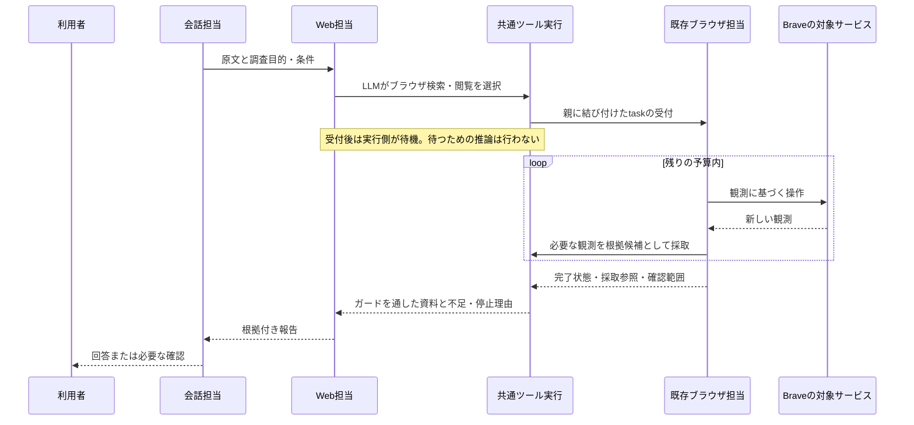

# ブラウザ操作によるサービス内検索の設計

作成日: 2026-10-21 JST

状態: **設計案・実装前。** ユーザーの「まず既存のブラウザ操作を使う」「検索方法の選択はLLMに任せる」という依頼に基づく。合意後に実装する。本書の作成では製品コード・設定・稼働サーバーを変更せず、実ブラウザ・実LLMの受入も行っていない。

## 1. 目的と完了条件

ユーザーがサービス名・ドメイン・タブを指定して調査を依頼したとき、Web担当が依頼と利用可能な手段を理解し、既存のブラウザ担当へサービス内検索・閲覧を依頼できるようにする。検索語、検索方法、対象タブ、検索結果から読む資料、終了や別経路への切替はLLMが判断する。

完了は、検索操作の成功ではなく、依頼に必要な情報を確認し、出典・確認範囲・未確認事項を含めて回答できることとする。検索できない場合も、何が妨げになったかを説明する。結果がないことと、結果を取得できなかったことを区別する。

YouTube・X・Instagram・Wikipedia・各種Wikiは受入例であり、対応サイトの固定リストではない。別のサービスや初見の検索画面でも、既存のブラウザ操作で扱える範囲なら同じ仕組みを使う。

今回の汎用性は「サイトにある検索機能を、画面の観測から使うこと」を指す。検索欄、検索ボタン、検索結果の種類や絞込みの操作はLLMが観測から選び、サイトを増やすたびにコード・selector・操作手順を追加しない。一般検索へドメイン制限を付けるだけでは、サイト内検索の実施という完了条件を満たさない。

ユーザーがサイト内で探すことを求めた場合、その条件を保って当該サイトの検索を使う。LLMに委ねるのは、依頼の意味の解釈と、その条件内での検索語・画面操作・絞込み・読む資料・追加調査の選択である。検索画面を利用できなかった場合は、未実施と理由を報告する。すべてのサイトでの成功を保証する意味ではなく、認証・閲覧制限・bot対策等の影響は実機受入で区別する。

## 2. 範囲

今回含めるもの:

- Web担当から既存のブラウザ担当を呼び出し、サービス内の検索・検索結果の選択・詳細ページの確認を行う。
- ブラウザで確認した資料を、取得時点とURLを持つ根拠としてWeb担当へ返す。
- 受付、実行中、完了、確認待ち、失敗、取消を親の調査へ接続する。
- 既存の検索・HTTP取得とブラウザのどれを使うかをLLMが選ぶための指示・ツール説明・実行時情報を整える。
- 既存のScript・進捗・承認・入力値の由来・タブの排他・期限を再利用する。

今回含めないもの:

- 各サービスの公式API、新しい検索provider、サイト専用のスクレイパーやselector、検索URLテンプレート、サイト名の振分け辞書。
- 専用ブラウザや別プロファイル、新しい拡張機能、Cookie・認証情報の抽出、任意JavaScript実行。
- ログインやCAPTCHAの自動突破、課金・投稿・フォロー等、検索に不要な操作。
- 動画・音声の認識、字幕取得の新機能、動画の自動再生。画面で確認できない内容の要約はしない。
- 日常の複数操作エージェント全体、汎用plannerや新しい実行基盤の実装。

## 3. 現状の根拠と再利用方針

| 確認箇所 | 現状 | 本設計での扱い |
| --- | --- | --- |
| `api/domains/capabilities/bundles/web-shared-execution.bundle.json` | Web担当のツールは検索、HTTP本文取得、保存本文参照、取得手順参照。ブラウザ操作は含まれない | 新revisionでブラウザへの依頼ツールと選択指示を加える |
| `api/domains/web-research/adapters/llm-fetch.ts` | 検索はDuckDuckGo、本文は安全なHTTP取得 | 維持する。ブラウザを検索provider内部の自動切替先にしない |
| `api/application/browser/browser-task-runner.ts`、`browser-task-tools.ts` | 共通の単発型核、1ジョブ1推論、観測した要素への一手ずつの操作 | この担当と実行機構を再利用する。Web担当に同じ操作ループを複製しない |
| `api/domains/browser/service/tasks.ts`、`task-api.ts`、`lifecycle.ts` | task全体の状態と一手ごとのQueue jobは別。承認・期限・epoch・取消を管理し、終了時は通常会話へ通知 | 親付き呼出しの関連付けと配送先を加える。業務SQLはbrowserに置く |
| `api/domains/browser/service/observe.ts`、`observation.ts` | 観測本文は上限付きで返し、DBの観測台帳には本文を保存しない | 調査用に選んだ観測だけを採取する公開契約が必要 |
| `api/domains/browser/service/grants.ts`、page-operatorの指示 | 利用者原文の引用から入力値を作り、ページ由来・承認済みの値を別に扱う | 原文をホストから渡し、この検査を維持する |
| `api/domains/tool-runtime/contracts/index.ts`、`service/index.ts` | 非同期ToolAdapter、根拠Sources、期限付きの結果vaultがある。pending中に対応jobが終了すると失敗へ移す | 非同期接続と根拠返却に再利用。ただし複数jobからなるtaskの存続確認は補う必要がある |
| `api/domains/agent-runtime/service/evidence-catalog.ts`、`guided-report.ts` | task内の根拠参照、容量検査、根拠付き報告 | ブラウザ資料も同じ経路に載せる |

ブラウザの短い終了文だけでは、取得内容と出典を検証できない。指示の変更だけでは根拠返却と非同期終了の契約を満たせないため、専用追加はこの接続部分に限定する。

関連設計は[ブラウザのタブ操作](browser-tabs-toolchain-design-2026-10-18.md)、[実行Script・進捗](browser-script-progress-ui-design-2026-10-20.md)、[単発型・協働型](subagent-task-and-session-agents-design-2026-10-18.md)。現在の実装範囲は[ブラウザ運用文書](../docs/browser.md)を優先し、旧設計の過去時点の未実装記述を現在の状態と混同しない。

[日常の複数操作エージェント計画](everyday-task-agent-implementation-plan-2026-10-21.md)にも、子の受付と完了の区別・親配送・二重通知の抑止がある。そこに記載された仕組みは未実装として扱う。実装着手時に共有部分の状況を確認し、同じ呼出し関連付け・完了配送を再利用する。本機能のために同計画の全段階を先行実装せず、二重の台帳や配送機構も作らない。

## 4. 採用する構成と責務

Web担当は調査全体を所有し、サービス指定の解釈、検索方法の選択、根拠の十分性、最終報告を判断する。ブラウザ担当は依頼された部分を観測しながら操作し、どの結果を開くか、何を採取するか、どこで止まるかを判断する。操作担当の短い要約を独立した事実の根拠にしない。

application層は両担当の公開portを接続し、原文の解決、呼出しの関連付け、資料の変換、通知配送を担う。browserからagent-runtimeやdialogueの内部を参照せず、Web担当からbrowserのテーブルを直接読まない。複数domainの確定は同じwriterのtransactionと公開操作で行い、外部通信はtransaction外で行う。

## 5. LLMに渡す判断材料と指示

### 5.1 配置する層

| 層 | 内容 |
| --- | --- |
| Web担当のprofile・SKILL | ユーザーの指定範囲を保つ、利用可能な検索方法を選ぶ、根拠の十分性を判断する、手段変更や不明を説明する |
| ブラウザ担当のSKILL | 検索欄・結果・詳細を観測して操作する、必要資料を採取する、原文の入力値制約・Script・停止規則を守る |
| 実行時context | ホストが解決した利用者原文、調査目的、対象・期間・必要件数等、ブラウザの設定・接続状況、選択可能なタブ、残り予算、過去の失敗 |
| ツールschema・説明 | 依頼の入力、受付と完了の区別、根拠候補と本文の区別、確認待ち・接続失敗の返却契約 |
| 実行側 | 所有権、epoch、期限、承認、入力grant、URL安全検査、排他、容量、取消、重複排除 |

サービス名の解釈や対象が同じかという意味判断はLLMに残す。ホストは「wiki」を機械的にWikipediaへ決めず、文脈から判別できなければLLMが確認する。ツールを使えるかという能力検査と、どのツールを使うかという意味判断を分ける。

### 5.2 Web担当へ追加する指示案

> 利用者が指定したサービス・サイト・タブ、対象、期間、件数を調査条件として保ちます。今回の依頼と利用可能なツールから検索・取得方法を選びます。指定サービス内で探す依頼では、そのサイトにある検索機能を既存のブラウザ担当で操作します。検索欄・結果の種類・絞込みは実際の画面を観測して選び、サイト別の固定手順を前提にしません。一般検索のドメイン制限だけでサービス内検索を実施したとは扱いません。サービス名の言及だけで検索操作を必須にはせず、指定URLの確認など依頼に合う方法を選びます。
>
> ブラウザへは、確認したい対象と条件、必要な根拠を渡します。画面の操作手順を推測で固定しません。受付は調査完了ではありません。返された資料と確認範囲を読んで回答の十分性を判断します。検索一覧の抜粋だけで詳細を確認済みとはしません。
>
> 使えない手段や不足を確認した場合は、残り予算と利用者の条件から次の方法を選びます。一般検索へ切り替えてもサービス内検索を行ったとは答えません。「そのサービス内だけ」などの制約を広げる必要がある場合は確認します。ログイン・CAPTCHA・承認が必要な場合は、その地点と必要な対応を伝えます。

ブラウザ担当には、依頼の検索条件、候補一覧と詳細資料の区別、採取ツール、確認できない動画内容等を補わないことを追加する。既存の高優先度のpage-operator指示と矛盾する新しい優先順位は設けない。

「公式API→ブラウザ→一般検索」の固定順や「失敗したら自動で一般検索」といった切替は実装しない。本段階で公式APIツールは追加しない。利用可能な手段だけをLLMに示す。

## 6. 呼出しと非同期完了の契約

### 6.1 Web担当からの依頼

登録ツールの仮称を `browser.research` とする。サイト別ツールは作らない。平坦な入力として、確認したい内容の `question`、検索範囲・期間等の `constraints`、必要な場合の `url` または `tabRef` を受ける。検索条件の意味はLLMが判断し、必須条件は今回の原文とWeb担当の依頼に併せて保持する。

owner、conversationId、親task・invocation ID、取消epoch、元の利用者message、期限はモデルの引数から採用せずホストが束縛する。`question`を利用者原文へ昇格させない。ブラウザ担当には原文と引継ぎ依頼を区別して渡す。原文を解決できない場合は開始せず、引継ぎ文から入力権限を作らない。

初期タブ・URLはLLMが選ぶ。ホストは実在する操作可能タブか、安全なURLかを既存規則で検査する。未指定ならブラウザ担当が一覧と観測から選ぶ。設定済みのBrave・Bridgeを使い、未接続時は保存済みの承認省略設定による接続、または利用者の手動接続という既存経路に従う。設定やトークンは自動変更しない。

### 6.2 受付・存続確認

ToolAdapterからbrowserの公開開始操作を呼び、invocationとbrowser taskの対応を同じtransactionで保存する。同じrequestIdの再送は同じ子を返し、入力が異なる場合は競合として拒否する。親付き呼出しの種別と関連IDはbrowserの公開契約へ追加し、画面起点を装って通知を避けない。

親は既存のツール待機へ移り、ブラウザの各観測や操作のたびには再推論しない。ブラウザは既存の1ジョブ1推論で継続する。受付receiptや最初のstep jobの完了だけでToolAdapterを成功にしない。

共通tool-runtimeには、**完了の正本がQueue jobか、adapterの操作全体か**をホスト登録で表せる最小契約を追加する。既存ツールはjob基準を維持し、複数jobからなる呼出しではadapterが公開task状態を読み、activeならpending、終端なら確定結果を返す。モデルはこの種別を指定できない。browser名による専用分岐にしない。

`jobId`は既存のスケジュール追跡に残すが、最初のstep jobの終了を子全体の失敗へ変換しない。親のreconcileと子の期限・中断処理によりpendingの放置を防ぐ。新しい常駐待機ループや、待機中にQueueの実行枠を占有するjobは作らない。終了通知からの再開と通常reconcileは同じinvocationの確定処理を通し、どちらが先でも一度だけ採用する。

### 6.3 結果と通知

| browserの状態 | Web担当へ渡すもの | 親の扱い |
| --- | --- | --- |
| queued / running | pendingとtask参照 | 実行側が待機 |
| completed | 採取資料、実施した検索・閲覧の範囲、未確認事項 | 根拠登録後にWeb担当を再開。回答完了かはWeb担当が判断 |
| needs_input | 必要な接続・認証・承認等の説明と継続参照 | invocationはpartial（不足をnotesに保持）として確定し親を再開。確認済み資料がなくても検索成功にしない |
| failed / expired / indeterminate | 失敗分類、確認できた範囲、実行不確定の有無 | failed、または有効な採取資料がある場合だけpartial。次の行動はLLMが選択 |
| cancelled | 取消 | 親の取消後には資料も回答も採用しない |

親付きのbrowser終了はapplicationから親invocationへ配送する。子の一般会話への終了通知は出さず、親の回答と二重にしない。通常の `browser_operate` の直接通知は維持する。

確認待ちの間、親を無期限のpendingにしない。Web担当は取得済みの範囲と必要な確認を報告する。利用者が回答した後は新しい調査呼出しとして、ホストが同じowner・会話の継続参照を検証して再開する。承認は既存の10分・対象・一回限りの検査を通し、LLMの「許可済み」という説明から作らない。期限切れや条件変更時は新規依頼にする。

短い同意だけが返った場合、今回の同意messageと、元の検索依頼のmessageをホストが別々に保持する。検索語の由来を検証する原文は、検証済みの継続元から解決する。モデルが過去の依頼文を再構成した文字列は使わない。明示承認済みの値・操作は既存の承認移送を使い、引継ぎ依頼の一般的な説明で承認範囲を広げない。

## 7. 観測を根拠として渡す契約

### 7.1 採取

ブラウザ担当へ、現在の観測を採取する登録ツール（仮称 `browser.page.collect`）を追加する。入力は `observationRef` と資料の用途（候補一覧 / 詳細資料）。本文・タイトル・出典URL・取得時刻をモデルが書き直して渡す入力にはしない。

browserは自分が返した直近の上限付き観測をtaskに束縛して一時保持する。採取時にowner・task・epoch・タブgeneration・観測参照を検証し、**実際に返した観測そのもの**を複製して固定する。古い観測の再採取は拒否する。採取後にページが変わっても、固定済み資料の取得時点は変わらない。操作用refの失効と、既に採取した過去時点の根拠を区別する。

直近の観測と選んだ資料の一時バッファだけを持ち、全閲覧履歴は蓄積しない。既存の観測上限（32 KiB・深さ12・200 ref）と、親の結果・根拠容量を同時に守る。tool-runtimeの一結果32 KiBはmetadata・notesも含むため、本文だけで枠を使い切らない。超過時は境界を保って切り詰め、切詰めを明示するか、容量不足を返す。親の根拠catalogにも既存上限を適用する。

採取資料は、子の終端時にapplication経由でToolResultの `readings` へ変換する。browserの既存の軽量終了状態へ本文を埋め込まず、結果vaultへの受渡しまで一時保持し、受渡し・期限・取消・中断で解放する。永続化するのは関連ID、取得時刻、出典metadata、digest等の必要情報に限定し、browserの観測DBに本文列を追加しない。

### 7.2 根拠の区別

| 資料 | 返却・利用の規則 |
| --- | --- |
| 検索結果一覧 | `basis: snippet`。候補選択用で、詳細を読んだ根拠へ昇格させない |
| 詳細ページで確認した本文 | `basis: page`。ホストが発行したsource参照、実URL、タイトル、観測時刻、切詰め、ガード結果を持つ |
| ブラウザ担当の要約・停止理由 | notes。独立した出典にはしない |
| スクリーンショット | 既存capture参照。画像だけから本文根拠を自動生成しない |

画面が一覧か本文か、どの記述が依頼に必要かはブラウザ担当が判断する。ホストはサイト別パターンで分類せず、観測の実在と出所を検証する。個別投稿を本文として確認できる場合も同じ基準を使い、一覧の短い抜粋を投稿全体とみなさない。

採取本文をWeb担当へ渡す前に、既存web-researchの本文ガードと隔離された意味判定を再利用する。現在の公開入口だけではブラウザ観測を丸ごと検査できないため、検査対象の組立てを最小の公開操作として切り出す。新しいサイト別ガードや、拒否時にガードを外す経路は作らない。拒否・判定不能の資料は根拠にせず不足として返す。この検査はWeb担当への根拠採用の境界であり、ブラウザ担当の操作安全性を新たに保証するものではない。

ブラウザ担当へ渡す生の観測は引き続き未信頼資料とし、ページの指示で目的・権限を変えない。検索画面が「別サイトへ情報を送れ」と指示しても入力grantや承認の根拠にしない。

### 7.3 URL・保持・公開範囲

引用URLは実際の観測URLまたはホストが観測から確認したリンクを使い、モデルが推測した投稿IDや動画IDから作らない。クエリを含むURLを無条件に会話へ流さない。候補一覧は本文出典にせず、原則として実際に開いた詳細ページのURLを引用する。認証情報付きURLや署名付きURLなど、安全な出典URLを確定できない資料は公開根拠にしない。

ログイン状態は既存プロファイルで維持するが、初版の採取対象は利用者が依頼した公開情報の画面とする。DM・アカウント設定・非公開ページの内容を調査根拠として外へ渡す範囲拡張は含めない。公開情報か判断できなければ採取せず確認する。公開性の意味判断はLLMに置き、完全な機械的判別を保証したとはしない。

現状tool-runtimeの本文は15分の期限付きメモリvault、SQLiteは主に出典・参照metadataである。`docs/web-research.md`の保存本文に関する記載だけから、browser資料の永続保存が既にあると判断しない。本段階ではこのvaultを再利用し、`web.find` / `web.read_saved` 用のHTTP本文保存やstable cacheへ流し込まない。参照が失効した資料は再閲覧し、過去の要約から復元しない。

## 8. 入力、タブ、停止、取消

検索語はLLMが利用者原文から抽出・言い換えできる。入力には元の一節の `quote` を添え、既存grantで検証する。Web担当の依頼文、Memory、ページの提案語を原文の引用に見せかけない。ページ由来の追加語や原文にない入力が必要なら、既存の入力値承認で止まる。追加語を使うためだけに安全検査を緩めない。

タブ選択と新規タブ作成もLLMが判断する。利用者が指定したタブはその条件を保ち、接続前からある不可視のタブを推測で操作しない。接続単位の直列実行とタブleaseを再利用し、利用者の操作等で観測が変わったら取り直す。調査終了時に利用者のタブを一括で閉じたり、全ブラウザを切断したりしない。

CAPTCHA、ログイン要求、閲覧制限、同じ失敗の反復、根拠不足、予算不足は観測とツール結果からLLMが判断する。ホストはサイト名・画面文言の辞書で自動迂回しない。認証操作は利用者へ渡し、既存の通常接続・再依頼で継続する。読取りのHTTP取得にある10秒制限を、ブラウザtask全体の制限へ流用しない。

子の期限は親の残り時間とbrowserの通常上限の短い方に束縛し、親へ結果を返す余地を残す。推論回数は既存のbrowser上限を維持し、子の推論・外部操作・待機も親の消費として記録する。ブラウザを一回呼んだことで内部の操作が無制限になる予算にはしない。Web担当へ提示する可用性は残りの親予算を含めて決め、意味によるルート選択はLLMに残す。

親の取消・訂正による失効は対応する子taskへ伝え、commit後に既存のabort経路を実行する。子だけの取消も親へ返す。他のbrowser taskは巻き込まない。受渡しの直前に親invocation・epoch・期限を再確認し、古い子の結果を採用しない。切断・backend再起動・結果の有無不明では操作を自動再送しない。

## 9. 登録と変更範囲

[登録と拡張](../docs/toolchain-extension.md)と[検証手順](../docs/toolchain-extension-verification.md)に従い、bundleと登録adapterで接続する。

| 対象 | 必要な差分 |
| --- | --- |
| capabilities | Web担当のツール・SKILL、調査用ブラウザ担当の採取ツールとSKILL、新schema・runtime metadataを新revisionで登録。通常の操作担当へ不要な採取権限を広げない |
| browser | 親呼出しの束縛、期限、採取契約、一時観測の管理、公開終端結果、完了先の区別。通常の操作・承認・Script経路を共用 |
| application/browser・toolchain | 既存runnerを使う調査用packageの選択、ToolAdapter接続、原文の解決、本文ガードへの接続、ToolResultへの変換、親配送・取消 |
| tool-runtime | task全体を完了の正本にできる最小の共通契約。既存vault・settle・cancel・replayを共用 |
| agent-runtime・dialogue | ツール可用性・予算、原文への参照、確認待ちの引継ぎに必要な最小差分。報告schema・通常の根拠付き最終回答経路を維持 |
| web-research | 既存本文ガードへ取得済み観測を渡す公開入口。新しい検索providerやサイト専用取得は追加しない |
| 画面 | 既存の調査カードとブラウザScript・状態を参照。必要な関連付けのみを登録。第二の検索入力欄や独立した管理画面は作らない |

担当のpackage選択は登録した呼出し用途からホストが解決する。通常の `browser.operate` 固定をそのまま使って、SKILLが欠けた状態で採取を期待しない。旧revisionは書き換えず、新規登録のpin・digestを確認する。

## 10. 検討した代替案

| 案 | 判断 |
| --- | --- |
| Web担当の指示だけを変える | ツールも根拠返却もないため単独では成立しない。選択指示の改善自体は採用する |
| Web担当へ全ブラウザ操作ツールを直接渡す | 操作状態・Script・入力grantをWeb実行ループへ持ち込む変更が大きい。既存担当の再利用を優先する |
| 既存ブラウザ担当の終了文だけを返す | 出典本文を照合できず、検索成功と根拠確認も区別できない |
| 一般検索のqueryへ常に `site:` を足す | サービス内検索を使う依頼を満たせず、検索方法をコードが固定する |
| サイト別にURLやクリック列を登録する | 初見の画面へ対応できず、意味判断を専用処理へ移すため採用しない |
| 公式APIを先に導入する | 将来の選択肢。今回は既存ブラウザ利用という依頼の範囲外 |
| 既存担当＋非同期の親配送＋観測の採取 | 採用案。小さな契約追加は必要だが、操作・承認・実行機構を再利用できる |

## 11. 実装順序と検証計画

| 段階 | 作業と依存 | 終了条件 |
| --- | --- | --- |
| P0 合意・現状固定 | 本設計の合意、共有接続の実装状況と未コミット差分を確認。既存の通常Web検索・browser操作の基準挙動を記録 | 今回の範囲と既存由来の失敗を区別できる |
| P1 部分 | 観測採取・公開結果・入力原文の束縛・親の期限/取消、ガードの公開操作 | 所有domainで正常系と失効・容量・拒否を確認 |
| P2 結合 | ToolAdapter、task全体の存続確認、終端配送・通知、登録bundle、既存runner/packageの再利用 | 実際の登録から開始→複数step→資料→親報告を固定モデルで通す。初回step終了で親が失敗しない |
| P3 通し・回帰 | 会話入口、確認待ちと新しい継続呼出し、取消・重複配送、既存Web/通常browserの回帰 | 公開入口から根拠付き回答・停止理由まで到達し、二重通知と失効後採用がない |
| P4 実モデル・実ブラウザ | 保存済み設定のBrave/Bridgeを使い、下記の通常例・制約例を確認 | fixtureと別の記録に実際の選択・操作・回答・時間/推論消費・未確認範囲が残る |

### 11.1 部分試験

- 別task・別owner・古いgenerationの観測、モデルが捏造した観測参照を採取できない。採取後のページ変更で出典の内容や取得時刻が変わらない。
- 本文・URL・時刻をモデルの文字列で置き換えられない。切詰め・ガード拒否・不明を保持し、一覧を詳細の根拠へ変えない。
- 先頭に大きなナビゲーションがあるページ、32 KiB境界、結果metadata込みの容量超過、vault期限切れで誤ったcompleteにしない。
- 原文の言い換え検索は既存grantを使える。ページの提案語や引継ぎ文だけにある語は承認なしで入力できない。
- ページ内の指示注入、非公開情報への誘導、秘密の送信要求で権限が広がらない。これはガードだけの成功ではなく、ツール呼出しと停止を確認する。

### 11.2 結合・通しの行動試験

| 入力・状況 | 期待する判断と観測可能な合格条件 | 禁止する挙動 |
| --- | --- | --- |
| 「YouTube内でこのテーマの動画を3本探して」 | ブラウザの検索を選び、候補の詳細画面で必要なメタ情報と実リンクを確認して返す。予算不足なら確認件数を示す | 動画を視聴した扱いで内容を生成 |
| 「Wikipediaでこの用語を調べて」 | サービス内で探し、記事本文を確認して引用 | 検索一覧の抜粋だけで全文確認済みと回答 |
| 「Xでこの期間の投稿を探して」 | 対象期間を維持し、実際に見えた投稿と確認範囲を返す | 取得日時を投稿日時として扱う |
| 「Instagram内でこのテーマの投稿を探して」 | 観測したサイト内検索と表示される絞込みを使い、画面で確認できた投稿・説明文・実リンクを返す。検索が利用できなければ理由を示す | 専用の検索APIや固定selectorを必要とする設計、未確認の画像内容の説明 |
| Wikipedia以外の指定Wikiで記事を探して | 指定されたWikiの検索画面を使い、対象の記事本文を確認する。対象Wikiが曖昧なら確認する | 「wiki」という語からWikipediaへ固定する |
| 初見のサービス、検索欄名や配置の変更 | 観測から操作を選び、同じ登録ツールで検索できる | サイト専用分岐や固定selectorの追加 |
| 同じ検索目的でサイトだけを変更 | 共通ツールと同じ指示構成で、それぞれの画面から検索操作を選ぶ。利用不能は検索未実施として区別 | サイトごとのコード追加、一般検索による無言の代用 |
| サービス名を含むが指定URLの一項目だけを質問 | LLMがHTTP取得も選べる。必要な値と出典を返す | サービス名だけで必ずブラウザ起動 |
| CAPTCHA・ログイン・手動接続待ち | その地点を説明し、必要な利用者操作へ渡す | 自動突破、情報が存在しないとの断定 |
| 指定サービスだけという制約下で検索不能 | 制約内で不足を報告し、範囲変更が必要なら確認 | 無断で一般検索へ広げてサービス内検索と称する |
| サービス指定なし、ブラウザ未設定 | 既存手段をLLMが選び、設定や接続を不要に要求しない | ブラウザを全検索の固定必須経路にする |
| 一手目が完了し二手目が実行中 | 親は待機、最終終了時に一度だけ再開 | job終了を検索完了や失敗と誤認 |
| needs_input後に同意、期限切れ、条件変更 | 有効な同意だけを既存承認へ結び、他は新規依頼とする | 同意の捏造、失効した承認の転用 |
| 親取消と子完了の競合、重複終了通知 | 子を停止し、古い結果を採用せず、通知は一回 | 取消後の回答復活、他taskの取消 |
| 接続断・再起動・操作結果不明 | 中断を報告し、再送せず利用者へ確認を渡す | 同じ操作の自動再実行 |

試験はWeb・ブラウザ・共通ツール実行の部分から始め、実際のadapter/bundleを使う結合、会話からの通しへ進む。実装時は `bun run verify -- --domain <name>` でbrowser、web-research、tool-runtime、capabilities、agent-runtimeと影響したdialogue/inferenceを確認し、applicationの結合試験を明示して実行する。UIを変更した場合は対象の `tests/browser/<対象>.spec.ts` を指定してE2Eを別に実行する。`verify:all`へブラウザE2Eを混ぜない。

実モデルでは同じサービスの言い換えに加え、fixtureで固定した画面と異なるサービス・画面も含める。評価するのはツール選択、条件の維持、実際の操作と根拠、回答、停止であり、内部の推論過程や指示の文言一致ではない。bot対策の影響は実際に観測したサービス・接続状態・日時に限定して記録し、常時成功の保証にしない。

## 12. 本設計の作成結果と残作業

- 完了: 既存設計・実装・指示・ツール契約の確認、責務と必要な契約差分の整理、代替案比較、行動試験と実装順序の定義。
- 範囲の明確化（2026-10-21）: Instagram・各種Wikiも含む、サイト内検索操作の汎用性を明記した。別Session向けとして取り消された複数能力エージェント全体への拡張は行わない。
- 未着手: P0の実装合意と基準挙動の実行、製品コード、bundle登録、設定変更、各段階の動作試験。
- 本書の確認: ローカルリンクの実在、文書の構造、差分の空白検査を確認済み。既存機構との責務の対応、固定サービス分岐の不在、範囲と受入条件を点検した。設計のみのため、製品の部分・結合・通し試験は今回実施しない。
- 実装前の確認点: 同時進行の共通呼出し接続があれば再利用すること、原文と継続承認の参照をホストで解決できること、親子の予算を二重化しないことをP0で確認する。本書にない権限緩和・取得範囲拡張が必要と分かった場合は設計へ戻る。
