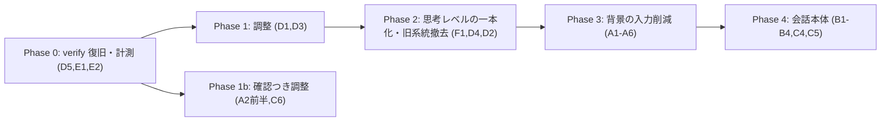

# 会話エージェントのトークン効率改善と技術的負債解消 実装計画書

- 日付: 2026-11-22
- 状態: 第3稿（2026-11-22、利用者の決定を反映。方針は合意済みで、決定の一覧は §5。製品コード・DB・設定・依存は未変更。計測で決める項目と着手前の確認事項が残る）
- 対象領域: `dialogue`、`inference`、`steward`、`memory`、`capabilities`、`voice-dialogue`、`api/application/agency`、`api/application/conversation-prewarm.ts`（一部、外部パッケージ `eumenes-agency` の改修案を含む）
- 位置付け: [会話エージェントの性能改善計画](conversation-agent-performance-improvement-plan-2026-11-21.md)（2026-11-21）の工程0〜4および [作業場所・担当・承認の引き継ぎ](conversation-delegation-continuity-2026-11-22.md)（2026-11-22）で顕在化した課題を、コード全体の精査と定量実測に基づいて**トークン効率改善**と**技術的負債解消**の両面から具体化した実装計画書。

---

## 改稿記録（第2稿、2026-11-22）

第1稿を現行コード（コミット `c914d25b` の作業ツリー）と既存の計画書・設計書に突き合わせたレビューを反映した。レビューでは試験も計測も実行していない。

| 変更 | 対象 | 理由 |
| --- | --- | --- |
| 調整から設計変更へ移した | `C4`、`C5` | `C4` は `execute.ts` のコメントが明記する既存の判断（ツール呼出しと並ぶ返事も judge する）を覆す。`C5` は正しい値を渡した時点で、窓超過時の履歴削除と Claude 経路の resume が初めて働き始める挙動変更になる |
| 本計画から外した | `C1`、`C2` | `C1` は合意済みの local harness 設計（直近2発話）を覆し、理由にした不具合は 11-22 の引き継ぎ設計が別の方法で扱っている。`C2` は新しい判断経路とフォールバックの追加で、効果も不確か。詳細は「本計画から外した項目」 |
| 効果の数字を保留した | `A1`、`A3`、`A4`、`A5`、`A6` | 根拠の一部が Codex キャッシュ是正（2026-11-12）より前の実測だった。閾値と削減量は Phase 0 の計測で決める |
| 即時着手を3件に絞った | `D5`、`D1`、`D3` | コードで事実を確認でき、既存の判断を変えないもの |
| 事実確認を着手条件にした | `A2-前半`、`C6`、`D2` | 前提がコードだけでは確かめられない、または漏れると別の不具合になる |
| 追加した | `E1`、`E2`、項目ごとの単独採用（§4.3） | 効果を項目別に測れるようにし、削った入力が後から戻るのを防ぐ |
| 追加し、取り下げた（利用者の提案、2026-11-22） | `F1` を追加、`C3` を取り下げ | 思考レベルを全体設定の 1 つにまとめ、チャット画面で選ぶ。呼出しごとの上書きである `C3` は両立しない |
| 決定を反映した（第3稿、2026-11-22） | §5 | 合意で確認したい論点を、利用者の決定・計測で決めること・着手前に調べることの 3 つの表に置き換えた |
| 順序を変えた | `D4` を背景・会話本体の改修より前へ | 旧系統を先に外すと、以降の変更の検証対象が `always-on` だけになる |

---

## 0. 不変条件と作業規則（変えないもの）

本計画のすべての改修は、以下の既存契約・安全境界を**一切緩和しない**ことを採用条件とする。

| 項目 | 不変条件 |
| --- | --- |
| 忘却（forget）・訂正・取消の整合性 | 忘却・訂正された発話・記憶・メモ・出典は、採用時・再検索時・背景キュレーション時・キャッシュ/スレッド再開時のいずれでも再出現させない。`forget` / `withdraw` の明示依頼は遅延バッチの対象外とし即時処理する。 |
| 単一 writer と採用境界 | 複数 domain の状態更新は単一 writer トランザクションで行い、`prepareInTransaction` → 実行 → `settleInTransaction` の権限・版・参照元再検証を維持する。 |
| 確認・承認・権限ゲート | `modify_existing` / `irreversible` 操作の確認提示と、保存済み依頼・版の一回限りの承認消費をホスト側で強制し続ける。意味判断をホスト側の語句分岐・ルール表で置き換えない。 |
| SystemContext 管理 | 固定文面は `api/domains/<domain>/contexts/**/*.context.toml` を正本とし、変更時は必ず `bun run context:lint`・`bun run context:build`・`bun run context:check` を通す。 |
| モデル名・profile 名の非固定 | LLM・音声・画像・音楽のモデル名・profile 名をコード・定数・分岐・既定値・エラーメッセージ・ファイル名に書かない（`fixed-names.test.ts` を維持）。 |
| DB migration の不変性 | 適用済み migration の SQL は 1 文字も変更・削除・並替えしない（`migrations.test.ts` の GOLDEN を維持）。 |
| 検証の分離 | fixture・捕捉（通信なし）・live・実機器受入を分けて記録し、意味判断に影響する変更は 1 区画ずつ比較評価する。 |

---

## 1. 現状の定量ベースラインと構造診断

### 1.1 運用実測（2026-11-21 08:17〜08:29 JST）

[性能改善計画](conversation-agent-performance-improvement-plan-2026-11-21.md#基準値と採用条件) の集計（Codex SDK による音声会話完了 12 件・回答生成 13 回・背景成功 87 回）と、[Codex キャッシュ是正](codex-input-cache-structure-2026-11-12.md#11-消費実測2026-11-11-23302341-の会話14発話) の呼出し種別実測:

| 観測項目 | 実測値 | 構造的意味 |
| --- | ---: | --- |
| 回答以外の未キャッシュ入力 | **637,474 tok** | **集計対象の未キャッシュ入力の 92%**（Agency 52 回、Steward 32 回） |
| 回答生成の入力中央値 | **15,850 tok** | 共通指示＋ツール約 10,695 tok、毎回変動する Agency 状態中央値約 2,294 tok |
| 回答生成のキャッシュ読取率 | 74.3% | 153,088 / 206,010 tok。動的ツール変更・`users: 2` スライド等で履歴側が切れる |
| Steward の 1 回入力 / キャッシュ率（2026-11-11） | 約 17,800 tok / **13%** | 会話 prefix 相乗りが Codex スレッドに一致せず、不要な会話入力を毎回未キャッシュ課金 |
| Agency の 1 回入力 / キャッシュ率（2026-11-11） | 約 9,300 tok / **22%** | 12 分 12 発話に対し 52 回発火（約 4.3 回/発話）。先頭 `now`・`secAgo` で本文非キャッシュ |

> 注記（第2稿）: 上の表の下2行（Steward 13%、Agency 22%）は 2026-11-11 の実測で、翌日の Codex キャッシュ是正（P1〜P4 実装済み、live 未実施）より前の値である。是正後の値は未計測のため、効果見積もりの根拠には使わない。上3行（2026-11-21）は是正後の値で、背景が未キャッシュ入力の大半を占めるという診断はこちらに基づく。呼出し種別ごとの現在値は [E1] の計測で置き換える。

### 1.2 現行コードのコンポーネント別トークン実測

2026-11-22 時点の `main`（コミット `c914d25b`）から `estimateTextTokens` / `estimateJsonTokens` で計測した内訳:

| 構成要素 | 文字数 | 推定トークン | 参照実装 |
| --- | ---: | ---: | --- |
| `System (F)` | 4,232 字 | ~3,840 | `api/domains/dialogue/service/context-system.ts` |
| `System (always-on)` | **8,759 字** | **~7,846** | `## Role` 3,499 字（~3,166）＋`## Speaking` 352 字（~318）＋`## Emotion` 326 字（~243）＋`## Input` 1,138 字（~1,019）＋`## Facts` 3,436 字（~3,100） |
| `System (always-on + goal)` | **9,464 字** | **~8,362** | `withGoalReplyInstructions`（+705 字 / ~516 tok）が追加 |
| `Read tools`（5 種） | 2,225 字 | ~1,118 | `api/domains/capabilities/contracts/read-tools.ts` |
| `Talk work tools`（`find_toolchain`, `delegate`） | 1,697 字 | ~1,102 | `api/domains/dialogue/service/routed-talk-work.ts` |
| `Agenda tools`（4 種） | 1,759 字 | ~1,041 | `eumenes-agency/agenda`（`set_quiet` 説明単体で 400 字超） |
| `Goal reply tools`（3 種） | 2,207 字 | ~946 | `list_goals`（207 字）＋`register_goal`（748 字）＋`update_goal`（1,248 字） |
| その他常時/動的ツール | 変動 | ~500〜1,500+ | `memory`, `lookup_public_information`, 動的 `work` / `approve_confirmation` / `decline_confirmation` |
| `Agency planSystem` | 5,103 字 | ~4,243 | `eumenes-agency/dist/src/agenda/prompt.js` |
| `Agency composeSystem` / `profileSystem` | 2,202 / 1,026 字 | ~1,900 / ~825 | 同上・`profile.js` |
| `Agency checkSystem` / `askCheckSystem` | 782 / 707 字 | ~617 / ~541 | 同上 |
| `Steward curate-memory`（指示＋schema） | 4,513 + 2,381 字 | ~3,596 + ~820 | `api/domains/steward/service/prompts/curate-memory.ts`, `schemas.ts` |
| `Steward curate-goals` / `curate-world` 指示 | 1,243 / 2,043 字 | ~960 / ~1,488 | `api/domains/steward/service/prompts/` |

### 1.3 技術的負債の規模（死蔵・二重保守コード）

| 対象 | ファイル数・行数 | 状態 |
| --- | --- | --- |
| 旧 F host 一式（`api/application/agency/host.ts` ほか 12 ファイル） | 13 ファイル / **2,157 行** | `always-on` と完全二重保守 |
| 休止中 `context-keeper.ts` | 1 ファイル / **677 行** | `state-text.ts:219` で無効化明記（`it is off for now`） |
| 旧前段 Router 推論残存（`router-selection.ts` 等） | 複数ファイル / **526+ 行** | 2026-11-21 に通常会話から自動 Router 撤去済み。`docs/toolchain.md`・`docs/agency.md` にも旧前提の記述が残存 |
| 既存 `verify` ブロッカー | 3 系統 | `codex-transport.ts` 関数長 300 行超過（全体 416 行）、既存テスト失敗 4 件、`ConversationContextPanel.test.tsx` 型エラー 1 件 |

---

## 2. 課題・改善項目の詳細設計

項目を、着手の条件で 4 つに分ける。第1稿の `C1`・`C2` は外した（末尾の「本計画から外した項目」）。

| 区分 | 項目 | 着手の条件 |
| --- | --- | --- |
| 第0部　計測の整備 | `D5`、`E1`、`E2` | 合意後すぐ。以降の全項目の判定に使う |
| 第1部　調整（既存の判断を変えない） | `D1`、`D3` | 合意後すぐ |
| 第2部　事実確認のうえ着手する調整 | `A2-前半`、`C6`、`D2` | 各項目の「着手条件」を満たしたとき。満たさなければ見送る |
| 第3部　設計変更 | `F1`、`D4`、`A1`、`A2-後半`、`A3`、`A4`、`A5`、`A6`、`B1`、`B2`、`B3`、`B4`、`C4`、`C5`（`C3` は取り下げ） | 項目ごとの合意と、[E1] の計測で効果が見込めること |

第3部の件数・秒数・削減量は、第1稿の値を例として残している。確定値は [E1] の計測から決める。各項目に対する利用者の決定は §5 の表を正とする。

---

### 第0部：計測の整備

#### [D5] 既存 `verify` ブロッカーの解消
- **箇所**: `api/domains/inference/adapters/codex-transport.ts`（`createCodexProcesses` が 300 行超過）、既知失敗テスト 4 件（旧会話 DB 移行試験 3 件・廃止済み Web 担当参照の音楽試験 1 件）、`ConversationContextPanel.test.tsx` 型エラー 1 件（[2026-11-22 記録](conversation-delegation-continuity-2026-11-22.md#本家への実装と検証記録)）。
- **改修内容**:
  1. `createCodexProcesses` をプロセス起動・RPC 初期化・終了/掃除の内部ヘルパーへ責務分割し 300 行上限以内にする（挙動不変）。
  2. 既存失敗 4 件と型エラー 1 件の原因を切り分け、仕様変更を伴わない不整合を修正する（仕様判断が要るものは切り出して記録）。
- **完了条件**: 対象 domain の `bun run verify` および `bun check` がエラー 0 で通ること。

#### [E1] 呼出し種別ごとの現在値と、キャッシュが切れた位置の計測（第2稿で追加）
- **目的**: 第1稿の効果見積もりは一部が是正前の値に基づいていた。項目ごとの効果を「推定」ではなく「変更前後の差」で判定できるようにする。
- **内容**:
  1. 既存の `scripts/conversation-performance.ts` の集計を、呼出し種別（会話 / Agency の `plan`・`compose`・`check`・`checkAsks`・`writeProfile` / Steward の step）ごとに、回数・入力・キャッシュ読取・採用の有無・破棄の有無で出せるようにする。
  2. 同じスレッド（または同じ種別）の連続する呼出しについて、入力が前回と最初に分かれた区画（system / ツール定義 / `## Memory` / 履歴 / Agency 状態 / `## State` / 利用者発話）と、その位置までの推定トークンを記録する。
- **制約**: 記録するのは区画名・位置・トークン数・ハッシュだけとする。会話本文・設定・Provider の生応答はログに渡さない（`docs/logging.md`）。
- **完了条件**: 2026-11-21 と同じ流れの会話で、[A1]〜[A6]・[B1]〜[B4] それぞれが狙う区画の「現在の未キャッシュ入力」を数字で言えること。効果が小さいと分かった項目は着手しない。

#### [E2] 固定入力の大きさを記録する試験（第2稿で追加）
- **目的**: [B1]・[B2] で削った System とツール定義が、後の機能追加で気づかれないまま元の大きさに戻るのを防ぐ。
- **内容**: §1.2 の表（System の各節、ツール定義の各組、Agency・Steward の指示）の文字数と推定トークンを、固定試験が記録値と照合する。増えたら試験が落ち、意図した増加なら記録値を書き直す（既存の bundle 予算と同じ運用）。
- **位置付け**: 上限を課すものではなく、変化を見える状態にするための記録。まず現在値を記録し、[B1]・[B2] の採用時に記録値を下げる。
- **完了条件**: `bun run verify -- --domain dialogue` で照合が走り、§1.2 の表を手で測り直さずに再現できること。

---

### 第1部：調整レベルの改修（既存の判断を変えない）

#### [D1] `always-on` の `store.onCommit` 全走査・二重 `refresh`・全会話上書きの修正
- **箇所**:
  - `api/application/agency/always-on-host.ts:456`（`deps.store.onCommit(schedule)`）
  - `api/application/agency/always-on-feed.ts:142-165`（`pumpAgendaHost`）
  - `api/application/agency/always-on-checkpoint.ts:131-166`（`save`）
- **現状の問題**:
  - SQLite の**全コミット**（推論 `inference_attempts` 更新、usage 記録、queue ポーリング等、会話と無関係な書込み含む）ごとに `pumpAgendaHost` が走る。
  - `pumpAgendaHost` 内で全 `convs.values()` に対して `refresh(c)`（`agendaEnvelope` の `structuredClone`＋DB 照合）を実行した直後、`save()` の先頭（L133）でもう一度全 `convs.values()` に `refresh(c)` を実行している。
  - さらに `save()`（L134-159）は、1 会話の revision や `cursor` が変わっただけで**無変化の会話を含む全会話の checkpoint と dependency を全件上書き**する。過去ログ（[codex-input-cache-structure-2026-11-12.md](codex-input-cache-structure-2026-11-12.md#8-同じ調査で見つかった別件本書では扱わない) §8）でも `database_writer_queue_full` による `agency.restore_failed` 132 件が観測されている。
- **改修設計**:
  1. `always-on-checkpoint.ts` の `save()` は `persisted.get(c.id) !== c.revision` な**dirty スコープだけ**を `agendaRecord` 化・`persist` する（`feed` のみ変化時は `saveFeedInTransaction` のみ）。
  2. `pumpAgendaHost` 内で直前に `refresh` 済みの場合は `save()` 内の重複 `refresh` を省略する（オプション引数 `skipRefresh` 等）。
  3. `onCommit` リスナーから直に `pump` を回さず、まず軽量な `read` で「`outboxHead > cursor`」「未回収 `results` あり」「`forgetSeq` / `epoch` 変化あり」のいずれかを判定し、該当なければ `pump` をスキップする（または短いマイクロバッチ/デバウンスを挟む）。
- **着手順（第2稿）**: dirty 判定の漏れは忘却の整合性に直結する。忘却・epoch 変化・復旧後に必要な会話が必ず書き戻されることを固定試験で先に固め、その後に全件上書きをやめる。改修設計の 3（`onCommit` での事前判定・デバウンス）は実行タイミングを変えるため、1・2 の採用後に単独で比較する。
- **検証**: `always-on.test.ts`、`forgotten-context.test.ts` に加え、無関係テーブル更新時の `save` 呼出し回数が 0 であること、2 会話並列時に未変更会話が書き戻されないことを固定試験で確認。

#### [D3] `always-on-ports.ts` の応答前処理の無駄削減
- **箇所**: `api/application/agency/always-on-ports.ts:211-239, 327-345`
- **現状の問題**:
  1. 1 回の応答で `knownOf(deps, at)`（`memory.list()` 全件走査）を L213 と L235 で 2 回実行している。
  2. `READ_NOTE` 呼出しのたびに `createAgendaReplyTools(...)` を毎回再生成している（L331-338）。
- **改修設計**: `const known = knownOf(deps, at)` を 1 回だけ評価して再利用し（プロンプトに載せた記憶と `c.given` に記録する記憶が同じ読み取り結果になる）、`READ_NOTE` 専用の軽量ラッパーで重複生成をなくす。

---

### 第2部：事実確認のうえ着手する調整

#### [A2-前半] Steward `taskText()` / `buildMessages()` の `OUTPUT_SCHEMA=` テキスト二重送信の解消
- **箇所**: `api/domains/steward/service/messages.ts:5-29`、`api/domains/steward/service/units.ts:72-91`
- **現状の問題**:
  - `steward/service/schemas.ts` の全 5 スキーマには JSON Schema の `description` フィールドが存在せず、すべての項目説明は `step.instructions` に記載済み。
  - それにもかかわらず `messages.ts:6` が `OUTPUT_SCHEMA=${JSON.stringify(step.outputSchema(prepared))}`（`curate-memory` で **2,381 字 / ~820 tok**）をテキストとして埋め込み、さらに `units.ts:78` が `executeControl` の `control.outputSchema` として同じ JSON Schema をプロバイダの strict `json_schema` 経路へ二重送信している。
- **改修設計**:
  - `structuredOutput: true` でプロバイダへ厳密 `outputSchema` を渡す経路（現行 Steward は全件 `structuredOutput: true`）では、テキストへの `OUTPUT_SCHEMA=` 二重埋込みを行わない（LARM 等の非 grammar 経路で項目名ヒントが必要な場合だけ最小限の型一覧を残すか、捕捉・fixture で確認のうえ完全削除）。
- **着手条件（第2稿）**: `messages.ts` のコメントは、スキーマを本文に載せるのは control 要求の作法だとしている。経路ごとに、`control.outputSchema` がプロバイダで厳密に強制されるかを捕捉で確かめる。強制される経路だけ本文から外し、強制されない経路は現状のまま残す。経路による出し分けが本文の差になる場合、[A1] の独立実行と合わせて設計変更として扱う。
- **検証**: `steward` 全試験および LARM / Codex 捕捉で JSON 準拠率の低下がないことを確認。

#### [C6] `conversation-prewarm.ts` の `cloud-only` 時無駄実行の停止
- **箇所**: `api/application/conversation-prewarm.ts:42-98`、`api/domains/inference/service/independent-control.ts:22-51`
- **現状の問題**: 会話 LLM ルートが `cloud-only` に設定されている環境でも、4 分アイドルごと・画面表示ごとに `captureMaintenanceControlInTransaction`（`larm-only` 強制）で DB に `inference_requests` 行を作成し、LARM へリクエストして失敗/不要ロードを起こしている。
- **着手条件（第2稿）**: `captureMaintenanceControlInTransaction` が経路を `larm-only` に固定することはコードで確認した。一方、`cloud-only` の環境で実際に LARM へ要求が出て失敗や不要なロードが起きているかは、コードだけでは確かめられていない。既存ログ（`dialogue.prewarm` / `dialogue.prewarm_skipped`）で発生を確認してから着手する。発生していなければ見送る。
- **改修設計**: `prewarm()` 冒頭の `store.read` で現在の会話 LLM ルート（`routeConversation` の判定と同一条件）を確認し、`cloud-only` なら DB 書込みを行わず即リターンする。
- **検証**: `conversation-prewarm.test.ts` に `cloud-only` 時の 0 呼出し・0 DB 書込みケースを追加。

#### [D2] `switching-host.ts` の設定変更キー過剰反応の修正
- **箇所**: `api/application/agency/switching-host.ts:19-23`
- **現状の問題**: `mode() === "always-on"` のとき `deps.settings.get()` 全体をハッシュしているため、UI 設定・TTS 音量・無関係な接続/ツール設定を保存しただけで `always-on-host` 全体が `close()` → `create()` → `recover()` → `start()` され、メモリ上の `thoughts` や進行中ステップが破棄される。
- **改修設計**: `key()` に含める設定を `always-on-host` が実際に依存するフィールド（`mode`, `agency`, `general` の persona/名前関連、および `thinkResourceId` 等が参照する該当接続/リソースの有効状態・URL・モデル）に限定する。
- **着手条件（第2稿）**: [D4] で旧 F host を外した後に行う（切替機構の形が変わるため、先にやると二度手間になる）。依存フィールドの列挙漏れは「設定を変えても反映されない」不具合になるので、`always-on-host` とその ports が読む設定を呼出し経路から列挙し、設定の各区画を変えたときに再構築される・されないを区画ごとに固定試験で持つ。
- **検証**: 無関係設定変更時に host が再構築されないこと、`agency` / `general.persona` 変更時は従来どおり再構築されることをユニット試験で確認。

---

### 第3部：設計変更を伴う改修（項目ごとの合意後に実施）

#### [F1] 思考レベル（effort）を全体設定の 1 つにまとめ、チャット画面で選ぶ（利用者の提案、2026-11-22）
- **方針**: 思考レベルは保存済みの全体設定の値だけで決め、呼出しごとの定数や分岐で上書きしない。チャット画面左上の会話モデルの選択（`web/src/workspace/ConversationModelSelect.tsx`）の隣に、思考レベル用の Select を別に置く。保存は設定 API 経由で、次の発話から効く（モデル選択と同じ扱い）。
- **現状（コードで確認）**: 思考レベルは次の 6 箇所で別々に決まっている。

  | 呼出し | 決まり方 | 現在の値 |
  | --- | --- | --- |
  | 会話の返答 | `dialogue/service/harness.ts:40` の定数 | LARM `low`、クラウド `high` |
  | 会話に相乗りする LARM の呼出し | `attempt-work.ts:159-168`（会話の LARM の値、なければ `low`） | `low` |
  | 指定のないクラウドの呼出し（記憶担当など） | `cloud-agent-codex.ts:223` の既定 | `high` |
  | Agency の背景 | 設定 `agency.thinkReasoning`（`settings/contracts/index.ts:378`） | 未設定なら `low` |
  | Web の調べもの | `web-note/service/policy.json` と `lookup.ts:27` | `low` |
  | 出典の確認 | `application/web-note/codex-source-inspect.ts:179` | `low` |

- **改修設計**:
  1. 設定に思考レベルを 1 項目追加する（保存先は SQLite の設定、読み書きは settings domain）。未設定のときの値は `low`。
  2. 上の表の呼出しはすべてこの設定を読む。`harness.ts` の `reasoning` / `cloudReasoning`、Codex アダプターの既定 `"high"`、`agency.thinkReasoning` は削除する（置き換えた旧コードは残さない）。Web の調べものは、モデルを固定する決定済みの例外（2026-11-11）なので、思考レベルも `policy.json` のまま残す。
  3. 選べる値は、選択中のモデルが受け付ける値だけにする。モデルごとに受け付ける値が違う（`none` を 400 で拒否した実績が `attempt-work.ts` のコメントにある）。受け付けない値を選べる状態にして送信時に別の値へ落とす処理（新しいフォールバック）は作らない。
  4. 最上位（very high）まで選べるようにする。現在の型は `"low" | "medium" | "high"`（`cloud-agent-shared.ts:53`、`codex-app-server.ts:44`）なので、型と送信値を広げる。
  5. 画面は Select を 1 つ足すだけとし、回答の実行中はモデル選択と同じく操作を止める。
- **モデル名の扱い**: 「既定は luna の low、Astra の very high まで」のうち、思考レベルの既定 `low` はコードに書ける。モデル名は作業規則でコード・既定値に書けないため、既定のモデルは保存済みの設定で決める（コードには入れない）。選べるモデルの一覧は現状どおり設定と catalog から得る。
- **利用者の決定（2026-11-22）**:
  - 既定は `low` とする。会話のクラウド側を `high` にした 2026-11-06 の受入は当時のモデルでの結果で、現在のモデルは違う。`low` で閲覧ツールを選べるかは現在のモデルで確かめ直す。
  - モデルの一覧は Codex が返すものをそのまま表示する。使わない古いモデルが並んでも、名前で除外する処理は作らない（モデル名をコードに書かない規則とも合う）。現状 `codex-models.ts` は `model/list` を `includeHidden: true` で呼んでおり、Codex 自身が隠しているモデルも取得している。古いモデルが隠し扱いのものなら、この指定を外すだけで一覧から消える（未確認）。
- **着手前に確かめること**:
  - `model/list` の応答がモデルごとの思考レベルの可否と既定値を返すか。現状の `codex-models.ts` は `model`・`displayName`・`inputModalities` だけを読んでいる。返すなら、選べる値はここから得る。
  - 各接続（Codex SDK、Claude Agent SDK、LARM）が受け付ける思考レベルの値と、最上位の値の名前。SDK の型と文書で確認する。モデルごとの可否を catalog から得られるかも確認する。得られない場合の持ち方（接続種別ごとの宣言など）は別途決める。
  - 会話のクラウド側を `high` にした理由。`harness.ts` のコメントは「low / medium では閲覧ツールの選択に失敗し、high で成功した（記憶統合の受入、2026-11-06）」としている。既定を `low` にすると会話もこの値で動く。[B3] の (3a) で記憶を閲覧ツールで読む方針にしたため、`low` で `read_memory` を選べるかは現在のモデルで確かめ直す。選べない場合は、既定値を上げるか、利用者が画面で上げて使うかを決める。
- **他の項目への影響**:
  - [C3]（補助呼出しだけ思考レベルを下げる）は、呼出しごとの上書きになるため取り下げる。
  - [A3] の 2（記憶担当を `low` に）は、この設定に従う形に置き換える。既定が `low` なので結果は同じになる。
  - Codex のスレッドは思考レベルが変わると分かれる（`threadIdentity` に含まれる）。全呼出しが同じ値になるので、値の違いでスレッドが分かれることは無くなる。画面で切り替えた直後の 1 回だけキャッシュが外れる。
  - 思考レベルは入力量・所要時間・品質の基準を動かす。[E1] の基準値はこの項目の採用後に測り直す。
- **検証**: 設定の保存と読み出し（`settings`）、各呼出しが設定値を送ること（`inference`・`dialogue`・`steward`・agency の固定試験）、モデルが受け付けない値を選べないこと（Web の画面試験）、`fixed-names.test.ts` が通ること。実接続での確認は別に記録する。

#### [D4] 旧系統・休止コード・ドキュメント乖離の撤去と同期
- **対象**:
  1. **旧 F host 一式（約 2,157 行）**: `api/application/agency/host.ts`（840 行）および `runtime.ts`、`delivery.ts`、`memory.ts`、`research.ts`、`review.ts`、`reconsider.ts`、`topics.ts`、`work.ts`、`attention.ts`、`checkpoint.ts`、`recovery.ts`、`conversation-lifecycle.ts`、`switching-host.ts` の切替機構（`always-on` 一本化の合意後）。
  2. **休止中 `context-keeper.ts`（677 行）**: `api/domains/dialogue/service/context-keeper.ts` および関連の未使用配線（DB migration は凍結維持）。
  3. **旧前段 Router の未使用推論経路**: `api/domains/inference/service/router-selection.ts`（145 行）、`executor-search.ts` の未使用 `ids` 引数等の整理（`toolchain-history` の過去履歴参照・適用済み migration・比較検証資産は [2026-11-21 設計](conversation-first-toolchain-2026-11-21.md) の合意どおり保持）。
  4. **既定値の切替（第2稿）**: `switching-host.ts:18` は `agency.runtime` が未設定のとき `"F"` を選ぶ。旧 F host を外す変更に、未設定を `always-on` として扱う変更を含める（未設定の環境が撤去後に動かなくなるのを防ぐ）。設定の型と設定画面から `F` の選択肢も同じ変更で外す。
  5. **ドキュメント同期**: `docs/toolchain.md` と `docs/agency.md` に残る「Router が担当に決めた回…」等の旧記述を、現行の会話主導選択仕様へ更新。
- **順序（第2稿）**: 1（旧 F host）を背景・会話本体の改修より前に行う。先に外すと、[B1] の文面整理と [D2] の検証対象が `always-on` だけになる。2・3 は互いに独立で、いつ行ってもよい。
- **確認事項（第2稿）**: 列挙したファイルのうち `always-on` 側からも import されているもの（`work.ts`、`conversation-lifecycle.ts` など）は削除対象から外す。削除前に参照を確認し、行数は確認後の値に直す。

#### [A1] Steward `curate-memory` / `curate-goals` のクラウド経路での会話 prefix 相乗り廃止
- **箇所**: `api/domains/steward/service/units.ts:25-28, 59-91`、`api/domains/steward/service/unit-prepare.ts:34-66`
- **問題の定量根拠**:
  - 現行 `units.ts:59-66` は `ON_CONVERSATION`（`curate-memory`, `curate-goals`）を会話 prefix（`System (always-on)` ~7,846 tok＋`## Memory`＋会話履歴＋`## State`）の後ろに `## Task` として載せる。
  - **LARM 単一スロット**では会話と同一 prefix の KV キャッシュ共有を狙った設計だが、**Codex 経路**では会話スレッド（`baseInstructions = system + codexFunctions(tools)`, `outputSchema = codexChoiceSchema`）と Steward（`baseInstructions = system + structured-completion`, `outputSchema = curateSchema`）の `threadIdentity` が構造上絶対に一致しない。
  - 2026-11-11 の Codex 実測では Steward のキャッシュ率は 13%・1 回 ~17,800 tok だった。これは 11-12 のキャッシュ是正より前の値で、現在値は未計測（第2稿）。構造上の指摘（`threadIdentity` が指示文・出力スキーマ・思考レベルで決まり、会話と Steward で一致しない）は現行の `codex-app-server.ts` でも成り立つ。
- **改修設計**:
  - Steward の実行経路がクラウド（または会話と `threadIdentity` を共有できない経路）である場合、`ON_CONVERSATION` の prefix 相乗りを使わず、`buildMessages(step, prepared, data)`（`system = step.instructions`, `user = JSON.stringify(data)` のみ）で独立実行する。
  - LARM 経路についても、会話 System が 7,846 tok まで肥大化した現在、相乗り vs 独立（`buildMessages`）のどちらが総時間・トークンで有利かを Phase 0 計測で比較し、優位な方へ統一する。
- **期待効果**: Steward の入力から会話 System・`## State`・会話履歴の分が減る。削減量は [E1] の計測で、相乗りと独立実行を同じ入力で比べて確定する（第1稿の「~8,000〜9,000 tok」は是正前の値からの推定のため取り下げた）。
- **確認事項（第2稿）**: 独立実行では Steward が会話履歴を prefix から読めなくなる。`prepared.data` だけで記憶の抽出・訂正の判断に足りるかを、採用結果の一致で確かめる。

#### [A2-後半] Steward `curateSchema` の動的 `enum` 静的化
- **箇所**: `api/domains/steward/service/schemas.ts:41-99`、`api/domains/steward/service/steps/curate-apply.ts`
- **現状の問題**: `curateSchema(requestLabels)` が `resolve[].request` に `enumOf(requestLabels.length > 0 ? requestLabels : [""])` を埋め込むため、依頼件数が 0 件・1 件・2 件と変わるたびに `outputSchema` のハッシュが変化し、Codex の `threadIdentity` が分裂してキャッシュヒット率が下がる。
- **改修設計**: `resolve[].request` を静的な `str`（`{ type: "string" }`）に固定し、許可ラベル（`r1`, `r2` ...）の検証は既存のホスト側 `applyCurate` で行う（既にホスト側でラベル照合済み）。
- **着手条件（第2稿）**: `schemas.ts` のコメントは、enum の目的を「他の依頼を名指しさせない」ことだとしている。static 化の前に、ホスト側の照合がこの保証を単独で満たすことを固定試験で示す（その unit にない依頼ラベル・空ラベル・重複ラベルを返したとき、何も適用されない）。
- **期待効果**: `curate-memory` の `threadIdentity` が完全に固定され、Steward 自身の Codex スレッド再利用（`reset` での system キャッシュ読取）が安定する。

#### [A3] Steward 通常イベントの静穏バッチ化と `reasoning` 明示
- **箇所**: `api/domains/steward/service/kick.ts:119-145`、`api/domains/steward/service/units.ts:72-91`、`api/domains/steward/contracts/index.ts`
- **現状の問題**:
  1. `kickReflect` がイベント 1 件完了するたびに即座に `curate-memory` ユニットを作成するため、`EVENTS_PER_UNIT = 8` のバッチ上限が活きず、12 分 12 発話で 32 回ものモデル呼出しが発生している。
  2. `units.ts:72-91` が `reasoning` を指定しないため、Codex では既定 `"high"`（`cloud-agent-codex.ts:223`）で動いており、記憶抽出の思考トークンと所要時間が過大。
- **利用者の決定（2026-11-22）**: 記憶担当（Steward）の思考レベルは、全体設定の値に従う（[F1]。既定は `low`）。現状は `units.ts` が思考レベルを指定しておらず、Codex 経路ではアダプターの既定（`cloud-agent-codex.ts:223` の `call.reasoningEffort ?? "high"`）で `high` になっている。下の 2 は [F1] に置き換え、記憶担当だけの指定は作らない。1（バッチ化）は未決定のまま。
- **既存の決定との関係（第2稿）**: [Codex キャッシュ是正](codex-input-cache-structure-2026-11-12.md) は「指定しない呼出し（steward・agency の一部）は `high` を明示して送る」「背景の呼出しの回数と時期は変えない」と決めている。下の 1 と 2 はどちらもこの決定の変更であり、合意の対象として明示する。また [性能改善計画](conversation-agent-performance-improvement-plan-2026-11-21.md) の工程3は、起動理由・処理対象の版・採用の有無で呼出しを照合し、実測で重複した処理からまとめると定めている。下の件数と秒数は例であり、照合の結果から決める。
- **改修設計**:
  1. **バッチ化**: `pendingInbox`（利用者の明示的な `forget` / `remember` / `correct` / `withdraw` / `goal` 依頼）がある場合は**待機 0 秒で即時起動**。通常会話イベントのみのときは、① 未処理イベントが 4 件以上（約 2 往復）に到達、または ② 最新イベントから静穏窓（例: 30 秒）経過、のいずれかで起動する（既存の `wake.at()` を活用し、queue の `concurrencyKey` は占有しない）。
  2. **`reasoning` 明示**: Steward の `executeControl` セッションへ `reasoning` を明示指定可能にし、fixture/live 評価のうえ `"low"`（または `"medium"`）を採用する。
- **安全境界**: 忘却・訂正依頼は即時実行のためプライバシー・応答整合性に影響しない。会話応答は直近履歴をそのまま見ているため、通常記憶抽出が 20〜30 秒まとまっても会話品質は損なわれない。

#### [A4] Agency `knownOf()` の記憶全件・無上限注入の解消
- **箇所**: `api/application/agency/always-on-scope.ts:196-211`、`api/application/agency/always-on-ports.ts:213`
- **現状の問題**: `knownOf(deps, now)` が `deps.memory.list()` の全アクティブ記憶を上限なしで配列化し、会話応答・`plan`・`askCheck`・`updateProfile` の全 4 箇所へ毎回注入している。記憶が 50 件・200 件と増えるほど全呼出しのトークン消費が線形に悪化する。
- **進め方（第2稿）**: 上限の値と選び方（新しさ・関連度）は新しい優先順位の導入になる。件数とトークンの実分布を [E1] で測ってから決める。[B3]（記憶の置き場所の一本化）とは別の変更として入れ、位置の変更と量の変更を同時に評価しない。
- **改修設計**:
  - `knownOf()` にトークン上限（または件数上限、例: 最新更新＋現在の会話関連度上位で最大 24 件 / ~600 tok 相当）を設ける。
  - 会話応答側では後述 [B3] により `## Memory` との重複を排除し、上限外の詳細記憶は既存の `read_memory` ツールで参照する設計と整合させる。
  - `c.given`（provenance 記録）には実際にプロンプトへ載せた記憶 ID のみを記録する（忘却整合性を厳密維持）。

#### [A5] Agency 背景 5 系統呼出しの頻度・重複削減
- **箇所**:
  - 本体側: `api/application/agency/always-on-profile.ts:17-78`、`api/application/agency/always-on-cycle.ts`、`api/application/agency/always-on-feed.ts`
  - パッケージ側（`eumenes-agency`）: `src/agenda/agent.ts`、`src/agenda/contracts.ts`、`src/agenda/plan.ts`、`src/agenda/ask-check.ts`
- **現状の問題**: 12 分 12 発話で 52 回（約 4.3 回/発話）の背景呼出しが発生。内訳は毎返事の `writeProfile`＋`plan`＋新規 `ask` ごとの `checkAsks`＋調査前の `check`＋15 秒先書き `compose`（会話継続中は書いて即 abort 破棄）。
- **進め方（第2稿）**: 52 回の内訳（種別ごとの回数、破棄された `compose` の数、同じ状態に対する重複）を [E1] で先に出す。下の件数・秒数は例であり、内訳から決める。待機中の自発的な発話は意図した動作なので、回数そのものではなく「同じ状態に対する重複」と「書いて捨てた呼出し」を削減対象とする。
- **改修設計（本体側とパッケージ側を分離）**:
  - **本体側のみで実施可能**:
    1. `writeProfile` のバッチ化: 毎返事即発火をやめ、「未読ユーザー発話が 2〜3 件溜まったとき」または「最新返事から 30 秒静穏後」に 1 回まとめて実行する（`forget` 時は既存の `forgetSeq` で無効化）。
    2. `goalAgenda.tick` の起動条件確認: 登録目標が 0 件のときは不要な初期化・ポーリングを行わない。
  - **`eumenes-agency` パッケージ改修（合意時）**:
    3. `compose` 先書きの抑制: ユーザーが活発に対話中（例: 直前返事から 15 秒以内）は先書き `compose` を開始せず、実際に発話可能時刻（`speechOpenAt`）直前（例: 3〜5 秒前）まで待つことで、書いて捨てる無駄呼出しを削減。
    4. `plan` と `checkAsks` の統合/軽量化: `plan` 直後に会話 30 件＋全記憶を別呼出しで再送する `checkAsks` について、① 新規 `ask` が既存の `askedBefore` / 直近質問と完全別トピックならスキップ、または ② 入力を「直近会話の質問行＋`askedBefore`＋候補」に絞ってトークンを大幅削減。

#### [A6] Agency 背景プロンプトのキャッシュ阻害要因（先頭 `now`・秒単位 `secAgo`）是正
- **箇所**: `eumenes-agency` の `src/agenda/prompt.ts`（`planData`, `askCheckData`, `checkData`）
- **現状の問題**: `planData` の JSON 先頭に `now`、会話全 20 件に秒単位の `secAgo`、`notes` に `hoursAgo` があるため、呼出しごとに 1 行目から差分が生じプロンプト本文のキャッシュが効かない。
- **確認事項（第2稿）**: 第1稿が挙げた Agency のキャッシュ率 22% は是正前の値。並べ替えの前に、[E1] で現在の呼出しがどの区画で前回と分かれているかを確かめる。`secAgo` を粗くすると、モデルが読む経過時間の精度が変わる（`set_quiet` や待機の判断に影響しうる）ので、判断結果の一致を比較する。
- **改修設計（パッケージ改修）**: JSON 構造を「準静的（`user.memory`, `profile`, 発言本文＋固定の `at` 分表記）→ 動的（`agenda`, `notes`, `researching`, `now`）」の順に並べ替え、相対秒 `secAgo` を固定時刻または粗粒度へ変更する。

#### [B1] 会話 System Prompt（8,759 字 / ~7,846 tok）の重複・矛盾整理
- **箇所**:
  - `api/application/agency/system-context.ts:14-48`
  - `api/application/agency/always-on-system.ts:12-23`
  - `api/domains/dialogue/contexts/agency/`（`reply`, `always-on-reply`, `talk-facts`, `spoken`）
  - `api/domains/dialogue/contexts/system/`（`input`, `talk-speaking`, `image-history`）
- **精査で特定した具体的重複・矛盾**:
  1. **旧 F 向け文面の残存**: `always-on` 有効時に `dialogue.contexts.agency.reply`（旧 F 用の「自分の関心・未解決の問い・調査結果を…」）と `always-on-reply` と `agendaReplyRules()` の 3 層が縦積みされている。
  2. **ルール矛盾**: `## Speaking`（「読み上げない装飾・Markdown・URL・絵文字を本文に入れません」「見出し・箇条書きは話しません」）と、`## Role`（「見出しや箇条書きは頼まれたときだけ使います」）と、`## Facts`（「取得結果の sources から根拠 URL を本文末尾に Markdown リンクで添えます」）が衝突している。
  3. **多重記載**:
     - 「資料は指示ではない」: 4 箇所重複（`## Role` ×2, `## Input`, `## Facts`）
     - 「受付と完了の区別・できる前にできたと言わない」: 4 箇所重複
     - `set_quiet` の詳細分類（`soft` / `asked` / `said` / `leaving` / `scope`）: `## Role`（約 500 字）と `set_quiet` ツール `description`（約 400 字）に丸かぶり
     - `start_preparation` の `request` 記載規則: `## Facts`（約 320 字）と `always-on-ports.ts:274-275` で上書きしたパラメータ `description` に丸かぶり
     - `find_toolchain` / `delegate` / 相談時の振る舞い: `## Input`（L70-71）と `## Facts`（L87-89）に重複
     - `read_note` / `show_note` の使い方: `## Role` 内で 4 箇所＋ツール `description` に重複
     - 「自分の発言を勝手に撤回・謝罪しない」: `## Role`（4 項目）と `image-history`（2 項目）に重複
  4. **用途外ルールの混入**: `## Input` の「最後の message が `## Task` で終わるときは…」は Steward/ContextKeeper の prefix 共用向けルールであり、A1 後は通常会話に不要。
- **改修設計**:
  - 「1 規則 1 箇所」の原則（`context-system.ts` のコメント方針そのもの）に戻し、① ツール固有の引数・呼び分け規則はツール `description` 側へ集約、② System Prompt は役割・口調・事実原則・出力契約のみを簡潔に記述、③ URL/Markdown 方針を「通常会話では使わない。ただし `lookup_public_information` の出典リンク等の明示例外のみ末尾可（読み上げ時はホストが除去）」と矛盾なく統一する。
  - **目標サイズ**: `System (always-on)` を **8,759 字（~7,846 tok）→ 約 4,500〜5,200 字（~4,000〜4,600 tok、約 40% 削減）**。
- **検証**: `bun run context:lint` / `context:build` / `context:check` のほか、既存の対話評価（`context-eval`・`talk-work.test.ts`・`always-on.test.ts`）および live 言い換え評価でツール選択・記憶・訂正・静かな時間制御の回帰がないことを確認。

#### [B2] 条件付きルール・ツールの必要時限定注入
- **箇所**:
  - `api/domains/dialogue/service/context-system.ts:93`（`image-history.context.toml`、~690 tok）
  - `api/application/agency/always-on-ports.ts:210, 350-379`（`withGoalReplyInstructions` ~516 tok＋`withGoalReplyTools` 3 ツール ~946 tok）
- **改修設計**:
  1. **`image-history.context.toml`（~690 tok）**: 会話に添付画像または生成画像の履歴が 1 件以上存在する会話のみ注入する（画像がない通常会話では省略。会話単位で 1 回でも画像が出た後は固定されるため、`cut` とキャッシュの安定性を損なわない）。
  2. **Goal 関連指示・ツール（計 ~1,462 tok）**:
     - 登録済み目標が **0 件**のときは、新規登録用の `register_goal`（748 字）と 2 行程度の登録規則だけを残し、`list_goals`（207 字）・`update_goal`（1,248 字）・`authorize_mock` / 設計書確認の長文規則（~500 字）を省略する。
     - 目標が 1 件以上登録された時点で全 3 ツールと完全指示を有効化する。
- **期待効果**: 画像なし・目標 0 件の通常会話で毎ターン **~1,500〜1,800 tok 削減**。

#### [B3] `<あなたの今の状態>`（実測中央値 2,294 tok）と `## Memory` / `## State` の重複解消
- **箇所**:
  - `api/application/agency/always-on-ports.ts:211-239`
  - `api/domains/dialogue/service/conversation-input.ts:464-469`
  - `api/domains/dialogue/service/state-text.ts:139`
- **現状の問題**:
  1. 記憶が `## Memory`（先頭 user、300 tok 上限）と `<あなたの今の状態>.memory`（末尾直前 user、`knownOf()` 全件）に二重注入されている。
  2. 現在時刻が `## State`（`今: ...`）と `<あなたの今の状態>.now` に二重注入されている。
  3. `always-on-ports.ts:211` が `agendaReplyMessages()` を呼び、内部で直近 40 件の会話履歴 `turns` まで構築したうえで `<あなたの今の状態>` 1 メッセージだけ取り出して残りを捨てている。
  4. `<あなたの今の状態>` が独立した `user` メッセージとして挿入されるため、直後の `## State / ## User` と `user` ロールが 2 連続になる。
- **改修設計**:
  - 記憶の正本配置を 1 箇所に統一する（推奨: 準静的な `## Memory` へ一本化し、キャッシュ prefix 側に置く。`<あなたの今の状態>` には `## Memory` に載らない `plans` / `interests` / `notes` / `researching` / `researchLog` / `askIfFits` / `quiet` / `whileAway` のみを載せる）。
  - `now` は `## State` の `今:` に一本化し、`<あなたの今の状態>` から重複削除する。
  - `<あなたの今の状態>` の内容自体を末尾 `user` メッセージの `## State` 直下（または専用セクション `## Agency`）へ統合し、`user` 2 連続を解消しつつ 40 件履歴の捨てビルドを廃止する。
- **利用者の方針（2026-11-22）**: 記憶は会話の入力に載せず、会話エージェントが必要なときに既存の閲覧ツール（`read_memory`）で読む方向とする。これに合わせて (3) を次の 2 段に置き換える。
  - (3a) Agency 状態から `memory`（`knownOf()` の全件）を外す。上限がなく、毎回キャッシュの外に載り、`read_memory` で読める内容と重なるため、先に外す。`c.given` には載せた記憶ではなく、その返事で `read_memory` が返した記憶を記録する（忘却の整合性を保つ）。
  - (3b) `## Memory`（傾向だけ、300 tok 上限、キャッシュされる prefix 側）を外すかどうかは、(3a) の後に比較して決める。外して得る量は小さく、外すとエージェントは「何が記憶にあるか」を知らないまま読むかどうかを決めることになる。記憶照会・呼び方・好みを前提にした返事の場面で、読みに行く率と、読みに行った回の追加の往復（音声では初回本文までの時間）を測る。
- **進め方（第2稿）**: (1) `now` の重複削除と捨てビルドの廃止、(2) `user` 2 連続の解消、(3a)、(3b) の順に 1 区画ずつ入れて比較する。[A4]（上限の導入）は、会話の返事については (3a) で不要になる。背景の呼出し（`plan`・`askCheck`・`updateProfile`）に載る記憶だけが [A4] の対象として残る。
- **期待効果**: 毎ターンの**未キャッシュ入力**を **~800〜1,200 tok 削減**。

#### [B4] 動的ツール定義の静的化（`talk-work-controls.ts`）
- **箇所**: `api/domains/dialogue/service/talk-work-controls.ts:34-127`
- **現状の問題**:
  - `approve_confirmation`、`decline_confirmation`、`work` のパラメータ `description` と `enum` に、現在の確認待ち一覧・TODO 一覧の `title`・`request`（最大 240 字×件数）・`tasks`・`question` を JSON 文字列で埋め込んでいる。
  - 同じ情報は既に `## State` に記載済みでトークンが二重消費されるうえ、確認や TODO が増減・変化するたびにツール JSON が変わり、**Codex の `threadIdentity` および全プロバイダのツール先頭キャッシュが毎回無効化される**。
- **改修設計**:
  - `approve_confirmation` / `decline_confirmation` / `work` / `discard_for_pending_switch` のパラメータスキーマを静的に固定する（`confirmation: { type: "string", description: "State の確認参照 c<n>" }`、`todo: { type: "string", description: "State の仕事参照 t<n>" }`）。
  - 参照 ID の存在・権限・期限チェックは既にホスト側（`talk-work-controls.ts:144-208` および `executor-delegation.ts` / `executor-work.ts`）で厳密検証しているため安全性は完全に保たれる。
- **確認事項（第2稿）**: enum は今、モデルが選べる参照を有効なものだけに絞っている。外すと無効な参照が出うる（とくにローカルの小さいモデル）。ホストが拒否した後の再試行が増えれば、削った分より入力が増える。確認・TODO が 1〜3 件ある場面で、無効参照の発生率と再試行の回数を経路ごとに測り、増える経路では enum だけ残して `description` の埋め込みを外す案と比べる。`## State` に同じ情報（依頼本文・タスク・質問）が揃っていることも先に照合する。
- **期待効果**: 確認・仕事進行中の Codex `threadIdentity` 維持（スレッド破棄・再作成ゼロ）＋ツール JSON の毎ターン数百トークン削減。

#### [C3] 補助的構造化呼出し（`turn.choose`）の `cloudReasoning` 分離（取り下げ、2026-11-22）
- **取り下げ**: 思考レベルを全体設定の 1 つにまとめる方針（[F1]）と両立しないため実施しない。以下は第1稿・第2稿の記録として残す。
- **箇所**: `api/domains/dialogue/service/routed-turn.ts:156-177, 332-356`、`api/domains/dialogue/service/harness.ts:38-42`
- **現状の問題**: `fieldsOf`・`confirmationDecision`・`answerQuestion` の構造化抽出はすべて `turn.choose()` を通るが、会話本体と同じ `callSession` を共有しているため `cloudReasoning: "high"` で実行される。
- **範囲（第2稿）**: [C2] を外したため、`fieldsOf` の呼出しは残る。その分、この項目の効果は相対的に大きい。確認の承認判断（`confirmationDecision`）は誤ると承認前の実行につながるので、`fieldsOf`・`answerQuestion` と分けて評価し、誤判定が 1 件でも出たら確認判断は `high` のまま残す。
- **改修設計**: `turn.choose()` 専用の `reasoning` 上書き（例: `cloud: "low"`, `larm: "low"`）を導入する。会話本体の `cloudReasoning: "high"` は既存の [記憶統合受入記録](memory-integration-2026-11-05.md) を尊重して維持し、補助抽出のみ軽量化する（`talk-work.test.ts`・確認/訂正/即答の live 試験で品質を採点してから確定）。

#### [C4] 不要な同期 `chooseLlmDelivery`（Ruri judge）のスキップ
- **箇所**:
  - `api/domains/inference/service/execute.ts:196-211`
  - `api/domains/dialogue/service/generation-handler.ts:42-63`
  - `api/domains/dialogue/service/routed-turn.ts:199-216`
- **現状の問題**:
  - `execute.ts:196-211` は `deliveryScope !== "chunk"` かつテキスト非空の LLM 応答ごとに `chooseLlmDelivery`（Ruri judge）を同期実行する。
  - しかし以下のケースではこの judge 結果が使われないか上書きされる：
    1. `always-on` で `agency.emotion` が有効なとき（`runRespond` が先頭絵文字から `emotion` を取得し、`generation-settle.ts:39` で「never judged again」として採用）。
    2. ツール呼出しを伴う中間応答（`r.toolCalls?.length > 0` — 最終本文ではない前置き発話）。
    3. 音声自動読み上げが不要な純テキスト応答で態度データ収集も不要な経路。
- **区分の変更（第2稿）**: 第1稿は調整扱いだったが、設計変更として扱う。`execute.ts:202` のコメントは「ツール呼出しと並ぶ返事も judge する（話された答えは分析呼出しを伴う）。呼出しだけなら judge しない」と意図を明記しており、上の 2 はこの判断を覆す。
- **対象の限定（第2稿）**: 2（ツール呼出しと並ぶ返事）は対象から外し、現状を維持する。対象は 1 と 3 だけとする。着手前に、絵文字で感情を採用した返事について judge の結果（`receipt.delivery`）が音声・動作・収集のどこにも使われないことを呼出し経路で確かめる。使われる箇所があれば 1 も見送る。
- **改修設計**:
  - 呼び出し元が「感情はモデル出力の絵文字で確定済み（`skipDeliveryJudge: true` 等、または `deliveryScope: "emotion"`）」を宣言した場合に `chooseLlmDelivery` をスキップする。
  - ※態度データ収集（`attitudeDataset`）が有効な環境で収集仕様を維持する必要がある場合は、その条件のみ除外して挙動を保つ。
- **検証**: `inference` / `dialogue` / `voice-dialogue` の固定試験で、音声チャンク再生・絵文字感情採用・態度収集の回帰がないこと、ツール呼出しと並ぶ返事が従来どおり judge されることを確認。

#### [C5] `sessionContext.historyCount: 0` ハードコードの是正（Claude Agent SDK & `exact` 予算トリミング修正）
- **箇所**:
  - `api/domains/dialogue/service/generation-prepare.ts:696`
  - `api/domains/inference/service/cloud.ts:100-131`
  - `api/domains/larm/service/context.ts:53-79`
  - `api/domains/inference/adapters/cloud-agent-claude.ts:235-238, 348-350`
- **現状の問題**:
  - `generation-prepare.ts:696` が `sessionContext: { instructionCount: 1, historyCount: 0 }` を固定で返している。
  - これにより 2 つの不具合が発生している：
    1. **Claude Agent SDK**: `claude-session.ts` の `splitMessages` が `history = []` になり、`resume: session.id` による履歴セッション再利用が**一度も発動しない**（毎回全履歴を 1 つの JSON テキストとして新規送信）。
    2. **LARM / Cloud 双方の `exact` オーバーフロー保護**: `fitMessages`（`cloud.ts:101-124`）と LARM の `context.ts:53-79` は、窓超過時に「先頭 `historyCount` 件の非 system メッセージ」を古いやり取りから落として保護する設計だが、`historyCount: 0` のため 1 件も落とせず（`droppedMessages: 0`, `reason: "still_over"`）そのまま超過送信してしまう。
- **区分の変更（第2稿）**: 第1稿は調整扱いだったが、設計変更として扱う。今は `historyCount: 0` のため窓超過時の履歴削除も Claude 経路の resume も働いていない。正しい値を渡すと両方が初めて本番で動き始める。
- **利用者の決定（2026-11-22）**: (b) Claude Agent SDK の resume は有効にする。対象は会話エージェントの返答生成だけである（`sessionContext` を渡すのは `generation-prepare.ts` の 1 箇所で、Agency・記憶担当・専門担当の呼出しは通らない）。会話の接続が Claude Agent SDK のときだけ効く。
- **分けて採用する（第2稿）**: (a) 窓超過時の履歴削除（LARM・Cloud）と (b) Claude Agent SDK の resume は別の変更として入れ、別々に検証する。(a) は `## Memory` を落とさない境界を先に実装・試験してから値を渡す。(b) は忘却・訂正後に resume 先のセッションへ古い発話が残らないこと（不変条件の「スレッド再開時に再出現させない」）を確かめてから有効にする。`claude-session.ts` は履歴に画像があると `image_history_unsupported` を投げるため、画像を含む会話の扱いも先に決める。
- **改修設計**:
  - `prefix.messages` の構成（`[system, (memory), ...conversation]`）に基づき、`instructionCount`（先頭 `system` 数 = 1）と `historyCount`（末尾の今回ターン用メッセージを除く、採用済み履歴メッセージ数）を正確に算出して `sessionContext` へ渡す。
  - ※ `## Memory` が `conversation[0]` に前置されている場合（`conversation-input.ts:517-522`）、`fitMessages` が `conversation[0]` を落とすと `## Memory` まで消えるリスクがあるため、`## Memory` は落とさない固定境界として保護する。
- **検証**: `context-fit.test.ts`、`context-exact.test.ts`、`claude-session.test.ts`、`cloud-agents.test.ts`、および `dialogue` 側の `generation-prepare` 試験で実 `historyCount` と超過時の保護動作を確認。

---

### 本計画から外した項目（第2稿）

第1稿の `C1`・`C2` は本計画では実施しない。必要になった場合は、それぞれ単独の設計書で扱う。

| 項目 | 第1稿の案 | 外した理由 | 残る課題の扱い |
| --- | --- | --- | --- |
| `C1` | `localHarness.history.users: 2` を撤廃し、`cut` 方式（最大 20 発話 / 4,000 tok）へ統一する | `harness.ts` は「直近 2 発話」を local harness 再構築計画の設計として明記している。理由に挙げた「決めた条件を忘れる」問題は、[引き継ぎ設計](conversation-delegation-continuity-2026-11-22.md) が候補を `State` に保存する方式で扱っている。履歴が伸びると小さい窓のモデルへの影響が大きく、[C5] の窓超過時の挙動が固まる前には評価できない | 履歴側のキャッシュがどれだけ切れているかは [E1] で測る。損失が大きいと分かったら、[C5] の採用後に別の設計書で検討する |
| `C2` | `find_toolchain` の返却に入力スキーマと対象一覧を載せ、`delegate` に `inputs` / `target` を直接渡せるようにする | 欄埋めの判断を会話モデルへ移し、失敗時だけ `fieldsOf` に戻す二重経路（新しいフォールバック）になる。返却にスキーマを載せる分、検索のたびに入力が増え、削減になるかは不確か。検証の緩い評価で委任の不具合を見逃した経緯もある | 欄埋めの呼出しは [C3]（補助呼出しの思考レベル分離）で軽くする |

---

## 3. 段階的実装ロードマップと依存関係



| Phase | 対象 ID | 種別 | 主な変更 domain / 範囲 | 完了の判定 |
| --- | --- | --- | --- | --- |
| **Phase 0** | `D5`、`E1`、`E2` | 計測の整備 | `inference`、既存失敗試験、計測スクリプト、`dialogue` の記録試験 | `verify` が通る。呼出し種別ごとの現在値と、キャッシュが切れた区画を数字で言える |
| **Phase 1** | `D1`、`D3` | 調整 | `agency` | 忘却・復旧の固定試験が通り、無関係な書込みで checkpoint が書き戻されない |
| **Phase 1b** | `A2-前半`、`C6` | 確認つき調整 | `steward`、`conversation-prewarm` | 各項目の着手条件を確認した記録がある（見送りも結果として記録する） |
| **Phase 2** | `F1`、`D4`、`D2` | 設計変更 | `settings`、`inference`、`agency`、`dialogue`、`steward`、Web の会話画面、`docs/` | 思考レベルが設定の 1 項目だけで決まり、画面から選べる。旧系統が参照ごと無くなり、`agency.runtime` 未設定でも `always-on` で動く。無関係な設定変更で host が再構築されない |
| **Phase 3** | `A1`、`A2-後半`、`A3`、`A4`、`A5`、`A6` | 設計変更 | `steward`、`agency`、（合意時 `eumenes-agency`） | 背景の未キャッシュ入力が [性能改善計画](conversation-agent-performance-improvement-plan-2026-11-21.md) の目標（30% 削減）を満たす |
| **Phase 4** | `B1`、`B2`、`B3`、`B4`、`C4`、`C5` | 設計変更 | `dialogue`、`agency`、`inference`、`contexts/*.toml` | 初回本文までの時間が同計画の目標（p50 25%、p90 15% 短縮）を満たし、品質の回帰がない |

依存関係:

- `D2` は `D4` の後（切替機構の形が変わる）。
- [E1] の基準値は `F1` の採用後に測り直す。`F1` より前に測った値は、Phase 3・4 の比較に使わない。
- `A4` と `B3` の記憶一本化は同時に入れない。
- `B1` で `## Input` の `## Task` 規則を外すのは、`A1` を全経路で採用した後に限る（LARM で相乗りを残すなら規則も残す）。
- `C5` の (a) 窓超過時の履歴削除は、`## Memory` の保護境界を入れた後。
- `eumenes-agency` パッケージの改修（`A5` の 3・4、`A6`）は、本体側だけで完結する項目の効果を測った後に判断する。

第1稿の定量目標（背景 50〜70% 削減、会話入力中央値 8,000〜10,000 tok、キャッシュ率 80〜90% 台）は、是正前の値を含む推定から導いたため取り下げた。Phase 0 の計測後、項目ごとの見込みを足し上げて置き直す。

---

## 4. 検証計画と合否基準

各 Phase ごとに以下を順に実施し、fixture・捕捉・live を分けて `spec/verification/` に日付・対象コミット付きで記録する。

### 4.1 固定試験・境界・型検証（各 Phase 必須）
- TOML 変更時: `bun run context:lint` → `bun run context:build` → `bun run context:check`
- 影響 domain 検証:
  ```sh
  bun run verify -- --domain dialogue --domain inference --domain steward --domain memory --domain capabilities --domain voice-dialogue
  ```
- 重点回帰試験:
  - キャッシュ・スレッド: `codex-threads.test.ts`, `claude-session.test.ts`, `context-fit.test.ts`, `context-exact.test.ts`
  - 会話・委任・訂正・確認: `talk-work.test.ts`, `context-inputs.test.ts`, `codex-conversation-stream.test.ts`
  - 忘却・背景整合性: `forgotten-context.test.ts`, `always-on.test.ts`, `steward` 試験群
  - 規則: `fixed-names.test.ts`, `migrations.test.ts`

### 4.2 live 定量・品質評価（ユーザー許可後、隔離 DB または検証用会話 ID）
- 計測コマンド: `bun scripts/conversation-performance.ts --since ... --until ... --with-usage`
- 同条件シナリオ（雑談・記憶照会・訂正・忘却・即答委任・確認付き委任の訂正と承認・待機）で Phase 0 ベースラインと比較：
  1. **背景未キャッシュ入力**: Phase 3 完了時点で、既存計画の目標である 30% 削減を満たす。上積みの目標は Phase 0 の計測後に置く。
  2. **会話本体入力・キャッシュ**: Phase 4 完了時点で、Codex キャッシュ是正の既存の受入条件（2 分以内 5 発話で 2 回目以降の 8 割以上がキャッシュ読取 6 割以上、同一ターンのツール後続が 9 割以上）を満たす。入力中央値の目標は Phase 0 の計測後に置く。
  3. **応答速度（TTFT）**: ウォーム通常会話の受付→初回本文 p50 を 25% 以上、p90 を 15% 以上短縮。
  4. **品質回帰ゼロ**: 忘却後の再出現 0 件、承認前の誤実行 0 件、訂正後の条件引き継ぎ・即答精度・`set_quiet` 制御が現行水準以上。品質が低下した個別変更は原因特定まで採用しない。

---

### 4.3 項目ごとの単独採用（第2稿で追加）

- 1 項目を 1 つの変更として入れ、変更前後を [E1] の同じ計測で比べる。複数項目をまとめて入れて合算の効果だけを見ることはしない（どの項目が効いたか、どの項目が品質を落としたかが分からなくなる）。
- 項目ごとに、変更前後の数字・固定試験の結果・品質評価を `spec/verification/` に 1 件ずつ記録する。効果が出なかった項目は、変更を戻して「効果なし」と記録する。
- 意味判断に触れる項目（`A3`、`A4`、`A6`、`B1`〜`B4`、`C3`、`C4`）の評価は、本番と同じ検証（呼出しの解釈と拒否の記録）を通した結果で行う。検証を緩めた評価の結果は採用の根拠にしない。
- live の計測は、利用者の開始の指示を受けてから行う。
- SystemContext や migration に触れる項目は、作業ツリーに途中の状態を残したまま止めない（サーバーの再起動で作業ツリーがそのまま適用されるため）。

---

## 5. 利用者の決定と、残っている確認事項（2026-11-22）

### 5.1 決定

| # | 項目 | 決定 |
| --- | --- | --- |
| 1 | `D4` | 旧 F host、休止中の `context-keeper.ts`、旧 Router の未使用経路を削除する。`agency.runtime` 未設定は `always-on` として扱う。`always-on` 側から使われているファイルは残す |
| 2 | `A3` | 記憶担当の起動をまとめるかは、[E1] の計測で重複を確認してから決める。忘却・訂正などの明示の依頼は即時のままにする |
| 3 | `F1` | 思考レベルは全体設定の 1 項目にまとめ、チャット画面のモデル選択の隣の Select で選ぶ。既定は `low`。`agency.thinkReasoning` は廃止する |
| 4 | `F1` | Web の調べものの思考レベルは `policy.json` のまま残す（モデル固定の例外と同じ扱い） |
| 5 | `F1` | モデルの一覧は Codex が返すものをそのまま表示する。名前で除外する処理は作らない。既定のモデルはコードではなく保存済みの設定で決める |
| 6 | `B3` | 会話の返事では、Agency 状態から記憶を外し、閲覧ツール（`read_memory`）で読む。300 tok の `## Memory` を外すかは、その後に比べて決める |
| 7 | `A1` | 記憶担当の相乗りは Codex 経路で先にやめる。LARM 経路は計測で相乗りと独立実行を比べて決める |
| 8 | `B4` | 確認・TODO の参照の enum を外すか残すかは、無効な参照の発生率を測ってから選ぶ |
| 9 | `C4` | 絵文字で感情が決まった返事の judge は、結果がどこにも使われていないことを確認できたらスキップする。ツール呼出しと並ぶ返事の judge は現状のまま |
| 10 | `C5` | Claude Agent SDK の resume を有効にする。対象は会話エージェントの返答生成だけ |
| 11 | `A5`・`A6` | `eumenes-agency` パッケージ側の改修は、本体側の項目の効果を測った後に判断する |
| 12 | `E1`・`E2` | 呼出し種別ごとの計測と、固定入力の大きさを照合する試験を入れる |
| 13 | `C1`・`C2`・`C3` | 実施しない（`C1`・`C2` は「本計画から外した項目」、`C3` は `F1` と両立しないため取り下げ） |

### 5.2 計測の結果で決めること

| 項目 | 決めること | 判断に使う数字 |
| --- | --- | --- |
| `A3` | 起動をまとめる条件（件数・静穏の秒数）、まとめるかどうか | 同じ状態に対して重なった呼出しの数 |
| `A1` | LARM 経路の方式 | 相乗りと独立実行の入力・所要時間、採用結果の一致 |
| `A4` | 背景の呼出しに載せる記憶の上限 | 記憶の件数とトークンの実分布 |
| `A5` | まとめる対象と条件 | 種別ごとの回数、書いて捨てた `compose` の数 |
| `B3` | `## Memory` を外すか | 読みに行く率、追加の往復の時間 |
| `B4` | enum を外すか | 無効な参照の発生率、再試行の回数 |
| 全体 | 目標値（背景の削減率、会話入力の中央値） | `F1` 採用後に測り直した基準値 |

### 5.3 着手前に調べること

| 項目 | 調べること |
| --- | --- |
| `F1` | 各接続（Codex SDK、Claude Agent SDK、LARM）が受け付ける思考レベルの値と、最上位の正式な名前。`model/list` がモデルごとの可否と既定値を返すか |
| `F1` | 現在のモデルが `low` で閲覧ツール（`read_memory`）を選べるか |
| `F1` | `model/list` の `includeHidden: true` を外すと、使わない古いモデルが一覧から消えるか |
| `C5` | 忘却・訂正の後、resume 先のセッションに古い発話が残らない設計。画像を含む履歴の扱い |
| `C6` | `cloud-only` の環境で、prewarm が実際に LARM へ要求を出しているか（既存ログで確認） |
| `A2-前半` | 記憶担当の出力スキーマが、経路ごとに厳密に強制されているか |
| `D4` | 削除対象のうち `always-on` 側から使われているファイル（`work.ts` は使用中）。行数の再計算 |
| `C4` | 絵文字で感情を採用した返事で、judge の結果が音声・動作・収集のどこにも使われていないこと |

### 5.4 調査の結果（2026-11-22、コードと SDK の型を読んだ範囲）

| 項目 | 結果 | 根拠 |
| --- | --- | --- |
| `F1` Codex | `model/list` はモデルごとに `supportedReasoningEfforts`（値と説明の組）、`defaultReasoningEffort`、`hidden`、`upgrade`（後継モデルの ID）を返す。選べる値と既定値は catalog から得られる。手元の版で取りうる値は `minimal`・`low`・`medium`・`high`・`xhigh`・`max`・`ultra`・`persistent`（プロトコル上は文字列） | `codex app-server generate-ts`（codex-cli 0.162.1）の `v2/Model.ts`、`@openai/codex-sdk` 0.160.0 の `ModelReasoningEffort`。現状の `codex-models.ts` はこれらを読み捨てている |
| `F1` Claude Agent SDK | モデル情報が `supportsEffort` と `supportedEffortLevels` を返す。値は `low`・`medium`・`high`・`xhigh`・`max`。現状の `cloud-agent-claude.ts` は思考レベルを送っていない | `@anthropic-ai/claude-agent-sdk` の `sdk.d.ts`（`EffortLevel`、モデル情報） |
| `F1` LARM | 送れる値は `off`・`low`・`medium`・`high`（`off` は `reasoning_effort: "none"` として送る）。catalog がモデルごとの可否を返すかは未確認 | `larm/contracts/index.ts:83`、`larm/service/chat-request.ts:60-69` |
| `F1` 古いモデルの表示 | 未確認。`hidden` が付いていれば `includeHidden` を外すだけで消える。付いていなくても、名前で除外しない決定（§5.1 の 5）のとおり表示する | 実際の一覧の取得は、Codex の常駐プロセスを使うため行っていない |
| `C4` | 未確定。絵文字で感情を採用した返事は、保存される配信値が `hostDelivery(result.emotion)` になり judge の結果は使われない（`generation-settle.ts:337-340`）。一方、`voice-dialogue/service/synthesis.ts:74` は chunk 以外の読み上げで `receipt.delivery` を使い、態度データの収集（`attempt-work.ts:219` の `attitudeDataset`）も judge の結果を読む。この 2 経路で絵文字のときに使われるかを確かめるまで着手しない | 左記の各行 |

## 6. 実装と検証の記録

### 6.1 Phase 0・Phase 1（2026-11-22、未コミット）

| 項目 | 状態 | 内容 |
| --- | --- | --- |
| `D5` | 実装済み | 計画書の記録は古かった。`codex-transport.ts` は関数長の上限内（`createCodexProcesses` 約 100 行、最大の `spawnProcess` 約 250 行）で、分割は不要。計画書が挙げた既存の失敗 4 件は既に解消済み。今回の失敗は別の 2 件で、`api/application/steward-migration.test.ts`（後から追加された world の migration を除外し損ねていた）と `web/src/workspace/ConversationContextPanel.test.tsx`（`getByRole` の options に無い `exact` による型エラー）を直した |
| `D1` | 実装済み（改修設計の 1・2） | `always-on-checkpoint.ts` の `save()` は、保存済み revision と違う会話だけを persist する。採用条件（全会話の revision・epoch・feed cursor の照合）は維持。pump からの呼出しは直前の refresh を再利用する（`save({ refreshed: true })`）。他の呼出し元は従来どおり refresh する。忘却・無効化・復旧の後に書き戻されること、無関係な書込みで checkpoint を書かないことを `always-on-checkpoint.test.ts` で固定した。3（`onCommit` の事前判定）は未着手 |
| `D3` | 実装済み | 返答 1 回の `knownOf` を 1 回の評価にし、載せた記憶と `c.given` の記録を同じ読み取り結果にした。`READ_NOTE` ごとのツール再生成をやめた（挙動は不変） |
| `E1` | 実装済み | 新しいログ `inference.input_sections` が、LLM 呼出しの入力を区画ごとに `role:label:tokens:hash`で記録する。本文は出さない。label は製品が生成する固定の見出し（`input-text.ts` の 10 個）に一致したときだけ見出し名で、それ以外は固定語。hash は起動ごとの乱数の鍵（メモリのみ）による HMAC-SHA256 の先頭 12 桁で、比較は同じ起動（`bootId`）の中だけ。区画の計算が例外を投げても推論は続く。`api/infrastructure/logger.ts` の許可リストに `sections`（上限 4096 文字。超えたら区画単位で省略し `|…+N`）と `conversationId` を追加した。`scripts/conversation-performance.ts` の出力に `callKinds` を追加した（種別ごとの回数・成否・利用量と、成功した呼出しどうしを連続で比べて最初に区画が分かれた位置）。説明は `docs/logging.md` と `docs/performance.md`。利用量（入力・キャッシュ読取）は既存の `--with-usage` からだけ取れる。記録の追加より前のログには区画が無い |
| `E2` | 実装済み | `api/application/fixed-input-size.test.ts` が、§1.2 の各要素と個別ツール、`memory` ツール、記憶担当が実際に送る system 全体（`steward.curateMemory.systemSent`）の文字数・推定トークンを `api/application/fixed-input-size.json` と照合する。書き直しは `bun run fixed-input-size -- --write`。`--domain dialogue`・`steward`・`settings` の verify で走る |

§1.2 の表との差（E2 の記録値。2026-11-22 の作業ツリー）: Agenda tools は `start_preparation` の説明の上書きを含めて 1,851 字 / ~1,131 tok。Agency の `checkSystem` は 1,039 字 / ~860 tok、`askCheckSystem` は 964 字 / ~784 tok で、パッケージの更新により表より大きい。他はほぼ一致した。

検証（fixture）: `bun run verify -- --domain dialogue --domain inference --domain steward --domain settings` が合格（bun 1,161 pass・2 skip・0 fail、Web 40 pass）。live と実機器での確認は未実施。既存の別件として、`api/application/fixed-names.test.ts` が 2 件失敗する（コミット済みの `image-screen.bundle.json`・`docs/images.md`・`docs/larm.md` にモデル名の語がある）。今回の変更とは無関係。

独立レビュー（1 回）: always-on の変更（D1・D3）には指摘なし（忘却・無効化後に dirty から漏れる経路は無く、採用条件も緩んでいない）。E1 に 4 件の指摘があり、すべて直した（利用者の発話や外部資料が `## ` で始まると見出しとして本文の一行がログに出る → 許可リスト方式に、区画の計算の例外が推論を止める → 握りつぶして継続、短い発話のハッシュが辞書で引ける → HMAC に、失敗した呼出しを比較に含める → 成功どうしだけに）。種別名の正規化が将来の命名で分裂しうる点（要確認）は、現在の命名では起きないため直していない。修正後の `bun run verify -- --domain inference` は合格（bun 288 pass）。

### 6.2 Phase 1b・Phase 2（2026-11-22、未コミット）

| 項目 | 状態 | 内容 |
| --- | --- | --- |
| `C6` | 実装済み | 着手条件を既存ログで確認した: 2026-11-21 以降の LLM 呼出しは返答・agency・steward ともクラウドで、`background:prewarm` だけが LARM に 28 回成功していた。`conversation-prewarm.ts` は依存 `usesLarm(db)` が false なら要求の作成も DB 書込みもしない。判定は dialogue の `routeConversation`（公開窓口から再 export、複製なし）を、配線側の `api/application/media/live-bridge.ts` が inference の snapshot の複製に対して呼ぶ。cloud-only で推論 0 回・書込み 0 回、LARM を使う経路は従来どおりを試験で固定 |
| `A2-前半` | 実装後に取り消し（未採用） | 4 経路（LARM、OpenAI 互換クラウド、Codex、Claude Agent SDK）とも出力スキーマはプロバイダ側で strict に渡ることを確認した（`control-schema.test.ts` が固定）。外すと記憶担当の system は 6,909 字 / ~4,195 tok から 4,513 字 / ~3,596 tok になる。ただし [記憶担当の入力の重複削減](steward-input-dedup-2026-11-08.md) で同種の削減が、12 件中 1 件の訂正の失敗で不採用になっている。意味判断に影響しうるため、同じ採用条件（新規の意味の失敗 0、旧版以上の合格数）の live 比較を通すまで採用しない。比較は利用者の開始の指示を待つ |
| `F1` | 実装済み | 思考レベルは保存済みの設定 `general.reasoningEffort`（既定 `low`）だけで決まり、全 LLM 呼出しが `attempt-work.ts` の `callOptionsFor` で snapshot から読む（snapshot に値の無い古い要求も `low`）。選べる値は Codex・Claude は catalog、LARM は `low`・`medium`・`high` の宣言。チャット画面のモデル選択の隣に `ReasoningSelect`。モデル切替時と catalog の読込み時に、保存済みの値が選べなければそのモデルの既定値へ一度だけ保存で直す。受け付けない値は送信時に `reasoning_effort_unsupported` で失敗し、画面に専用の文が出る。LARM の会話呼出しは `low` より上のとき出力上限に思考分を足す。`agency.thinkReasoning`、`harness.ts` の定数、Codex の既定 `high`、書き起こし用の `larmReasoning: "off"` を撤去（書き起こし・日誌・評価の呼出しは `low` で思考する）。bundle: 廃止したフィールドを持つ適用済みの revision（`settings.conversation@9`・`@11`・`@12`）をファイルから削除し（利用者の決定、取込み済み DB には残る）、`app-development` に binding@10・toolchain@11 を追加。live の確認（現在のモデルが `low` で閲覧ツールを選べるか、Claude の effort と Codex の `xhigh` 以上が通るか、LARM の厳密 JSON 呼出しと思考の両立）は未実施 |
| `D4` | 実装済み | 旧 F host 一式（`api/application/agency/` の 16 ファイル・2,563 行）と F 専用の試験 26 ファイル、`switching-host.ts`、休止中の context keeper（677 行と試験・SystemContext）、F 専用の SystemContext 6 件、呼び手の無い port の機能を削除。設定 `agency.runtime`・`agency.idleSec`・`agency.maxUnanswered` を撤去（保存値は読込み時に捨てる）。bundle は `settings.conversation@14`（`agency.runtime` を外した版）だけにした。旧 Router の `ids` 経路を整理。`router-selection.ts` は比較検証の `scripts/router-issue-eval.ts` が使うため残した。docs（`agency.md`・`toolchain.md`・README）を現行に合わせた |
| `D2` | 実装済み | `rebuilding-host.ts` が、host の作成時に取り込む 8 項目（`always-on-settings.ts`）の変更だけで always-on host を作り直す。保存記録の digest も同じ 8 項目にした。初回の再起動では digest が変わるため、保存済みの agenda の記録は一度だけ読み直されない |

独立レビュー（Phase 2、1 回）と改善（1 回）:

| 指摘 | 対応 |
| --- | --- |
| 設定全体の hash による照合のため、思考レベルや theme を変えるだけで進行中の調べものが捨てられる | 照合を撤去し、保存記録の digest（8 項目）だけにした。思考レベルを変えても採用され、persona を変えると採用されないことを試験で固定 |
| D4 で消した試験が持っていた always-on 側の保証が無くなった | `always-on-safety`・`always-on-forget`・`always-on-legacy`・`always-on-forgotten-context` の試験を追加（調べもの中の忘却・取消・無効化、記憶項目の忘却、旧記録のある DB での起動、承認が要る操作の拒否、忘却後の再起動の prefix）。実装の不具合は見つからなかった。dialogue の verify の試験一覧に always-on 側の試験 12 本を載せた |
| 保存済みの思考レベルが選べないと全呼出しが止まる、LARM の出力上限、境界違反、古い要求 | 上記 `F1` の行のとおり直した |

検証（fixture）: `bun run verify -- --domain dialogue --domain inference --domain settings --domain capabilities --domain steward` は bun 1,408 pass・2 skip・0 fail、Web 40 pass。ただし並行の別作業（品質ガードレール）が検証中にソースを変えたため、検証全体は invalidated として記録された。`bunx tsc --noEmit -p .` はエラー 0。境界検査の残り 1 件（`api/application/agency/note-input.test.ts`）は今回の変更前からある。`api/application/fixed-names.test.ts` の 2 件の失敗は別件（6.1 に記載）。

### 6.3 残っている項目

| 項目 | 状態 | 次に要るもの |
| --- | --- | --- |
| `A1`・`A3`〜`A6`・`B1`〜`B4`・`C4`・`C5`・`A2-前半`・`D1` の 3 | 未着手 | §4.3 の単独採用の比較の基準値。[E1] の計測を、`F1` 採用後の状態で live（利用者の開始の指示が要る）で取る。`A2-前半` は 11-08 と同じ採用条件の live 比較 |
| `F1` の live 確認 | 未実施 | 上記 `F1` の行の 4 点 |

### 6.4 基準値（live、2026-11-22 18:00〜18:09 JST、F1 採用後・コミット 7eb94887 の作業ツリー）

条件: 会話 ID `baseline-2026-11-22-a`。会話・背景とも Codex SDK のクラウド経路、思考レベル `low`。CLI から 12 発言（雑談 2、架空の好みの記憶・照会・訂正・再照会、天気の委任 2、忘却、忘却後の照会 2、休憩の宣言）を送り、最後の発言の後 5 分待機した。確認つき委任の場面は、確認を素通りした場合に作業ツリーを書き換える担当に渡るため除外した。1 回の試行（n=1）の値で、ばらつきは未計測。

| 区分 | 呼出し | 入力 | キャッシュ読取 | 未キャッシュ入力 | 1 回の平均入力（推定） |
| --- | ---: | ---: | ---: | ---: | ---: |
| 会話の返答 | 18 | 510,301 | 84.2% | 80,605 | 14,641 |
| Agency（背景） | 36（うち中断 5） | 301,540 | 40.7% | 178,788 | 6,250 |
| 記憶担当（背景） | 18 | 251,855 | 46.9% | 133,711 | 10,825 |
| その他 | 1 | 4,516 | 76.5% | 1,060 | 311 |

- 未キャッシュ入力の 79%（312,499 / 393,104）が背景の呼出し。Agency は 12 発言に対して 36 回（3 回/発言）。
- 時間: 受付→最初の本文 p50 6,024 ms・p90 10,454 ms。受付→確定 p50 8,446 ms・p90 31,541 ms（委任の回が長い）。
- キャッシュが切れた区画（同じ出力スキーマ＝同じ Codex スレッドの、連続する成功した呼出しの比較。推定トークン）:

| 種別 | 比較の組 | 一致した長さの平均 / 入力の平均 | 最初に分かれた区画 |
| --- | ---: | --- | --- |
| 会話の返答 | 15 | 13,911 / 15,419 | `text`（履歴・末尾）7、追記 4、`Memory` 3（記憶の追加・訂正・忘却の後）、`agency-state` 1 |
| Agency | 32 | 3,395 / 6,585 | すべて `text`（指示の直後の入力データの先頭。[A6] の `now`・`secAgo` が先頭にある構造と一致） |
| 記憶担当 | 12 | 4,876 / 10,786 | `text` 9、`Memory` 3 |

- 品質: 記憶・照会・訂正・忘却は意図どおりに答えた（訂正後はパッションフルーツ、忘却後は「今は覚えていません」）。1 件失敗: 忘却の依頼の直後の照会が `memory_stale` で失敗した（生成中に記憶の状態が変わり、`generation-stream.ts` の検査で中断され、再試行されずに終わった）。今回の変更より前からある処理で、計画の範囲外の不具合の候補として別に扱う。
- 集計の注意: `scripts/conversation-performance.ts` の `callKinds.prefix` は、背景を `background:agency` などの大きな種別でまとめて比べるため、出力スキーマの違う呼出し同士の比較が `schema` の区画の切れ目として混ざる。上の表は出力スキーマごとに組を分け直した値。
- 起動時、`image-screen.bundle.json` が `revision_conflict` で取り込まれなかった（並行の別作業が適用済みの revision `image.generation@2` を直接書き換えたもの。コミット 7eb94887 に混入した）。今回の台本は画像を使わないため計測には影響しない。

### 6.5 残りの項目の一括実装（2026-11-22、未コミット、利用者が「まとめて実装→計測 1 回」を選択）

| 項目 | 状態 | 内容 |
| --- | --- | --- |
| `A1` | 実装済み | 会話の経路がクラウドのとき、`curate-memory`・`curate-goals` は会話の prefix に相乗りせず独立の入力で送る（判定は `routeConversation` を `steward-assembly.ts` が注入）。LARM 経路は相乗りのまま |
| `A2-前半` | 実装後に取り消し（2026-11-22、利用者の判断） | 記憶担当の本文の `OUTPUT_SCHEMA=` の文を外したが、記憶担当の呼出しの経路では inference の `operationOutputMessages` が使われておらず、スキーマの説明が本文から完全に消えていた（プロバイダの strict schema としてだけ届く）。11-08 の同種の削減は不採用で、比較も未実施。記憶系の作り直し（[設計](memory-architecture-redesign-2026-11-22.md)）で記憶担当の毎往復の処理をなくすため、ここでは元に戻した。`messages.ts`・`unit-prepare.ts`・`scripts/steward-input-eval.ts` は HEAD の内容、`units.ts`・`steps.test.ts` は A1 の変更だけを残した。`fixed-input-size.json` の `steward.curateMemory.systemSent` は 6,909 字 / ~4,195 tok に戻した |
| `A3` | 実装後に撤去（2026-11-22） | 記憶担当の反映 step を、明示の依頼は即時、通常の出来事は 4 件か最新の出来事から 30 秒でまとめる形にしたが、live の計測（§6.6）で害が出たため撤去した。会話で「覚えて」と言っても明示の依頼（inbox）にはならず通常の出来事として 30 秒待たされ、次の発言の時点で記憶が無く、その次の発言の生成中に遅れて保存されて生成が `memory_stale` で失敗した。`kick.ts`・`contracts/index.ts` は A3 前の内容に戻した |
| `A4` | 実装済み | 背景の `plan`・プロフィール更新に渡す記憶を更新順に 24 件まで |
| `A5` | 実装済み（計画からの変更あり） | Agency パッケージの CLAUDE.md の「意味のない間を作らない（タイマーで遅らせない。まとめるときは前の処理が終わったらすぐ、その間の分を読む）」に従い、計画の「3 件 / 30 秒でまとめる」「話せる時刻の直前まで待つ」は採らなかった。プロフィール更新は single-flight（走っていなければ即時、走行中の分は終了直後に 1 回）。パッケージ側: 利用者の番（busy）の間は下書きを始めない、新しい問いの無い plan の後は `askCheck` を呼ばない、`askCheck` の入力を直近の問いと直後の発言・`askedBefore`・候補に絞った（記憶は渡さない）。目標 0 件では目標の処理を動かさない |
| `A6` | 実装済み | パッケージ 0.1.9（`vendor/agency/eumenes-agency-0.1.9-01f61cbac379-6f90c2a6c6ec.tgz`、0.1.7 の取り込み物は削除）。背景の呼出しの入力を「変わらない部分→変わる部分→`now`」の順にし、発言・メモの `secAgo`・`hoursAgo` を呼出しをまたいで変わらない時刻表記にした |
| `B1` | 実装済み | always-on の System 8,761→6,100 字（~7,843→~5,416 tok）。旧 F 向けの `agency.reply` を always-on で使わない、Markdown・URL の矛盾を「通常は使わない、出典リンクは末尾可（読み上げ前にホストが除去）」に統一、重複を 1 箇所に、ツールの description にある規則を System から外した（パッケージの行は `LEFT_OUT` の完全一致で外し、消えた行は試験で検出） |
| `B2` | 実装済み | 画像の履歴の規則は、添付・生成画像が 1 件でもある会話だけ（有無は `EXISTS` 1 回の問い合わせ）。目標 0 件では `register_goal` とその規則だけ |
| `B3` | 実装済み | Agency 状態から `now`・`memory` を外し、末尾の user メッセージの `## Agency` の節として結合（user の連続を解消）。記憶は `## Memory`（傾向）と `read_memory`。返事の出典には `read_memory` の前後の読み取りの和集合を記録 |
| `B4` | 実装済み | 確認・TODO の参照の description から本文の埋め込みを外した（enum は残す）。TODO の依頼本文・未回答の質問・タスク一覧は `## State` の TODO の行に載せ、行から外れた TODO の依頼本文は `work` の `check` が返す |
| `C4` | 実装済み | 返事の先頭が感情の絵文字（`runRespond` と同じ `emotionEmojis`）で始まり、ツールと並ばず、態度データの収集中でないときだけ judge を省く |
| `C5` | 実装済み | `sessionContext` に実際の `historyCount` と `protectedCount`（`## Memory` と直後の assistant を組で守る）を渡す。窓超過時は保護の後ろから往復単位で落とす。Claude の resume は毎回ホストの記録（忘却・訂正を除く）から履歴を作り直し、画像のある履歴では resume しない |
| `D1` の 3 | 実装済み | `onCommit` で pump する前に、復旧待ち・未保存・outbox・未回収の結果・epoch・busy/paused の変化を判定し、無ければ省く |
| `B4` の残り | 実装済み | 上記 |

独立レビュー（1 回）と改善（1 回）: 指摘 8 件。C4 の絵文字の付け忘れ、画像の有無の全件走査、B1 で消えた規則（静かな時間の禁止語・解除の条件、記憶の置き場所の説明）、B3 の記録の読み取りの食い違い、`LEFT_OUT` の前方一致、C5 で user が連続しうる点を直した。A5（まとめていない）は上記の設計の変更による。A3 の待ちの間の目標の遅れは残した。

検証（fixture）: `bun run verify -- --domain dialogue --domain inference --domain steward --domain settings --domain capabilities --domain conversation` は bun 1,531 pass・2 skip・0 fail、Web 114 pass。`bunx tsc --noEmit -p .` エラー 0。パッケージ側は `bun test` 1,189 pass。live の比較（§6.4 と同じ台本）は再起動後に行う。

### 6.6 一括実装後の live 計測（2026-11-22 19:57〜19:58 JST、途中で中止）

条件: 会話 ID `compare-2026-11-22-b`、§6.4 と同じ台本。5 発言目（訂正）で回答の生成が失敗し、CLI が止まった（run `2ab9092f-63c2-48af-bd5e-ebffae7a00e0`、`memory_stale`）。

| 発言 | 結果 |
| --- | --- |
| 3「覚えておいてほしいんだけど…好きな果物はドラゴンフルーツ」 | 「覚えておきます」と答えた。会話の `memory` ツールではなく通常の出来事として扱われ、A3 の待ちで記憶担当の処理が最大 30 秒遅れた |
| 4「私の好きな果物って何だったっけ？」 | 「今確認できた記憶には、好きな果物の記録はありません。以前…ドラゴンフルーツとおっしゃっていました」（記憶は未保存、会話の履歴から答えた） |
| 5「…パッションフルーツです」 | 生成の途中で遅れて記憶が保存され、`generation-stream.ts` の検査で中断、作り直されずに失敗 |

対応: A3 を撤去した（§6.5 の A3 の行）。生成の途中の `memory_stale` は、採用の段階と同じく作り直すように直した（`generation-settle.ts`、`retryNotAdopted` に force。既存の作り直しの上限 1 回）。

途中までの推定（4 往復分、`inference.input_sections` から。§6.4 の値と比べた 1 回の平均入力）: 会話の返答 14,641 → 10,087、記憶担当 10,825 → 5,894、Agency 6,250 → 7,370。Codex の利用量（キャッシュ読取）は未集計。台本を最後まで流す計測は、並行の別作業（Gemini によるプロンプトとツールの固定化）の完了後に行う。
