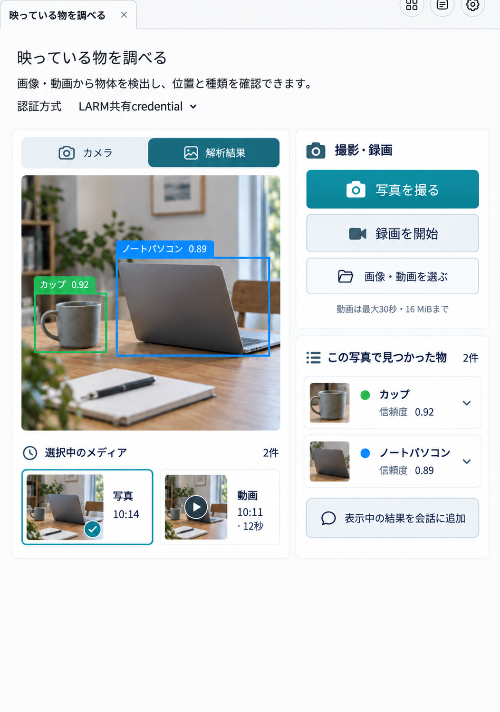

# 「映っている物を調べる」アーティファクト内レイアウト案

## 前提

実際のアーティファクトは会話の隣に開き、初期幅は画面の約半分。参照したブラウザ画像ではアーティファクト部分が 715×1016px だった。上端のタブと閉じる操作は共通ホストが持つため、図もその内側だけを対象にした。分割位置は利用者が会話25～75%の範囲で調整できる。

## 配置

- 約715px幅では、内側を左約400pxのプレビューと右約250pxの操作・結果に分ける。左でカメラと解析済み資料を切り替える。
- 右上に写真・録画・ファイル選択、右下に選択中の資料で見つかった物と会話追加を置く。座標は狭い列の表に詰めず、各物体の詳細で見せる。
- 動画を選択したときだけ解析済み時刻への移動を表示する。ライブカメラには検出枠を出さない。
- アーティファクトがさらに狭くなった場合はプレビュー、操作、結果の順に縦へ並べる。

画像生成による配置検討のみ。製品UIの実装・動作検証は含まない。
