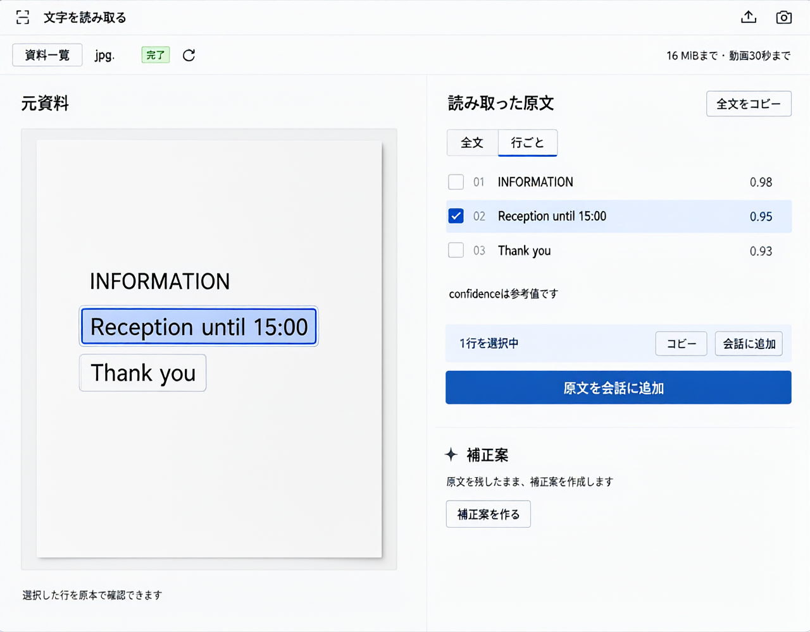

# OCRアーティファクトのデザイン案

2026年10月17日。画像生成による提案。同日、利用者からこの案をOCRアーティファクトへ反映する依頼を受けた。

状態: 作業ツリーへの実装と配布ビルド、部品試験、配布ビルドのブラウザ操作・スクリーンショット確認は完了。domain検証の各検査は成功したが、並行作業によるソース変更を検知して全体結果はinvalidated。利用者の再起動後、稼働画面の操作も成功。[実装・検証記録](../../verification/ocr-redesign-2026-10-17/README.md)へ結果を記録した。

## 反映計画

既存のOcrMedia・OcrPanel・OcrCorrection、登録view、props・eventを再利用する。原本の領域、控えめな入力ツールバー、資料名と状態、全文／行ごとの切替、青の選択表示、選択操作の帯、原文全体の会話追加、独立した補正案領域を実装する。結果表示はOCR部品内のOcrResultへ分け、状態とAPIの責務は変更しない。2列の比率と狭幅での縦並びは既存Artifactの配置に適用する。

API、DB、認証、LLM指示、ツールチェーン登録の変更は対象外。原文・補正案のコピー対象、採用・原文復帰、動画時刻・polygon・行選択、履歴、取消・再確認の既存操作を維持する。

検証は部品試験→OCRと利用側Artifactの関連試験→起動済みのWeb上で対象画面のブラウザ操作とスクリーンショット、の順に進める。既存の対象ブラウザ試験の期待値は、新しい表示切替を操作してから既存の結果を検査するよう更新する。全体のdomain検証も実行し、担当外の失敗は修正せず報告する。新たなbackend・Webサーバーを起動・再起動せず、起動済みの開発画面を使う。

完了条件は画面案の配置を実部品へ反映し、主要操作・狭幅・空状態・補正案採用時の挙動を確認し、ビルド成果物と確認記録を残すこと。画像案自体を製品画面へ貼り付ける実装は行わない。

## 補正・コピー入口の追加調整

利用者から、読み取り結果の補正とコピーボタンが見当たらないため追加してほしいとの依頼を受けた。既存の補正開始・全文コピーの操作を、結果上部の操作帯に並べる。長い結果をスクロールしても操作帯を見つけられる配置とし、行選択のコピーは「選択行をコピー」と明記する。下部の補正案詳細・作成・採用・原文復帰は維持する。既存callbackと実行中の無効化条件を再利用し、API・登録・LLM指示は変更しない。

完了条件は、原文・採用中補正案の全文コピーと上部からの補正開始、実行中の無効化を部品試験で確認し、関連domain検証・ビルド・ブラウザの固定データ操作で配置と操作を確認すること。サーバーは再起動しない。実装・部品単独ブラウザ確認・ビルドは完了。関連試験352件が成功し、一括検証は担当外のcatalog不整合で停止した。追加後の稼働画面はサーバー接続拒否により未確認。[追補の確認記録](../../verification/ocr-redesign-2026-10-17/README.md)に残す。

## 目的と範囲

原本を見ながら読み取った文字を確認し、必要な行をコピー・会話へ追加する操作を見つけやすくする。既存の[OCR仕様](../../../docs/ocr.md)と[画面の操作契約](../../.archived/ocr-artifact-design-2026-10-14.md)を維持し、画面の配置、余白、文字の強弱、色を検討する。

現状の実装では、右側に入力、状態、全文、行別結果、コピー・会話追加、補正案が縦に積み重なる。画像と結果の対応を確認する作業に対し、情報と操作の優先順位が見えにくい。

## 配置の方針

- 左に原本、右に結果を置く既存構成を使う。原本側を少し広く取り、読み取り位置を確認しやすくする。
- 入力は小さなツールバー、状態は資料名とバッジにまとめる。完了後も大きな入力操作が結果を押し下げない配置とする。
- 全文と行別結果は役割が異なるため残す。最終案では「全文」「行ごと」の表示切替を提案し、同じ文字が縦に二重表示されるのを避ける。表示切替はこの案をもとに同日の後続作業で実装した。全文コピーと選択行のコピー・会話追加を混同させない。
- 行選択と原本の対応領域には同じ青を使う。confidenceは小さな参考値として示す。
- 補正案は原文と別の領域に置く。作成・採用は明示操作のまま保持する。
- 色は既存DesignSystemのlightテーマを基準とする。淡いグレー、濃い文字、青の主要操作、緑の完了表示を使う。

既存の `ocr-media`、`ocr-panel`、`OcrCorrection` とprops・eventが操作を既に担うため、実装時もこれらを再利用する。新たな判断ロジックやツールチェーンの追加は必要ない。

## 生成物

[最終案の生成プロンプト全文](prompt-v3.txt)。保存済みLARM設定のcatalogから画像生成サービスを発見し、既存のbackend共通実行機構を使用する。Profile・モデル名・生成先を固定しない。

初案と第2案は、日本語の原稿を原画像・全文・行別結果の3箇所に描いた際に、文言の重複・欠落と選択位置の不一致が発生した。文字列と選択位置を強調して再生成しても解消しなかったため、最終案では短い英語の原稿を使い、全文と行別結果の同時表示を避けて配置を検討した。画像は見た目を検討する資料であり、行とpolygonの正しい対応は実装の試験で保証する。

この画像は完了済み画像を表示したサンプルであり、画面の実装や動作試験の証拠ではない。日本語ラベルの正本は仕様と既存の操作契約とする。未設定、空状態、解析中、失敗、取消、履歴、動画、補正候補の詳細、狭い幅での表示は、製品へ反映する際に既存契約と照合する。

## 画像生成段階の完了条件と確認

今回の完了条件は、実際の画像生成で作った画面案を保存して目視確認し、プロンプトと設計上の意図を残すこと。製品コードを変更しないため、domainの部分・結合・ブラウザ通し検証は実施対象外とする。実接続での画像生成・PNG取得の確認と、画像の目視確認を行う。

結果: 3回とも実接続で生成し、PNGを取得した。最終案は1280×1000。原稿と結果の3行の順序・内容、2行目のチェックと原稿の強調、選択操作と全文操作の分離、補正案の独立表示を目視で確認した。ファイル名の省略表記や小さな文字・アイコンには画像生成による不正確さが残るため、そのまま画面部品として使う画像ではない。サンプル原稿は英語だが、OCRの対応言語を変更する提案ではない。

3ラウンド後の見直しでは、日本語原稿を3箇所に繰り返し描く条件の再試行では改善しなかった一方、原稿の短文化と表示の重複削減により対応を確認できたため、追加生成せず今回のデザイン提案を完了とした。

製品への反映時は、OCR部品の部分試験、Artifactの結合試験、対象ブラウザ試験の順で、行とpolygonの対応、入力、履歴、コピー、会話追加、動画、補正案の既存操作を確認する。API、DB、認証、LLM指示・意味判断の変更は今回の範囲に含めない。
