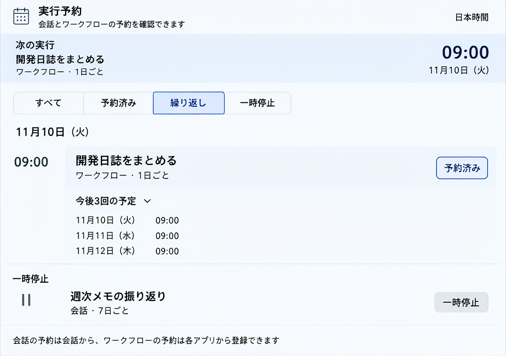

# 実行予約のアジェンダ表示

2026年11月9日。保存済みの LARM 接続から画像生成サービスを見つけ、1280×900の画面案を作った。初案をもとに、繰り返し予約と次回以降の確認を中心にした案を生成した。 [初案のプロンプト](prompt.txt) · [繰り返し表示のプロンプト](prompt-recurring.txt)

次回の実行を上部にまとめ、その下に予約を日本時間の日付ごとに並べる。次回カードと各行の間隔には、一度きりならカレンダー、繰り返しなら循環矢印を添える。「繰り返し」で絞り込み、実行予定の繰り返し予約は「今後3回の予定」を開ける。表示する時刻は保存済みの次回と固定間隔に基づく予定時刻。一時停止中は停止状態と間隔を表示する。幅の狭い表示ではカードの時刻と行の状態を縦に折り返す。

生成案の配置を、DesignSystemのボタンとバッジを組み合わせたOpenUIの表示に反映した。`artifact:scheduler.pending@2` は既存のSchedulerの一覧と変更通知を使う。登録は会話か各ワークフローの画面から行う。 [画面定義](../../../api/domains/capabilities/bundles/scheduler.bundle.json)

固定試験では、日本時間の日付またぎ、予約の並び順、変更通知による一覧の更新、一度きりと繰り返しの区別、3回分の時刻と一時停止の表示を確認した。Chromiumでは幅1000pxの明色と幅370pxの暗色を確認し、キーボードで予定の展開と絞り込みを操作した。隔離環境で `scheduler` と `artifact` の標準検証が通過し、旧版からの登録では旧定義の保持と新しいランチャーの表示を確認した。 [画面結合試験](../../../web/src/workspace/scheduler-artifact.test.tsx) · [予約APIの結合試験](../../../api/application/scheduler/scheduler-toolchain.test.ts)
