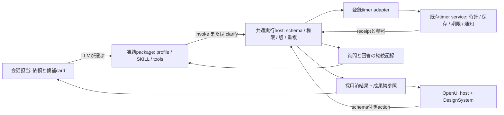

# タイマーを起点にした定義登録・共通実行・OpenUI・自然言語UI受入の設計

状態: 設計案・未実装・試験未実行。作成日: 2026-10-13。

設計担当: Astra。現行コードとの静的な整合レビュー: 親担当。

対象は `ugnoguchigxp/eumenes`、調査基準は main `3f79a1c538933ef30d463b28e828ab2f4b05f378`。本文の `path:line` はこの時点のソースを指す。変更範囲は設計文書と索引のみとし、製品コード・設定・依存・DB・試験コードは変更していない。サービス操作、試験、実LLM・実API呼出しも行っていない。

本書はタイマーの移行範囲の設計を定める。現状の判断は現行コードを優先し、既存計画の未実装項目を実装済みとは扱わない。関連する[ツールチェーン登録](../docs/toolchain-extension.md)、[段階別検証](../docs/toolchain-extension-verification.md)、[検証規則](../docs/verification.md)、[設定登録設計](settings-openui-definition-storage-2026-10-12.md)とは、版を固定した参照・有限のbinding・所有domainの公開操作という考え方を揃える。設定設計の先行実装は本書の前提にしない。

## 1. 目的と今回の到達点

専門能力を追加するたびに、会話の分岐、ツールの入力、実行先、専用React画面、UIイベント、テスト操作列へ同じ知識を書き直す作業を減らす。完全なゼロコード化は目標にしない。既存部品と単純APIで済む追加は定義登録へ寄せ、時間管理、複雑な状態遷移、特殊な外部API、固有の表示部品は型付きアダプターに残す。

選択可能なsubagent・tools・SystemContext・SKILL・artifactsが将来1000規模になっても、会話担当へ全仕様を常駐させない。1000組を厳密な一対一で作ること、同時に1000実行することは要求しない。複数chainでpackageを共有し、複数packageでtool・skill・UIを共有できる。依頼の解釈、担当の選択、足りない情報の判断はLLMが行い、発話の語句を用途別固定分岐へ置き換えない。

今回必須にするのは次の縦断経路である。

1. 版を固定した定義一式を検査・登録し、候補として発見する。
2. 会話担当がchainを選択し、専門担当だけにprofile・SKILL・tools・必要な状態を渡す。
3. 専門担当の型付き操作を共通hostが検査し、既存timer serviceで実行する。
4. receiptとtimer参照を共通結果へ包み、既存DesignSystemを使うOpenUIで表示する。
5. UI操作を登録されたinput schemaへ接続し、状態更新、必要な質問、回答後の続行まで扱う。
6. 凍結した自然言語の目的・評価基準を受け取るテスターAIが、実画面を見て操作を決め、画面証拠とhostの実状態で達成を判定する。

タイマー以外の全domain移行、汎用workflow DSL、DAG scheduler、任意JavaScriptの取込み、OpenUI SDKの全面的な動的実行、汎用タスク管理の再設計は今回の非目標とする。会話からのpause/resume追加も今回必須ではない。既存の会話公開操作はstart/list/cancelを保ち、UIのpause/resumeは維持する。

### 実装前の入口整理と新版の表示名

アーティファクト一覧には既存の「タイマー」を一つだけ表示する。保存済みタイマーを「タイマー: 名前」として個別に追加しない。（2026-10-14 利用者判断: 画面内の保存済みタイマー選択は削除した。再読込み後に既存timerを画面から開き直す手段は持たず、会話のreceiptと期限到達の通知から開く。）保存済みの計測・停止状態は維持し、入口の整理のためにタイマーを削除しない。

本書に基づいてこれから実装する新版の表示名は「タイマー（データドリブン）」とする。新版を有効化したら既存の入口を切り替え、入口とタブには同じ名前を使う。旧版の互換経路を残しても入口を追加せず、タイマー件数によっても入口を増やさない。新版の実装・検証前に既存版へこの名前を付けない。

## 2. 現状と不足の根拠

| 現行の事実 | 根拠 | 設計への意味 |
| --- | --- | --- |
| chainは一つのpackageを参照し、packageはprofile・複数skill・複数toolを参照する | `api/domains/capabilities/contracts/index.ts:149`、`service/registry.ts:125` | 一対一の能力セットを新設する必要はない。既存revisionモデルを拡張する |
| 登録revisionはhashで不変性を検査。tool schemaは中央のSchemaKeyに依存する | `api/domains/capabilities/service/registry.ts:20`、`contracts/index.ts:119` | 旧hashを変更せず、追加契約は新revisionまたは別の版付きbindingにする |
| 会話に提示する関数は共通 `{request}`。一度の主要呼出しは一つだけ | `api/domains/dialogue/service/conversation-tools.ts:34`、`:86` | timer移行で複数同時呼出しを許す必要はない |
| 候補元がtoolchainBuiltins。実行metadataも固定map | `api/domains/dialogue/service/delegate-conversation.ts:98`、`api/domains/capabilities/contracts/runtime-meta.ts:75` | データ登録だけでは会話へ露出しない。登録catalogとhostの対応能力を接続する必要がある |
| 検索はFTS・embedding・過去選択を統合。embeddingなしの実コードは最大8件 | `api/domains/capabilities/service/toolchains.ts:104`、`:173` | 文書/commentの「全件提示」と実コードの差を認識する。1000件時の未発見を黙って能力なしにしない |
| 選択後にpackageのprofile・SKILL・tool schemaを解決する | `api/domains/capabilities/service/toolchains.ts:217`、`api/domains/dialogue/service/toolchain-command.ts:74` | 遅延読込みの既存構造を維持する |
| command担当はinvoke/clarifyを返すが、未知backendがtimerへ落ちる分岐がある | `api/domains/dialogue/service/toolchain-command.ts:125`、`:214` | 明示登録したadapterだけを選ぶ。未知値をtimerとして実行しない |
| clarifyは質問を会話生成へ渡す。汎用の永続質問入力契約ではない | `api/domains/dialogue/service/toolchain-command.ts:358` | schemaを伴う質問・回答の保存と再開を最小追加する |
| agent-runtimeにはtask/step/observationと中断処理がある | `api/domains/agent-runtime/service/context.ts:61`、`service/lifecycle.ts:52` | 専門作業記憶を会話全文へ混ぜない。全runtimeを新造しない |
| tasksはwaiting_user/answer・epoch/generationを持つがkindとgrantはcoding/orchestration専用 | `api/domains/tasks/contracts/index.ts:126`、`service/progress.ts:77`、`service/lifecycle.ts:145` | そのままtimerへ流用できない。汎用tasks対応済みと呼ばない |
| queueのparentJobIdは親子の追跡 | `api/domains/queue/contracts/index.ts:30` | A+B→Cの依存DAGやjoinは未実装 |
| OpenUI 0.3.0とDesignSystemを利用。保存JSONを検査し一つの登録rootへ変換 | `packages/artifact-ui/package.json:15`、`src/compiler.ts:38` | 現方式を継承し、新DSLを作らない |
| SDK RendererはisStreaming=false、toolProviderなし | `packages/artifact-ui/src/index.tsx:39` | SDKの汎用action/streamingを利用済みとは扱わない |
| layoutは既存leafを1〜12件、16KiB以内で組合せ可 | `packages/artifact-ui/src/contracts.ts:247` | timerとform/questionの組合せを既存layoutから始められる |
| ArtifactEventは中央action列挙、valuesはstring/bool。Receiptは表示用の短い応答 | `packages/artifact-ui/src/contracts.ts:399` | domain receiptとUI receiptを区別。schema検証可能な共通action参照を足す |
| WorkspaceArtifactsはview/sourceごとの専用host分岐 | `web/src/workspace/WorkspaceArtifacts.tsx:171` | 移行対象だけ登録hostへ渡し、全画面書換えはしない |
| setupは時・分・秒を合計してstart APIへ送る。label欄はない | `web/src/components/domains/timers/TimerSetupArtifact.tsx:37` | 古い設計書の分秒・名前フォームを現行と混同しない |
| setupはevent.idをrequestIdにする一方、pause等は別UUIDを生成 | `TimerSetupArtifact.tsx:54`、`TimerArtifact.tsx:87` | 全UI再送が既に冪等とは断定しない。共通hostで論理操作IDを維持する |
| receiptと一覧からtimerを再発見する。初回一覧の既存timerは自動で開かない | `web/src/domains/timers/useTimerArtifacts.ts:49`、`:66` | 再読込み後もランチャーから同じtimerを開く現行体験を保つ |
| timerはserviceの時計、scheduler/queue、cancelEpoch、receiptを持つ | `api/domains/timers/service/operations.ts:176`、`expiry.ts:58` | タイマーの期限と通知をブラウザやLLMへ移さない |
| browser試験は固定操作、CSS/表示の検査とスクリーンショット保存 | `tests/browser/artifact-showcase.spec.ts:39`、`:640` | テスターAIによる自律UI受入は別途必要 |

利用者の「会話256K・作業64K」は希望する構成の説明であり、実装から検証したtoken上限ではない。`agent-runtime/service/context.ts:177,259` の65,536はmessagesの**バイト制限**であり、64K tokenと置き換えない。実装時はモデル別のcontext window、入力token数、serialized bytes、応答余白を別々に記録する。

## 3. 採用案と代替案

採用するのは、既存capabilitiesに「取込み定義＋版付きbinding」を足し、既存command経路とOpenUIに薄い共通hostを接続する案である。業務処理はdomainに残す。初回の基盤変更は必要だが、以後の同形追加で会話分岐・専用host・操作dispatcherの変更を不要にする。

| 案 | 判断と理由 |
| --- | --- |
| 現行どおり機能ごとのTS/React分岐を追加 | 初回は安いが追加箇所が増える。移行前の比較対象と旧版fallbackとして残す |
| 任意のAPIとUIを定義だけで完全表現 | 不採用。時計・冪等・権限・非同期・入力変換を巨大な式言語で再実装することになる |
| 汎用workflowエンジンと汎用TaskKindを先に作る | 今回は不採用。coding/orchestrationのgrant、再起動処理、保存契約への影響がtimer一操作より大きい |
| データ定義＋共通host＋登録adapter | 採用。既存契約を再利用し、追加者が選ぶ接続を明示できる |
| Playwrightのclick/wait/selectorをJSON/YAMLに変換 | 自然言語受入の代替として不採用。画面が変わると手順保守が必要で、目的達成の判断も増えない |

新しい専門担当は「既存packageの再利用」「profile/SKILLの差替え」「許可済み単純APIのbinding」「固有adapter」の順に必要量を選ぶ。新しい視覚表現が必要な場合はDesignSystem部品を追加して登録する。全追加で本体変更ゼロという約束はしない。

## 4. 境界とデータの所有



| 所有者 | 責務 | 保持しないもの |
| --- | --- | --- |
| capabilities | 定義revision、依存、入力/出力schema参照、binding revision、候補catalog | 実行中のtimer状態、秘密値 |
| applicationの組立て | 利用可能なadapterとschema providerを登録しdomain間を接続 | 所有domainのSQLや業務判断 |
| dialogueの共通command host | 選択、凍結参照、質問と一操作の継続、結果採用 | timerの残時間計算、汎用DAG |
| tool-runtime | 検証済tool実行、許可・期限、adapterへの接続、invocation記録 | 発話の意味分類 |
| timers | TimerDto/Receipt、scheduler、通知claim/ack、scope、revision、冪等性、保存寿命 | UI定義、モデルの会話記憶 |
| Webの共通Artifact host | source解決、版付きaction配送、表示snapshot、未確定操作の回復、購読解除 | 秘密、業務状態の直接更新 |
| timer UI adapter | h/m/s→秒変換、serverNowに基づく時計、receipt→snapshot投影、再発見 | 独自timer DB、別のexpiry engine |
| DesignSystem/OpenUI部品 | propsの表示、入力、イベント通知 | 認証、API URL選択、秘密、直接業務呼出し |

会話側に残すのは、依頼、選択理由の短い記録、質問、採用済み結果の要約、成果物・receiptへの参照である。専門側のschema全文、観測、入力草稿、再試行履歴を会話Memoryへ自動投入しない。専門作業記憶は実行またはinteractionの保存領域で必要時に読む。経験記憶へ昇格するのは、根拠のある短い知見を既存の採用規則で受け入れた場合だけにする。

## 5. 登録契約と最小例

### 5.1 取込み単位

新規の `CapabilityBundleV1` は配布用のJSONとUTF-8のprofile/SKILL本文を含む。既存のDefinitionを正本に保ち、manifestを別の実行言語にはしない。構成は `formatVersion, bundleId, definitions[], bindings[], artifacts[], schemas[]`。各参照は正確なrevision IDとdigestで固定する。manifest本文からシェル、JavaScript、任意モジュール、任意URLのコードは実行しない。

初回はリポジトリにレビュー済みbundleを置き、起動時の既存seed経路から検査・登録する。登録者向けAPIやマーケットプレイスは必須にしない。登録前のdry-runは未知参照、循環、hash不一致、権限不足、未登録adapter、重複関数、非対応schemaを一覧で返す。依存登録、定義保存、binding保存、公開revision切替は単一writer transactionで行う。失敗時は旧公開版を保つ。

bindingとartifact定義はcapabilities所有の追加テーブルに `id, revision, digest, document_json` を保存し、chain revisionから参照する。旧Definition JSONとhashには新しい既定fieldを挿入しない。新chain revisionだけに `bindingRevisionId` と `artifactRevisionId` を認める。既存runtime-metaは旧版の互換経路として残す。

schemaは当面、既存Zodから得る `builtin:<schemaKey>` と取込み内の版付きJSON Schemaを区別する。timerは既存schemaを使う。宣言APIで新schemaが必要な場合だけ、object/properties/required/additionalProperties:false、string/number/integer/boolean、enum、配列、明示されたサイズ・範囲という有限subsetを扱う。remote $ref、任意正規表現実行、条件式、コード生成は拒否する。既存Zodへ変換するschema providerでhost/UI/モデルの投影を揃え、未対応制約を黙って捨てない。モデルへ渡すtoolは従来どおり平坦objectで、top-level unionを使わない。出力のdomain schemaは既存Zodをそのまま使える。

### 5.2 タイマーの定義例

以下は**提案契約のJSON例**であり、現行登録APIへそのまま送れるデータではない。実装時のrevision競合確認後に採番する。既存の `package:timers.manage@1`、profile/skill、tool:start/list/cancelを再利用するため、それらの本文やschema hashは変えない。

```json
{
  "kind": "toolchain",
  "id": "timers.manage",
  "revision": 2,
  "title": "タイマー（データドリブン）",
  "summary": "相対時間タイマーの開始、確認、取消を扱う",
  "aliases": ["タイマー"],
  "tags": [],
  "useWhen": ["現在の依頼が相対時間タイマーの操作である"],
  "avoidWhen": ["反復アラーム"],
  "examples": ["3分のタイマーを開始して", "タイマーの残り時間を教えて", "このタイマーを取り消して"],
  "dependencies": ["package:timers.manage@1"],
  "packageRevisionId": "package:timers.manage@1",
  "functionName": "timer",
  "redirects": [],
  "artifact": {"kind": "component", "component": "TimerArtifact"},
  "bindingRevisionId": "binding:timers.command@1",
  "artifactRevisionId": "artifact:timers.workspace@1"
}
```

functionName=`timer` と旧component名=`TimerArtifact` は現行登録値を保つ (`api/domains/capabilities/builtin/toolchains.ts:147`)。新版の表示解決はartifactRevisionIdを優先し、旧component名は互換reader用に残す。新規fieldを除く必須項目・一package依存は既存検査を維持する。

```json
{
  "id": "timers.command",
  "revision": 1,
  "execution": "command",
  "adapterRef": "adapter:timers@1",
  "availabilityRef": "availability:timers@1",
  "tools": [
    {"toolRevisionId": "tool:timer.start@1", "operationId": "timers.start", "inputSchemaRef": "builtin:timerStart"},
    {"toolRevisionId": "tool:timer.list@1", "operationId": "timers.list-with-receipt", "inputSchemaRef": "builtin:timerList"},
    {"toolRevisionId": "tool:timer.cancel@1", "operationId": "timers.cancel", "inputSchemaRef": "builtin:timerCancel"}
  ],
  "outputSchemaRef": "domain:timers.receipt@1",
  "resultProjectionRef": "projection:timer-result@1",
  "artifactRevisionId": "artifact:timers.workspace@1"
}
```

`domain:timers.receipt@1` 等はhostで現行Zodを登録するための提案ID。既存domain receiptに架空のversion fieldを足すものではない。`operationId` は登録操作の名前であり、receipt内のUUID `operationId` とは別の意味なので、コードでは前者を `operationName` と内部命名して取り違えを避ける。

### 5.3 単純APIとadapterの境界

単純API bindingは `transport:"http-json"`、`connectionRef`、許可済みmethod/path template、入力/出力schemaRef、有限のfield対応、権限分類、timeout、response size、read/write分類、retry方式を持つ。field対応はliteral、検証済inputのfield、許可済resultのfield参照だけとし、式・ループ・任意path評価を持たせない。秘密はsettingsの接続設定参照からbackendで解決し、manifest・LLM・ブラウザへ渡さない。

新規外部APIを本段階で呼ぶ必要はない。宣言transportの動作確認には隔離fixtureを使う。実サービス対応時には接続先allowlist、redirect先、認証注入、SSRF制約、応答制限を共通hostで適用する。POSTはサービス側の冪等キーと照会仕様が登録されている場合だけ再送可能。GETであることだけを根拠に無条件再試行しない。

有限な宣言の例は次のとおり。これはfixture用の提案定義で、実在外部サービスのAPI仕様ではない。`connectionRef` はbackendの登録接続を指し、モデルが送信先や認証headerを指定しない。JSON fieldの写像以外が必要ならadapterへ移す。

```json
{
  "id": "fixture-item.read", "revision": 1, "transport": "http-json",
  "connectionRef": "connection:acceptance-fixture",
  "method": "GET", "pathTemplate": "/items/{itemId}",
  "pathFields": {"itemId": {"inputField": "itemId"}},
  "inputSchemaRef": "schema:fixture-item-id@1",
  "outputSchemaRef": "schema:fixture-item@1",
  "permission": "read", "timeoutMs": 5000, "maxResponseBytes": 16384,
  "retry": {"mode": "none"}
}
```

timerには専用adapterを採用する。ローカルtransaction、originKey、保存receipt、scope、scheduler、pause/resume、時計補正があるためである。adapterは `describe/available/snapshot/invokeInTransaction/reconcile/project` を提供する。新しいdomainアダプターを足すときだけapplicationの登録箇所を変更する。同じadapterを使うprofile/SKILL/package/UI variantの追加ではdispatcherを編集しない。

### 5.4 共通実行結果と参照

新しい共通envelopeは以下の項目を持つ。これは既存TimerReceiptの外側であり、TimerReceiptを置き換えない。

```text
ExecutionResultV1:
  executionId, interactionId?, chainRevisionId, packageRevisionId, bindingRevisionId
  outcome: completed | needs_input | failed | cancelled | expired | indeterminate
  receiptRef?: { owner: "timers", operationId, digest }
  resultRefs: [{ owner, kind, id, schemaRef, revision?, digest? }]
  artifactRefs: [{ artifactRevisionId, sourceRefs }]
  inputRequest?: { questionId, prompt, inputSchemaRef, revision, expiresAt }
  error?: { code, retry: never | reconcile | user_resubmit }
```

`completed` は今回の操作が確定したことを表す。start完了でもtimer自体はactiveであり、時間切れを意味しない。resultRefsは配列とし、timer専用文字列へ固定しない。digest付きreceiptは不変、timer stateRefはmutableでrevisionを持つ。将来AとBの成果物をCのinputRefsへ渡す余地を残すが、今回はjoin/loop/parallelを実装しない。参照のowner、権限、schema、保存期限をhostが検査し、本文を会話へ全展開しない。

## 6. タイマーAPI・receipt・UI入力の接続

### 6.1 現行APIを維持する

| 入口 | 現行入力と結果 | 共通hostでの扱い |
| --- | --- | --- |
| `POST /api/timers` | `{requestId:UUID, issuedAt:offset日時, durationSeconds:整数1..86400, label?:trim後1..80字}` → started receipt。新規201/replay200 | UIでも同じ論理操作は同requestId。会話は既存公開transaction操作を使いoriginを保持 |
| `GET /api/timers` | state/conversationId/timerId/cursor/limit。`{serverNow,items,nextCursor}` | 読取りsource。listed receiptと混同しない |
| `GET /api/timers/:id` | `{serverNow,timer,notification}` | 時計と表示の正本snapshot |
| `POST /api/timers/:id/cancel` | `{requestId,issuedAt,expectedRevision:整数>=0}` → cancelled/dismissed/unchanged receipt | 対象は認証済sourceから解決。UI入力にscopeを指定させない |
| `POST /api/timers/:id/pause`, `/resume` | cancelと同input schema → paused/resumed/unchanged等 | UI互換を維持。会話toolへの追加とは分ける |
| `GET /api/timer-actions/by-run/:runId` | UUIDのrunId → `{serverNow,receipt:nullまたはTimerReceipt}` | 会話経由の再発見。任意UI操作のrequestId照会APIではない |

根拠は `api/domains/timers/contracts/index.ts:25,147,259` と `controller/index.ts:21`。会話の `timer.list` は `recordListOperationInTransaction` を通すreceipt付き操作であり、GET一覧とは契約が異なる。旧 `capabilities/contracts/timers.ts:5` のlist入力状態はactive/elapsed/cancelledに凍結され、domain側のpaused対応と同一ではない。旧schemaのhashを書き換えず、会話paused対応を別revisionにする。

started receiptの形は次のとおり。ID・日時は説明用fixture値で、実実行の証拠ではない。

```json
{
  "kind": "timer_action",
  "action": "started",
  "operationId": "20000000-0000-4000-8000-000000000001",
  "serverNow": "2026-10-13T12:00:00.000Z",
  "timer": {
    "id": "10000000-0000-4000-8000-000000000001",
    "revision": 0,
    "state": "active",
    "label": "タイマー",
    "durationSeconds": 180,
    "startedAt": "2026-10-13T12:00:00.000Z",
    "dueAt": "2026-10-13T12:03:00.000Z",
    "cancelledAt": null,
    "pausedAt": null,
    "remainingSeconds": 180,
    "conversationId": null,
    "originRunId": null,
    "originMessageId": null,
    "errorCode": null,
    "bodyExpired": false
  },
  "artifact": {"kind": "timer", "version": 1, "timerId": "10000000-0000-4000-8000-000000000001"}
}
```

タイマーのstateはactive/paused/elapsed/cancelled。UIのsetup/confirmingは表示状態であり、domain状態へ保存しない。取消を不可逆な永久終端と定義しない。現行resumeはpausedに加えて、残時間があるcancelledにも対応する (`service/controls.ts:56`)。期限を過ぎてからのpauseはunchangedになり得る。取消後に以前のexpiry結果を採用しないことと、ユーザーの新しいresume操作で再開することは両立する。

### 6.2 OpenUI定義とruntime

表示の正本は既存JSONである。例えば次は現行の組合せ形式に従う。`timer-current` と `duration-question` の実体はhostが認証後に解決する。質問がない場合はquestion leafを含まない別の検証済定義を使う。

```json
{
  "view": "layout",
  "direction": "stack",
  "title": "タイマー",
  "children": [
    {"view": "timer-workspace", "source": "timer-current"},
    {"view": "question", "source": "duration-question"}
  ]
}
```

artifact登録はこの表示JSONの外側に `sourceBindings[]` と `actionBindings[]` を持つ。sourceBindingは許可済query/projection、resultRef、必要revisionを参照する。actionBindingは表示event名、対象source、operationIdまたはquestionId、inputSchemaRef、登録された入力変換を結ぶ。UI JSONから任意API URLを呼べるようにしない。

既存action互換層の例:

```json
{
  "eventAction": "timer-start",
  "source": "timer-setup",
  "operationId": "timers.start",
  "inputSchemaRef": "builtin:timerStart",
  "inputAdapterRef": "input:timer-hms@1"
}
```

`input:timer-hms@1` は既存時・分・秒の文字列を検証して秒へ変換する小さな型付きadapter。数字らしい文字列の汎用暗黙変換はしない。最終的にtimerStartとstartTimerSchemaの双方を通す。labelを追加する別UI定義ではschemaのoptional制約を使い、現行setupにあると仮定しない。

新しい共通eventは `version:1,eventId,eventCreatedAt,eventExpiresAt,artifactId,artifactRevisionId,source,sourceRevision,actionId,input`。eventIdはUUID、両時刻はoffset付きISO日時、inputはJSON値を許すがactionのstrict schemaで検証し、payload全体は16KiB以内にする。既存ArtifactEventは互換adapterでこの形へ変換する。中央のaction enumへ新用途の名前を増やす方式を通常経路にしない。部品はactionIdの参照をpropsで受ける。既存部品の独自eventは段階的に互換adapterへ寄せる。

backendの提案公開入口は `POST /api/toolchain-actions`（上記eventを受理）、`GET /api/toolchain-actions/:eventId`（同scope内の受付状態とreceipt参照の照合）、`GET /api/toolchain-actions?status=unsettled`（再接続時の未確定受付一覧）、`GET /api/toolchain-interactions/:id`、`POST /api/toolchain-interactions/:id/answers`、`POST /api/toolchain-interactions/:id/cancel` とする。既存timer APIは残す。新入口はブラウザから任意operation名を実行するgatewayではなく、hostが発行したartifact/source/binding参照に属するactionだけを受理する。受付と実行は6.4節の単一transactionで保存し、応答欠落が起きた後で初めて記録する方式にしない。WebはGETによる照合を通常の定期pollにせず、成否不明時・再接続時・明示再取得時にだけ行う。

共通hostは登録済みartifactRevisionを一度解決し、許可sourceのsnapshotを集め、`ArtifactRenderer` へ既存runtimeを渡す。timer adapterが時計補正・SSEによる無効化・deadlineでの再取得・focus/reconnectを受け持つ。残時間ゼロでもserverがactiveならconfirmingを表示し、ブラウザ単独でelapsedや通知済みにしない。ストップウォッチは現行clock-runtimeの局所状態として維持する。

UI応答は現在のaccepted/duplicate/conflict/rejectedを維持しつつ、共通host内部には `pending/indeterminate` を持つ。acceptedは保存済receiptを確認した後だけ返す。ネットワーク失敗をrejectedの確定失敗と同一視しない。新しいtimerを作る操作、タブを閉じる操作、timer取消はそれぞれ別であり、タブを閉じただけで取消しない。

### 6.3 操作と表示の流れ

**会話から開始:** 候補card→LLM選択→凍結package読込み→専門LLMがstartを選択→hostがschema/権限/期限を検査→timer adapter→既存transactionでtimer・schedule・receiptを保存→共通結果に包む→会話が事実を報告→同じtimer参照をOpenUIへ渡す。モデルの「開始した」という文は保存証拠にしない。

**UIから開始:** 時分秒入力→hms adapter→検証済input→hostが論理操作IDとissuedAtを一度確定→既存start→receiptを初期snapshotへ反映→同じタブでtimer表示。二重click・応答欠落による同一操作の再送は同requestId、同inputを使う。新しい意図の再開始は新eventId/requestIdを持つ。

**UIからpause/resume/cancel:** sourceとsourceRevisionを検査→targetRefからtimerIdを解決→同じ論理操作IDで既存APIへ送る→receiptからsnapshot更新・関連query無効化。revision conflictでは最新を読み直し、旧操作を新revisionで自動再送しない。利用者が更新後に操作し直す。

**状態再発見:** SSE切断後の再接続とページ再読込みで一覧・by-run receipt・timer GETを使う。ページ再読込み前のtimerは自動でタブを大量に開かない（2026-10-14: 画面内の保存済み選択は削除。§1の注記）。タブJSONの永続保存は今回の要件にせず、表示definition revisionとresultRefから再構成する。

### 6.4 副作用前の受付と再読込み後の回復

質問用interactionとは別に、tool-runtimeが `tool_action_requests` を所有する。新共通入口を通る**すべての副作用を伴うUI操作**に受付を保存する。ローカルのタブ切替・時計mode・入力編集中の値は対象外。既存 `tool_action_invocations` はagent task/step所有を前提にする (`service/index.ts:476`) ため、UIに架空のagent taskを作って流用しない。UI用公開portとowner契約は新設が必要であり、現行owner対応済みとはしない。UI ownerはhostが認証から得たscopeと発行済artifact/source権限参照を使い、クライアントのowner申告を信用しない。既存Agent Ownerを保持し、両入口から同じ登録adapterへ接続する。新受付はdomainのreceiptを正本として参照する。

1. Webは送信前にeventIdと、秘密を含まないtimer入力・artifact/source参照、host発行のowner/scope参照、eventCreatedAtとeventExpiresAtを再読込み可能な保留記録へ保存する。初回はタブ内のsessionStorageを使い、有効期間は作成から24時間とする。これにより、まだbackendへ到着していない古いHTTP要求と、再読込み後の新ID要求が競合することを避ける。秘密入力は保存対象にせず別channelを必要とする。
2. ローカルtimerでは `POST /api/toolchain-actions` の**一つのwriter transaction**で認証・所有scope・binding・入力を検査する。`eventId, requestId, issuedAt, canonicalInput, inputDigest, owner/scope, definition/binding/schema refs, expectedRevision, authorityEpoch, deadline` の受付行を先に作り、登録timer adapterから既存公開 `startInTransaction` 等を呼び、timer/schedule/receiptと受付の確定状態・receiptRefを一緒にcommitする。同ID・同digestは既存確定受付を返し、異なるdigestは409。UIのtimer requestIdは検証済eventIdと同じUUIDを使う。host時刻のissuedAtは最初の保存時に一度だけ決め、確定した入力は再送で変えない。
3. ここでは外部への副作用送信はない。commit前にクラッシュした場合は受付もtimerも残らず、同eventIdでやり直せる。commit後なら両方が残り、同receiptを返せる。受付だけを先にcommitしてqueueへ載せる二段階方式は、短いローカルtimerでは不要なので採用しない。domain実行をsavepoint内に置き、revision_conflict等の確定拒否は副作用をrollbackした上で受付へ安全なerrorCodeを記録する。schema不正は実行前拒否、同eventId異inputの409は既存受付を上書きせず監査記録に分離する。
4. ローカルtimerのPOST成功は200と確定した共通結果を返す。UIのacceptedはこのdomain receipt確認後だけ。応答欠落・再接続時は単件GETを使い、状態変更は既存SSEで通知する。将来の非同期外部adapterでは副作用送信前の受付commit＋queue/outboxが必要で、202は受付のみを意味しpendingとして表示する。202と確定acceptedを同一視しない。
5. 再読込み時はsessionStorageのeventIdを照合し、backendの未確定一覧も読む。GETの404だけを副作用不存在の確定証拠にせず、未到着の要求があり得る間は元のeventId/inputで再送・照合する。新IDの再開始へ自動変換しない。確定後にブラウザ保留記録を削除する。

eventCreatedAt/eventExpiresAtは最初の送信eventに含め、再送で更新しない。hostは新規受付に限ってこの期間とhost時計を検査し、24時間超・未来時刻の許容差30秒超・期限切れを拒否する。既存確定受付があれば先にowner/digestを検査してreceipt照合を行い、送信期限切れを理由に新規実行へ切り替えない。期限を過ぎたoutboxは送信用inputを破棄し、「以前の操作を照合できていない」旨を表示する。照合だけは現在の権限内で行えるが、receipt/tombstoneがなくても古いeventを今のissuedAtで実行し直さない。ログアウト・owner/scope変更時もoutboxを破棄して未照合の可能性を通知し、別scopeへ引き継いだり自動再送したりしない。再実行には利用者の新しい操作が必要である。端末時刻が不正なら新規受付を拒否して時刻再同期を案内し、記録済eventの期限をhostが黙って延長しない。

未確定一覧は非同期adapterの受付と、保存済みだが結果未確定の記録を再発見する共通契約である。今回のローカルtimerでは通常空になり、HTTP応答不明はclient outboxのeventIdと単件GETで解決する。外部HTTP POSTはtimerと同じatomicityを持たず、サービスの冪等キー・照会adapterがなければindeterminateで停止する。旧timer直接APIはこの受付台帳を必須にせず、既存requestId replay互換を保つ。会話の既存agent invocationも保持し、新経路のaction受付とはorigin/requestId対応を明示して重複実行しない。受付本文の容量・保存寿命は7節の制限に揃え、domain receipt本文を二重保存しない。

## 7. 質問、回答、再開の最小永続化

今回はdialogue所有の `command_interactions` と `command_interaction_events` を追加する。対象は「一操作に必要な質問と回答」だけで、taskの汎用state machineを複製しない。通常の値が揃った一操作には新interactionを強制しない。必要な場合に作り、質問継続と不確定操作の照合に限って使う。

主な列は `id, conversation_id, origin_message_id, origin_run_id, current_run_id, chain/package/binding/artifact revision refs, revision, authority_epoch, execution_generation, status, question_id, question_schema_ref, input_json, request_id, issued_at, receipt_ref, expires_at, created_at, updated_at`。本文と観測の保存は必要な入力に限定する。statusは `waiting_input, ready, invoking, completed, cancelled, expired, indeterminate`。既存runのqueued/running等をここへ重複コピーしない。

質問は `questionId,prompt,inputSchemaRef,revision,expiresAt`。質問schemaは事前登録されたものだけで、今回のtimerはdurationの入力または対象timerの選択を扱う。現行の自由文clarifyからは登録済 `answer-text@1` で受け、再開した専門LLMが意味を解釈して操作inputへ変換する経路も用意する。LLMの出力に新しい権限schemaを定義させない。

1. 専門LLMがclarifyしたとき、元runの有効期限内に質問を保存し、質問表示と会話への返却をenqueueする。同一interactionで質問は同時に一つ、合計最大3回。上限到達は失敗理由を返して停止する。
2. 質問の回答期限は作成から24時間を初期値とする。これは新しい提案値で、timerのrequestMaxAgeとは別。元のLLM runを24時間保持しない。元runは質問返却で終え、ユーザー回答後に新runを作る。
3. 回答は `{eventId,interactionId,questionId,expectedRevision,input}`。認証、conversation所有、question状態、schema、期限、authority epoch、凍結依存の有効性を検査する。UI回答でも自然言語回答でも同じ採用処理へ入れる。自然言語回答と質問の関連づけは会話LLMが明示参照を選び、hostは対象の正当性を検査する。
4. 回答の一度だけの受理、revision更新、execution_generation更新、新runとqueue jobの登録を同一writer transactionで行う。既存のrun期限を延長するのではなく、新runの通常予算とinteraction.expiresAtの小さい方を上限にする。新runが期限切れでも質問を無期限に復活させない。
5. 新runは必要な専門inputと凍結profile/SKILL/toolsだけを読み、invokeまたは次のclarifyを決める。質問の回答を会話の経験記憶へ自動昇格しない。
6. requestIdは一つの論理操作に対して予約・保持する。issuedAtは質問作成時ではなく、最初の実行入力確定時にhostが記録する。一度invokeを保存した後はinput/issuedAtを凍結し、成否不明でLLMに別操作を再計画させない。ユーザーが意味を変える場合は旧interactionを取消し、新意図として新IDを作る。
7. 取消はepochを進め、開いた質問を無効化する。遅れて届いた回答、旧generationのLLM結果、取消後の継続は拒否する。timer開始が既に確定した後のinteraction取消はtimerを暗黙取消しない。timer自体の停止には別の明示操作を使う。

再起動ではwaiting_inputを期限・権限確認後に復元し、開いた質問へ再接続する。実行中のモデル呼出しは既存queueのinterrupt方針で止め、勝手に再推論しない。invokingでtimerの保存有無が不明なら保存receiptを照合してcompleted/indeterminateへ進む。UI未確定操作の保存と再発見は6.4節の受付台帳が受け持つ。interactionは質問と論理意図を所有し、action requestは副作用送信を所有する。相互のIDを参照し、domain receipt本文を複製しない。

interactionは終端から30日で本文を削除し、同一IDの再実行を防ぐtombstoneをさらに30日保つ案とする。容量初期値はopen 256件、合計4096件、本文1件16KiB。超過は受付前に明示拒否し、既存timerの取消を妨げない。新action受付台帳では通常操作の容量とは別に取消用64件を予約し、既存timer側の取消予約容量と併せて検査する。予約枠も尽きた場合は明示拒否して容量回復後に同じeventId/requestIdで再試行し、新IDを発行するfallbackは設けない。これらは実装時に容量試験する設計値であり、現在の制限と混同しない。

代替のtasks新kind案には、grant union、kind hook、restartでのwaiting_user保持、API/表示、結果型の追加が必要である。今回はそれを避けるが、将来複数操作・長時間作業が必要になった時点ではinteractionを拡張し続けず、tasksへ専用kindを接続する設計を再判断する。

## 8. 失敗・取消・権限・版の規則

| 条件 | 必須動作 |
| --- | --- |
| 未登録chain/adapter/schema/source/action | 実行前拒否。未知backendのtimer fallbackを使わない |
| 入力不足 | LLMがclarify。登録schemaの質問へ接続し、値を推測して実行しない |
| 不正なUI入力 | field errorを返し保存しない。string/bool互換値も最終domain schemaを通す |
| 同requestId・同input | 既存timer replayで同receipt。副作用は一度。同ID・異なるinputはrequest_conflict |
| 成否不明 | indeterminate表示、同inputのreconcileだけ許す。新IDを自動発行しない |
| revision conflict | 最新状態を表示して再操作を待つ。勝手にexpectedRevisionを更新しない |
| 実行deadline超過 | 未実行なら拒否。保存済receiptがあれば副作用の存在と結果の採用可否を分けて記録し、完了を偽らない |
| timerのdueAt到達 | domainのexpiryとcancelEpochに従う。LLM runのdeadlineとは無関係 |
| permission失効・接続変更 | 実行前と結果採用前に再確認。古い結果を採用しない。接続先を別サービスへ黙って差替えない |
| 公開版更新 | 実行開始時に凍結したrevisionとbinding digestを使用。無効化・失効なら停止。新active版へ途中差替えしない |
| artifact表示版が非対応 | 操作を無効化し、同じ結果参照を対応表示へ開く。表示失敗でtimerを再作成しない |
| backend再起動 | 質問は復元、モデル処理は中断、未確定副作用はreceipt照合。timer保存・expiryは既存回復を利用 |
| bodyExpired/operation_expired | 「表示期限切れ」等を示し新規実行へ化けさせない |

タイマーの現在のscopeはHTTP入口でDEFAULT_TIMER_SCOPEを用いる構成であり (`controller/index.ts:48`、`service/index.ts:68`)、個別ユーザーtenant isolationが完成済みとは扱わない。共通hostの許可範囲は現行のAPI認証とhost scopeを上限とし、入力からscopeを受けない。会話origin、モデル結果の採用権限、sourceの操作許可は別に検査する。複数ユーザーを導入する場合はdomainごとのscope境界の設計が先に必要である。

なお既存timerは同requestId/digestのreplay検査をissuedAtの古さ検査より先に行う (`operations.ts:190`)。共通hostが独自の古さ検査で合法な既存replayを遮らないよう、未受付操作の期限と受付済操作の照合を分ける。

## 9. 1000規模へ備える選択と記憶

timer段階では、固定builtins配列からの公開を「有効catalog∩host対応adapter∩現在の権限」へ切り替える。各chainの専門全文は候補cardへ載せない。chainを選んだ後に依存closureを読む。起動時に1000packageのSystemContextを毎回組み立てない。

1000件の検索性能改善は別段階とする。後続で追加する候補取得契約は、最大8件という提示予算と検索cursor/coverage情報を持ち、「検索が尽きた」「embeddingがない」「今回の8件にない」を区別する。追加検索はLLMが短い検索要求を出す共通入口で行い、上限回数・残予算をhostが制御する。このcursor/追加検索入口の実装は今回のtimer移行の必須条件ではない。初回timer受入では既存候補数で互換を確認し、1000件の登録fixtureによる到達性・context bytes/token・検索時間の計測を後続gateとする。未計測のスケール性能を保証しない。

toolchain-historyの既存recipeはWeb取得の手順再利用である。task compositionの永続計画として流用しない。将来A+B→Cに必要なinput/output/state/result参照、schema版、owner、期限、採用済digestは共通envelopeに残す。依存順、join、部分失敗、補償、合成権限の追加は将来設計と明記する。

## 10. 自然言語UI受入テスト

### 10.1 テストの構造

テスターAIへ渡すのは、利用者の自然言語目的、許された操作範囲、初期条件、**実行前に凍結した評価基準**、予算、証拠提出方法である。クリック先、selector、wait秒数、操作順をテスト定義へ列挙しない。AIはスクリーンショットとアクセシビリティ情報を読み、どのUIをどう操作するかを逐次判断する。低水準のブラウザdriverは操作を実行する手段であって、テスト仕様の正本ではない。

実行を三つの役割に分ける。

- **テスト所有者:** 目的、scope、初期fixture、成功条件、失敗条件、許容差をレビューして凍結する。製品定義と同じ生成出力から無審査で期待値を作らない。
- **テスターAI:** 実画面を観測してUI操作を決め、目的を追う。製品DB/APIを使ってtimerを直接作る、sourceやfixtureを修正する、評価基準を変更する権限を持たない。
- **判定host:** readonly API・保存済receipt・隔離fixtureの観測で実状態を照合し、凍結criteriaを検査する。AIの説明と一致しない場合は成功扱いしない。必要な外観評価は独立reviewerが証拠に基づいて判定する。

AI操作の接続はPlaywright MCPを第一候補として比較する。既存の `@playwright/test` による固定回帰は維持し、MCP接続のテスターは自然言語目的から操作を選ぶ追加層とする。agent-browserだけへE2Eを置換せず、agent-browserやBrowser Useの追加導入も必須にしない。MCPの採用・導入は未決で、今回新しい外部ツールの導入は行わない。採用前に実画面観測、アクセシビリティ、操作記録、read-only観測権限の分離、timeout/cancel、隔離fixture対応、モデル版・費用・証拠保存を確認する。MCPを使うだけで自律評価や独立した合否判定まで実装済みになるとは扱わず、SDK固有APIの未確認仕様を本書の実装前提にしない。

[Playwright MCP公式README](https://github.com/microsoft/playwright-mcp)では、構造化されたアクセシビリティsnapshotを中心とする操作、スクリーンショット取得、任意JavaScriptを実行するevaluateが説明されている。採用時はsnapshotによる操作判断と撮影画像の視覚評価を分け、後者に対応するモデルを用意する。操作runnerのtool allowlistから任意evaluateやネットワーク改変を除き、API直叩きでUI課題を迂回させない。これは公式記述に基づく採用条件であり、MCP接続の実動確認結果ではない。

### 10.2 凍結ケースの具体例

以下はselector列を持たないケース定義例。IDや予算は提案値で、後述のpilot前に合意した値を固定する。

```json
{
  "caseId": "timer-ui-purpose-01",
  "version": 1,
  "goal": "3分のタイマーを作ってください。残り時間が減ることを確かめ、一時停止してから再開してください。",
  "initialStateRef": "fixture:empty-timers@1",
  "allowedSurface": "isolated-eumenes-browser",
  "criteriaRef": "criteria:timer-ui-purpose-01@1",
  "budget": {"wallSeconds": 300, "maxActions": 40, "maxModelCalls": 30, "maxCostUSD": 2},
  "evidence": ["screenshots", "observations", "actions", "readonly-host-state", "receipt-refs"]
}
```

凍結criteriaは次を含める。

| ID | 利用者の達成条件 | 画面とhostの照合 |
| --- | --- | --- |
| C1 | 3分のtimerを一つ開始できた | 画面で開始状態が分かり、hostにdurationSeconds=180の新timerが一件、started receiptが一件。既存fixture timerと混ぜない |
| C2 | 動作中の残時間が減る | 別時刻の画面観測が減少を示し、同timerがactive。API serverNowとdueAtから算出した秒数との誤差は通信・描画遅延を含め±2秒以内をpilot基準とする |
| C3 | 一時停止で残時間が保たれる | hostがpaused、画面も停止を理解できる。2秒以上離した二観測で残時間が変わらない。AIへ固定wait操作を要求せず証拠の時間差を条件にする |
| C4 | 再開で同じtimerが動く | timerIdが同じでstate=active、revisionが進み、残時間減少が再開。別timerの追加は失敗 |
| C5 | 余計な副作用がない | 作成数・receipt列が目的に対応し、別timerの変更や暗黙再開始がない。UIの「できた」という文だけでは合格にしない |

主caseはここで終了し、証拠確定後の後処理は隔離harnessが行う。後処理による取消はテスターの達成実績に含めない。現行 `TimerPane.tsx:63,155` はonPauseがあれば主操作でpauseを優先し、通常画面に独立取消ボタンがあるとは限らないため、UIだけの共通比較に取消を要求しない。

別ケースとして次を用意する。すべて操作手順ではなく目的・条件で定義する。

- **会話開始:** 「2分のタイマーを作って」。LLMの選択・実引数・保存receipt・返答・OpenUIを照合する。UIだけの試験と混ぜず、製品LLMをfixtureにした結合と実LLM受入を別記録にする。
- **会話UIから取消:** 作成済みの対象を会話で指定し「このタイマーを取り消して」と依頼する。同じ目的に対応する現行/移行版を比較し、hostがcancelled、返答が取消を示すことを確認する。pausedを取消成功として扱わない。取消後の旧expiry不採用は厳密試験で保証し、新しい明示resumeは禁じない。
- **質問継続:** 「タイマーを開始して」に対してduration不足なら質問が出る。回答後に指定時間のtimerが一つだけ作られる。質問後の再読込みでも続行でき、取消済質問への遅延回答では作られない。
- **不正入力:** 0秒や上限超過では理由が分かり保存されない。適切な値へ修正すると目的を達成できる。
- ~~**再発見:**~~ 2026-10-14 に画面内の保存済み選択を削除したため廃止した（UIだけでは達成できない目的になったため凍結ケース `timer-rediscovery-01` を削除）。
- **競合・通信断:** hostが制御した競合または応答欠落で、画面が確定成功を装わず回復可能。勝手な新ID再送による二重作成がない。
- **期限到達:** 短いtimerがelapsedとして確認できる。画面と通知状態は評価できるが、実際に音が鳴ったことはスクリーンショットで証明できない。音は別の実機器受入に残す。

### 10.3 成否と原因の分類

`verdict` と `failureClass` を分ける。

| verdict | 条件 |
| --- | --- |
| success | 必須criteriaがすべて証拠で満たされ、host状態が一致し、禁止した副作用がない |
| failure | 具体的なcriteria違反を観測した。例: 180秒でなく180分、表示上完了だが保存なし、二重作成、操作不能 |
| inconclusive | 証拠不足、モデル/driver故障、上限到達、環境不安定などで目的の可否を判断できない |

failureClassは `product / tester / environment / criteria / undetermined`。テスターが対象を見誤った、観測を飛ばした、JSONを壊した、費用上限で止まった場合は製品故障と自動判定しない。製品が正常であることの反証もない限りsuccessにしない。モデルが「無理」と述べただけならinconclusive。UIに操作が見つからない場合は証拠と独立レビューにより、発見性の製品問題かtester問題かを分ける。criteriaの曖昧さが見つかったらそのrunを無効として新versionで別runを行い、過去結果を後から合格に変えない。

### 10.4 証拠、再現性、予算

run manifestに基準commit、bundle/schema/criteria/fixture digest、ブラウザ・viewport・locale・timezone、driver版、testerモデルID/版、製品モデルID/版、推論設定、seedがあればseed、開始終了時刻、利用token、モデル呼出し数、action数、費用、停止理由を保存する。seedがあっても完全再現を保証しない。

各stepは `seq, observedAt, screenshotRef, observationSummary, chosenAction, actionResult, relatedRequestId` を記録する。スクリーンショットは開始、主要状態変化、失敗時、最終を必須とし、視覚評価の根拠を残す。host観測はserverNow、対象timerId/revision/state、receiptRef、通知状態を記録する。時刻を揃えて表示と状態を比較する。秘密・token・私用データはfixtureへ持ち込まず、通常運用ログに画像や会話本文を流さない。詳細証拠は専用の隔離保存先に置く。

初回pilotは**主caseだけ**を現行UI・共通host標準UI・配置variant A・配置variant Bの4群で各3試行、計12runとする。1runは上例の5分/40action/30呼出し/2USD、最大24USD。総上限30USDの残り6USDはdriver疎通・独立判定の予備枠で、失敗を合格へ置換する再試行枠にしない。各run費用にはtesterと当該runで呼ばれる製品モデルを含める。質問継続・取消等の別caseはこのpilotに混ぜず、別の実行許可と予算を固定して拡張する。これらは既存規則ではなく、実行依頼時に固定する提案値である。いずれかの上限、明示取消、禁止操作への要求で停止する。合格するまで自動反復しない。別modelへ変更した結果は別群として扱う。testerは画面理解・操作・構造化証拠提出に対応した版を固定し、必要なcontextと費用はpilotで測る。

### 10.5 現行比較と共通誤りへの対策

同じ目的・criteria・fixture・testerモデルで、現行timer UI、共通host版、共通host上の二つのUI配置variantを比較する。variantは登録済部品の配置・表示構成を変え、意味とAPIは同じにする。テスターへvariant別selectorや手順を渡さない。旧版に質問永続化等がないケースは「非対応」と分け、移行後機能の追加を単純な成功率改善と混ぜない。

比較指標はcriteria別成功数、failure/inconclusive内訳、誤副作用、所要時間、action数、費用、証拠不足、追加時の本体編集ファイル数、定義追加量、専用adapter量である。3試行はpilotであり統計的優越の証明とはしない。単にLLMを使ったために保守が楽になったと断定せず、UI変更時に修正したテスト仕様・実装の差分も残す。

AI生成の定義とAI生成のテストが同じ誤解を共有する危険がある。対策として、criteriaの根拠をユーザー目的と既存domain契約に結び、製品定義生成とは別レビューで凍結し、テスターには実装の答えを渡さない。判定hostは独立した厳密な値・receipt・副作用数を照合する。意図的な二重開始、duration変換誤り、偽成功表示などの故障を隔離fixtureに入れ、受入器が検出するかも確認する。これらの故障を製品コードへ混入しない。

## 11. 厳密コード試験との分担

自然言語受入は、利用者の目的からUIを発見・操作し理解できるかを評価する。権限、競合、期限、冪等性、取消、再起動、保存の正しさをモデルの評価に委ねない。既存Bun/domain/browser試験を維持し、必要箇所だけ追加する。

| 層 | 提案する確認 |
| --- | --- |
| 登録・schema | 旧revision hash不変、依存不在、循環、未知adapter、非対応schema、公開切替のatomicity、schema投影の一致 |
| 共通host | 未公開tool拒否、scope/source/action偽装、deadline、権限失効、cancelEpoch、版失効、response size、論理操作ID維持 |
| timer adapter | start/list/cancelの既存結果互換、paused/cancelledからのresume、due後pause unchanged、時計補正、origin dedupe、通知世代 |
| interaction | 質問・回答・enqueueのatomicity、二重回答、古いrevision/epoch/generation、期限切れ、restart、質問上限、保存容量と削除 |
| API/結合 | 会話→選択→専門input→保存receipt→返答→Artifact。実応答欠落後の照合、取消後の遅延結果不採用 |
| 固定browser | 共通hostのmount/unmount、source解決、表示・schemaエラー、query購読、レイアウトとアクセシビリティの回帰 |
| 自然言語browser | 複数UIで同じ目的を達成できるか、意味の伝わり方、エラーからの回復、証拠付き判定 |

既存の `api/domains/timers/test/*`、`api/domains/capabilities/test/timer-compatibility.test.ts`、`api/application/timer-toolchain.test.ts`、`web/src/domains/timers/*test*`、`tests/browser/timers.spec.ts`、`tests/browser/artifact-showcase.spec.ts` を比較起点にする。root `package.json` の `@playwright/test` 依存と既存browser fixtureを残し、自然言語ケースの導入を理由に削除しない。固定E2Eは同じ操作の再現と厳密な回帰に、自律UI評価は生成・構成変更された画面で目的を達成できるかの確認に使う。

実装後の提案gateは、変更domainの `bun run verify -- --domain <name>`（capabilities/tool-runtime/dialogue/timersと実際に変更する利用側）、該当application結合、browser回帰、横断変更の `bun run verify:all`、最後に許可された範囲の自然言語受入である。実LLM・外部API・実機器は別段階とし、固定fixture結果から成功を推定しない。検証中に入力ファイルを編集せず、入力hashと結果を保存する。本書の作成ではこれらを実行していない。

## 12. 変更候補と段階移行

| 変更候補 | 今回の責務 |
| --- | --- |
| `api/domains/capabilities/contracts/*`, `service/registry.ts`, `service/toolchains.ts`、所有repository/migration | binding/artifact/schema参照の検査・保存、bundle取込み、catalog公開。旧hash互換 |
| `api/domains/capabilities/contracts/runtime-meta.ts` | 旧版mapを互換として残し、新版は版付きbindingを解決 |
| `api/application/toolchain*.ts` と既存組立て箇所 | timer adapter/schema providerの登録。domain横断の公開port配線 |
| `api/domains/dialogue/service/delegate-conversation.ts`, `conversation-tools.ts` | 有効catalogから候補を得る。共通requestと一主要呼出しの制約は維持 |
| `api/domains/dialogue/service/toolchain-command.ts`, `generation-operation.ts` | 未知backend fallback撤去、新command binding経路、質問・結果の接続。旧経路と並存 |
| dialogueの新 `contracts/command-interactions.ts`, `service/command-interactions.ts`、所有repository/migration/controller | 一操作の質問/回答台帳、原子的な受理と再開、期限・epoch・保存寿命 |
| `api/domains/tool-runtime/*` | adapter解決、検証・実行・照合。timer所有SQLへ直接アクセスしない |
| tool-runtimeのaction受付contract/service/controller/repository/migration | UI owner追加、ローカル操作・受付・receipt参照の一括保存、同ID再送、単件/未確定一覧読取。質問interactionとは分離 |
| timer domain公開portとapplication adapter | 既存操作を使う。必要なreceipt参照の公開読取だけ追加し、expiryを再実装しない |
| `packages/artifact-ui/src/contracts.ts`, `runtime.tsx`, `components.tsx` | 共通action inputと既存event互換、schemaから入力propsを導出。表示は既存library/DS |
| Web新共通hostとdomain別登録adapter | source解決・action配送・receipt反映・未確定表示。時計だけtimer adapter |
| `web/src/workspace/WorkspaceArtifacts.tsx` | 移行済artifact revisionを共通hostへ渡す一経路を追加 |
| `TimerSetupArtifact.tsx`, `TimerArtifact.tsx`, `useTimerArtifacts.ts` | 既存処理をadapterへ移動し、二重実装を残さない。旧版切戻しに必要なwrapperは保持 |
| 新自然言語受入runner・ケース・証拠保存 | frozen criteria、tester driver、readonly host照合、予算・結果分類。製品機能とは分離 |

### 段階と戻し方

**P0 契約と比較基準:** 現行schema/receiptを固定fixtureにし、現行UIと厳密試験の比較対象を保存する。凍結criteriaを先にレビューする。ここで実装範囲を一操作＋質問回答に限定する。

**P1 登録と共通command host:** bundle検査、binding保存、adapter登録を実装し、timer start/list/cancelを旧経路と同じfixtureで比較する。新chain revisionを未公開のまま確認し、旧revisionを書き換えない。

**P2 共通Artifact host:** timer source/actionを接続し、既存UIと同じ見た目・操作を維持する。既存package参照を再利用した表示variantを追加し、中央dispatcher・WorkspaceArtifactsへの新分岐追加なしで表示と操作が成立することを確認する。単なる定義読込みだけを完了としない。

**P3 質問と未確定操作:** interaction永続化、回答再開、restart、取消・期限・容量、応答欠落後の照合を実装する。汎用tasksへ機能を広げない。

**P4 自然言語受入と限定公開:** 厳密gateを通した同一入力に対し、予算を固定してpilotを実行する。現行との比較と未確定結果を記録して、新chain revisionを有効化する。全1000件規模の性能改善は別の計測計画へ残す。

切戻しは新chain/bindingの公開ポインターを旧revisionへ戻し、新受付を旧経路へ戻す。既存timer DB、receipt、schedulerを巻き戻さない。旧表示はtimerIdから再構成できる。開いている新interactionは新規受付を止めた後も対応reader/adapterで完了または明示取消できるよう保持し、未知の新版入力を旧handlerへ渡さない。migrationは追加型で始め、旧table/columnの削除は切戻し期間終了後の別変更にする。authority失効を伴う撤回は即時停止し、保存済副作用の照合は続ける。

## 13. 受入条件と未決事項

実装完了の受入は以下をすべて満たすこととする。

- 登録→選択→専門SystemContext→timer実行→receipt→OpenUI→入力→状態更新/質問/再開が一本の経路で接続される。
- 同じtimer adapter・toolを使う別profile/SKILL/packageまたは表示variantの追加で、会話dispatcherと専用React hostを増やさない。変更ファイルと追加量を比較資料へ残す。
- 時計・expiry・通知・receipt・revision・scopeの正本がtimer domainに残る。旧保存timerと旧receiptが読み出せる。
- 同一論理操作の再送、取消後の遅延結果、古い版/権限/回答、再起動、期限切れに対する厳密試験が通る。
- 自然言語の同じgoal/criteriaを複数UI配置で実行し、selector手順の差替えなしに評価できる。AIの自己申告だけで成功にしない。
- 限定公開の暫定基準は、選択した厳密gate全成功、主caseの4群それぞれ3/3 successとする。failureまたはinconclusiveが一つでも残る群は未完了。baseline自体が通らなければ比較前提を診断し、移行成功を宣言しない。試行数の少なさを認めたpilot基準であり、統計的品質保証ではない。結果を見た後に同runのcriteria・閾値を緩和しない。
- success/failure/inconclusiveとproduct/tester/environmentの分類、証拠、model/費用/時間、未実行項目を報告できる。
- 切戻しで既存timerを消さず、二重作成せず、新interactionを旧handlerへ誤配送しない。

未決事項は、実装を曖昧にする項目と後続調整を分ける。

| 未決 | 着手・判定の扱い |
| --- | --- |
| 新revisionの実採番と現行functionName | P1登録前に現行catalogと照合。旧版を破壊しない |
| JSON Schema subset providerの詳細と標準API bindingのresponse制約 | timerは既存schema/adapterで先行可能。任意外部API対応完了とは呼ばない |
| 自然言語testerのdriver/model | P0〜P3の製品実装を妨げない。P4前に公式仕様とpilot適合を確認して固定 |
| pilot予算・許容時刻差・必要試行数 | 10章の初期案を実行前に確定しhash化。試験結果を見て遡及変更しない |
| 1000件catalogでの検索到達性/費用/遅延 | 後続計測。timer縦断完成と1000件性能受入を別に報告 |
| 複数user scope、複数操作の合成、長時間taskkind | 今回対象外。必要になった時点で権限・保存・回復を別設計 |

## 14. 自己レビューと未検証範囲

自己レビューでは、(1) 全面ゼロコード化にしていない、(2) LLM判断を語句分岐へ置換していない、(3) 既存timerの時計・receipt・取消・再発見を残した、(4) paused/cancelledからのresumeを誤って禁止していない、(5) domain receiptとUI receiptを区別した、(6) timer APIと会話用の凍結schemaの差を示した、(7) tasksの既存機能をtimer対応済みと扱っていない、(8) 自然言語テストをclick列に変えていない、(9) 評価基準と製品生成の共通誤りに対策を置いた、(10) 将来合成の参照と今回の実装範囲を分けた、を点検した。

今回確認したのは上記基準コードと文書の静的読取りである。新しい契約例・DB追加・UI host・自然言語runnerは未実装。定義例の実バリデーション、型チェック、Bun/browser試験、移行/切戻し、実LLM、実API、実機器、性能・費用測定はすべて未実行である。既存試験ファイルの存在・記述を確認したことを、今回の試験合格とは扱わない。

OpenUIの利用は現行ローカルコードと `@openuidev/react-lang` 0.3.0の依存宣言に基づく。上流の[Thesys OpenUI / packages/react-lang](https://github.com/thesysdev/openui/tree/main/packages/react-lang)の読取りを試みたが取得できなかった。上流最新版の機能、0.3.0以外の互換性、Browser Useの仕様は確認済みとはしていない。Playwright MCPは親担当が公式READMEの記述を確認した段階であり、導入・実行・モデル接続は未確認。本案はSDKの未確認機能に依存せず、既存の検証済JSON→登録Renderer経路を前提とする。
