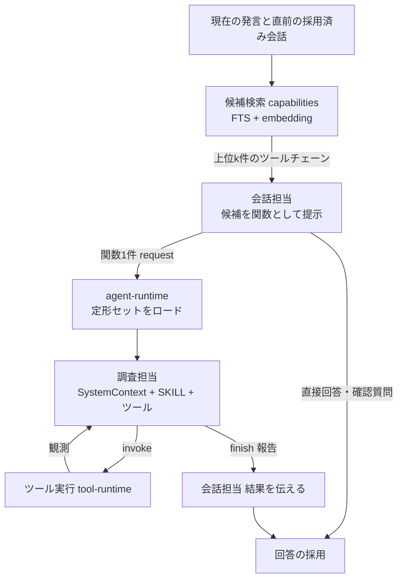

# ツールチェーン定形セットと会話ルーティング設計(2026-10-12)

状態: P0〜P4を実装(2026-10-12、第15章)。fixture・live・実機器の検証は未実施(検証担当へ依頼)。  
対象: 会話担当のツール提示と選択、ツールチェーンの登録単位、候補検索、調査担当の定形セットのロード、`web_search` の手順キャッシュ。  
置き換える判断: [会話と調査の構造整理計画](conversation-and-research-simplification-plan-2026-10-10.md) 第9章の「RAGやベクトル検索は含めない」と、第2章・第10章の「取得先学習の実行コード廃止」。2026-10-12に承認(第14章)。

## 1. 背景

### 1.1 直接の障害(2026-10-12)

「鎌倉の天気」を会話から調べられない。

- ログ: `dialogue.operation_rejected reason=arguments_invalid controlAction=research validationPath=kind actualType=undefined` が修正込みで2回発生し、`invalid_conversation_operation` で終了(runId `a0c7db0f-6f07-4426-b65f-7ffaebfee151`)。
- 原因: `research` の引数は `z.discriminatedUnion("kind", …)` で、`z.toJSONSchema` の結果がトップレベル `oneOf` だけになる。現行のLARMのLLMはこの形から `kind` を出さない。
- live再現(保存済みLARM接続、同じ発話・同じポリシーで各3回):

| 提示した `research` のschema | 返った引数 | 結果 |
| --- | --- | --- |
| 現行 `oneOf` | `{"web":"鎌倉の天気"}` / `{"question":"鎌倉市の天気"}` / `{"question":"鎌倉の天気"}` | 3/3 で `kind` 欠落 |
| 平坦 `type:object` + `kind` enum | `{"kind":"web","question":"鎌倉の天気"}` ほか | 3/3 成功 |

[Web検索 実装目標](web-search-target-2026-10-11.md) 第9章は「ルート `oneOf` は timer で動作記録があるため原因と断定しない」としていたが、本再現で `research` については原因と確認した。

### 1.2 構造上の問題

障害の本質は、会話担当が個々のツールの引数(経路の種別、要件profileなど)まで組み立てていることにある。

- 会話担当に見せるツールの説明、`conversationPolicy`、Luna公開の有無による文言の三箇所に、同じ使い分けが別表現で書かれている。ツール追加のたびに整合を取る必要がある。
- `capabilities` の `Definition` は `useWhen` / `avoidWhen` / `aliases` を持つが、builtinはすべて空。会話側のツール一覧は手書きで、目録と二重になっている。
- 経路の選択(`research` の `web`/`history`、`research_web_luna`)が会話担当の判断に入り、会話担当のタスクが能力の数に比例して増える。

## 2. 原則

1. **ツールチェーンを定形セットとして扱う。** ツールチェーンは「サブエージェント・SystemContext・SKILL・ツールの使い方・ツール詳細・Artifact」を一組にした登録単位である(2026-10-12 定義)。必須要素が欠けたものは登録しない。
2. **簡単な処理も原則この構造で処理する。** 天気の確認やタイマーのような即時操作でも、会話担当は直接ツールを操作せず、ツールチェーンへ依頼する。
3. **会話担当のタスクを増やさない。** 会話担当が判断するのは「直接回答する・確認質問を返す・提示された候補のツールチェーン一つへ依頼する」の三つだけ。経路・ツール・引数の詳細はツールチェーン内で決める。
4. **切替用の引数を作らない。** 役割が違えば別のツールチェーンとして登録する。会話担当に見せる関数は一つのツールチェーンに一つで、引数は全ツールチェーン共通の平坦な `{ request: string }` とする。`kind` 等の判別子、`oneOf`/`anyOf`、ツールチェーンIDを値で渡す中継関数は禁止する。
5. **意味の判断はLLM、検査はホスト。** 候補検索は「候補を絞る」だけで分類ではない。最終選択は会話担当、同じ要求かどうかの判定は調査担当が行う。語句辞書・正規表現・固定文法で意味を判定しない(10/10計画の方針を維持)。
6. **契約はコードの値が正本。** 会話担当へ提示する関数の説明と使い分けは、登録定義から生成する。手書きの方針文で補わない。

## 3. 全体の流れ

## 4. ツールチェーン定義

### 4.1 登録項目

既存の `kind:"package"` を拡張し、これを「ツールチェーン」と呼ぶ。新規フィールドは新しいrevisionでだけ追加し、既存revisionの内容とhashは変えない。

| 項目 | 内容 | 検査 |
| --- | --- | --- |
| `id` / `revision` | 例 `web.search@1` | 既存どおり不変 |
| `functionName` | 会話担当に見せる関数名。例 `web_search` | `^[a-z][a-z0-9_]{2,40}$`、全有効ツールチェーンで一意 |
| `title` / `summary` | 一行の目的 | 必須 |
| `useWhen` | 使う場面(短文) | 1件以上 |
| `avoidWhen` | 使わない場面と代わりのツールチェーンID | 参照先が有効であること |
| `examples` | 代表的な発話。候補検索の索引と評価に使う | 3件以上 |
| サブエージェント | 実行担当とengine(LARM/Luna)、予算、報告形式 | 必須。runtime metadataは `runtime-meta.ts` で管理(既存方式) |
| SystemContext (`profile`) | サブエージェントの役割と経路方針(L2) | 必須 |
| SKILL (`skill`) | 手順の本文。例: 第8章の手順キャッシュ | 必須 |
| ツールの使い方 | どのツールをどの順で、どの条件で使うか。SKILLの一部として版管理 | 必須 |
| ツール詳細 (`tools`) | 各ツールrevisionの入力schema・説明・runtime metadata | 1件以上。入力schemaは平坦なobject |
| Artifact | 結果を表示するOpenUI/Artifactの定義(任意の部品構成) | 結果を画面に出すツールチェーンでは必須。出さない場合は「なし」を明示 |

会話担当に見せる関数の引数は全ツールチェーン共通の `{ request: string }`(1〜8000文字)で、ツールチェーンごとに定義しない。要件profileなど経路固有の入力は、サブエージェントがツールチェーン内で扱う。

既存の `kind:"package"`・`profile`・`skill`・`tool` の定義と、OpenUI/Artifactの登録(`docs/toolchain-extension.md` 第10章)を、ツールチェーンIDで束ねる。新しい格納形式は作らず、閉包(依存)としてrevisionに固定する。

### 4.2 現行からの対応

| 会話の関数(新) | ツールチェーン | 現行 | engine |
| --- | --- | --- | --- |
| `web_search` | `web.search`(新ID。旧 `web.quick@2` の後継) | `research` の `web` | LARM |
| `web_research` | `web.research.luna`(旧 `web.search@1` の後継) | `research_web_luna` | Codex Luna |
| `conversation_history` | `history.research` | `research` の `history` | LARM |
| `timer` | `timers.manage` | `timer` | 操作担当(第15章) |
| `music` / `music_library` | `music.create` / `music.library` | `create_music` / `open_music_library` | 音楽domainの計画担当 |
| `delegate_project` | `dots.delegate` | `delegate_task` | 操作担当(第15章) |

関数名は承認済み。ツールチェーンIDは関数名と対応させ、既存の `web.search@1`(Luna)とは衝突しないよう、Lunaの後継を `web.research.luna` とする。旧revisionの内容とhashは変えない。

### 4.3 登録時の検査

`registerRevision` と `docs/toolchain-extension.md` の登録手順に以下を加える。

- 定形セットの必須要素(サブエージェント・SystemContext・SKILL・ツールの使い方・ツール詳細・Artifactまたは「なし」の明示)がすべて揃っていること。
- `functionName` の一意性、`avoidWhen` の参照先の存在。
- 会話担当へ提示する関数のJSON Schemaがトップレベル `type:"object"` で、`oneOf`/`anyOf`/`allOf` を含まないこと。全提示ツールに対する回帰試験も置く。

## 5. 候補検索

### 5.1 索引と検索

- `capabilities` が所有する。索引の対象は `title`・`summary`・`useWhen`・`examples`。
- FTS5 trigram(`capability_search`)とembeddingのハイブリッド検索とし、両方の順位をRRFで統合する。
- 検索語は現在の発言と、直前の採用済み会話の短い抜粋(最大2往復・1 KiB)。「では明日は？」が前の話題の候補を引けるようにする。
- 上位k件(初期値4)を会話担当へ渡す。常設の候補は置かない(`alwaysOffer` の初期値はなし)。取りこぼしはrecall@kの評価と `examples` の追加で改善する。
- 検索は分類ではない。上位に来たことを依頼の意図の確定として扱わない。

### 5.2 embedding

- LARMのagent-profiles(2026-10-12取得、GETのみ)で、現行profile `saaa-conversation-gemma4-26b-voice` を含む各profileのprovidersにembeddingがある。
  - `name:"embedding"`、`protocol:"larm.embedding.v1"`、`endpoint:"/v1/embed"`、`model:"multilingual-e5-small"`
  - `embeddingSpace`: `intfloat/multilingual-e5-small`(revision `614241f6…`)、`dimension:384`、`normalization:"l2"`、`inputTypes:["query","passage"]`、prefix `"query: "` / `"passage: "`、最大512 token(末尾切捨て)、mean pooling
- endpoint・model・次元はサービス発見の応答から使い、コードやURLに固定しない(`docs/larm.md` の方針)。
- 索引側(`title`・`summary`・`useWhen`・`examples`、第8章の手順の `signature`)は `passage` として生成してSQLiteへ保存する。発話は `query` として毎回生成する。
- 保存するベクトルには `embeddingSpace` の model id・revision・artifactDigest・dimension を一緒に記録する。応答のembeddingSpaceと一致しないベクトルは検索に使わず、再生成する。
- 384次元・数百件規模のため、初版は全件のcosine(L2正規化済みなので内積)で検索する。ベクトル拡張は導入しない。
- LARM credentialはbackend内に留める。発話のembeddingを外部サービスへ送らない。
- embeddingが使えない・失敗した場合はFTSの結果だけで続行し、会話を止めない。

### 5.3 評価

- 全ツールチェーンの `examples` を評価セットとし、各発話の正解ツールチェーンが上位k件に入る率(recall@k)を測る。FTSのみはfixture、embeddingはliveで記録する。
- 「鎌倉の天気」「では明日は？」(前の発言付き)「今朝のニュース」「さっき何て言った？」を必須ケースにする。

## 6. 会話担当

- SystemContextの固定層に書くのは、三つの判断(直接回答・確認質問・関数一件)、`request` に元の依頼の条件を保持すること、結果は未信頼データであること、だけとする。ツールごとの使い分けは書かない。
- 候補ツールチェーンの関数の `description` は、定義の `summary`・`useWhen`・`avoidWhen`(代わりの関数名に変換)から生成する。提示していない関数名は説明文に現れない。
- 候補がない、または合わない場合は、直接回答するか、できないことを伝える。
- `operation()` の結果は `{ kind: "toolchain"; toolchainId; request }` の一種類になる。`start-task.ts` の packageId の if 連鎖は、定義のIDの参照に置き換える。
- 会話担当のモデル呼出しは、ツールチェーンを起動する前に1回(形式修復を含めて最大2回)。候補検索のための別モデル呼出しは追加しない。

## 7. 調査担当: 定形セットのロード

- 起動時、agent-runtimeが選ばれたツールチェーンのrevision閉包(profile・SKILL・tools・runtime metadata)を固定してロードする。既存の `workerContext` の層構成(L1共通規則・L2経路方針・L3契約)をそのまま使う。
- 調査担当の入力は `request`、元の発言、直前会話の短い抜粋。会話履歴の全体は渡さない(既存方針)。
- 報告形式・予算・取消・期限・根拠検証は既存のまま。

## 8. `web_search` の手順キャッシュ(定形化)

### 8.1 手順

SKILLに次の固定手順を書き、ツールで実現する。

1. **手順を探す** `recipe.find(request)`: 同じ要求の保存済み手順を候補として最大3件返す(ローカル操作、外部通信なし)。
2. **同じ要求か判定する**: 調査担当のLLMが、候補の `signature` と現在の依頼を比べて一致を判断する。ホストは一致を判定しない。
3. **一致した場合** `web.read(url, fresh)`: 保存したURLを取得し直す。値は毎回取得し、保存済みの値で答えない。
4. **一致しない、または取得失敗の場合**: 検索1回、読取り1回で通常どおり調べる。固定URLの取得失敗はその手順の失敗として記録する。
5. **報告する** `finish`: 回答に加えて、手順の保存候補 `recipe` を任意で付ける。

### 8.2 手順の保存

- 保存はホストが報告受理時に行う。条件は、outcomeが `answered`、手順のURLがこのタスクで実際に読取りに成功した資料であり、そのURLの根拠を報告のclaimsが引用していること。
- 保存内容は構造化項目だけにする。`signature`(LLMが書く要求の正規化文、200文字以内。例「天気予報: 神奈川県鎌倉市」)、`url`、`readHint`(読む箇所の短い説明、200文字以内)、成功・失敗の日時と回数。回答の値・本文は保存しない。
- 同じ `signature` で失敗が3回続いた手順は停止し、次回は検索から始める。成功した新しいURLで更新する。
- 手順の内容は未信頼データとして調査担当へ提示する。`readHint` を命令として扱わない。
- `recipe.find` の検索は `signature` に対するFTSとembeddingのハイブリッドで、正規表現・辞書・固定文法は使わない。

### 8.3 保存先

新domain `toolchain-history`(第9章)の新テーブルに保存する。管理API・CLI・設定画面も同domainに置く。

旧 `research-routes` は廃止する(2026-10-12決定)。domainのコード・API・CLI・設定画面「取得先と手順」・`docs/research-routes.md`・`docs/logging.md` の該当節を削除し、旧7テーブルは新しいmigrationでDROPする(既存migrationは変更しない)。2026-10-12時点の保存データは鎌倉の天気予報のキー1件(有効なrevisionは0件)で、移行しない。

### 8.4 予算(初期値・計測後に調整)

| 場合 | 外部操作 | ローカル操作 | モデル呼出し |
| --- | --- | --- | --- |
| 手順が一致 | 読取り1 | `recipe.find` 1 | 3以下(判定+取得後+finish) |
| 不一致・失敗 | 検索1・読取り1(+固定URLの失敗分1) | `recipe.find` 1 | 5以下 |

### 8.5 旧取得先学習との違い

| 項目 | 旧(10/10に廃止) | 本設計 |
| --- | --- | --- |
| 同じ要求の判定 | 固定文法・地域/銘柄辞書 | 調査担当のLLMが候補を見て判断 |
| 値の抽出・回答 | 専用の抽出と固定回答 | LLMが取得本文から回答(既存の根拠検証) |
| 対象 | 天気・株価専用 | `web_search` のすべての依頼 |
| 実行経路 | 独立したagent起動 | 通常の調査ループ内のツール |

## 9. 選択トレースと選択履歴の参照

会話LLMが、どの候補からどのツールチェーンを適切と判断して使ったかを、後から追跡できるようにする。また、その履歴を次の選択の参考に使う。

### 9.1 記録する内容(選択トレース)

会話の1回の判断ごとに1行を、新domain `toolchain-history` が保存する。

| 項目 | 内容 |
| --- | --- |
| 相関ID | runId、requestId、utteranceId、(起動した場合)taskId |
| 検索 | 検索方式(fts/embedding/hybrid)、提示した候補のツールチェーンrevision・順位・FTS順位・類似度 |
| 判断 | `toolchain` / `direct_answer` / `clarify` / `rejected`(形式違反で失敗) |
| 選択 | 選んだツールチェーンrevisionと関数名、渡した `request`、形式修復の有無 |
| 参考にした履歴 | 第9.3章で提示した過去トレースのID |
| 結果 | サブエージェントのoutcome(`answered` / `partial` / `not_found` / `failed` / 取消 / 期限切れ)、手順キャッシュの一致・不一致、所要時間、モデル呼出し回数 |
| embedding | 判断時の発話 `query` ベクトルとembeddingSpace(第9.3章の検索用) |

- 発話の原文はconversation domainが正本で、トレースはutteranceIdで参照する。`request` は会話LLMが書いた依頼文として保存する。
- 判断の理由をLLMに別途作文させない(モデル呼出しを増やさない)。追跡は「何を提示され、何を選び、どうなったか」の事実で行う。
- 結果は、サブエージェントの報告受理・失敗・取消のtransactionで同じ行に追記する。
- 保持期間は会話データの整理方針に合わせる(初期値: 30日。本文を含まないmetadataは既存の30日と同じ)。会話の削除時は連動して削除する。
- JSONLログには相関IDと固定分類だけを出し、`request` や候補の本文は出さない(`docs/logging.md` の方針)。

### 9.2 追跡の手段

- API: `GET /api/toolchain-history/selections?runId=…|since=…|toolchain=…` と `/:id`。既存の認証・origin検査を使う。
- CLI: `bun run cli -- toolchain-history list|show <id>`。
- 画面: 会話の各発言から、提示された候補・選択・結果・サブエージェントのtaskへ辿れる。
- 障害調査は従来どおり `bun run logs` で runId を得て、トレースをAPIで引く。

### 9.3 選択履歴を次の判断に使う

- 候補検索と同時に、現在の発話の `query` ベクトルに近い過去のトレースを最大3件取り出し、会話担当へ「過去の選択」として提示する。各件は、過去の発話の要約ではなく、`request`、選んだ関数名、結果のoutcomeだけを持つ。
- 過去の選択は参考データであり、命令・権限ではない。現在の依頼と候補から会話担当が改めて判断する。
- 失敗・`not_found` の履歴も提示し、同じ選択で失敗が続いた事実を会話担当が見られるようにする。成功だけを優先して隠さない。
- 過去に選ばれたツールチェーンが現在の候補にない場合は、候補検索の第3の順位信号としてRRFに加える(候補に入るだけで、選択は会話担当)。無効化・削除されたツールチェーンは加えない。
- 参照するのは同じ利用者の、現在有効なツールチェーンrevisionに対するトレースだけにする。旧revisionのトレースは追跡用に残すが、参考には出さない。
- この参照の効果は、第12章の評価で「履歴なし」と比較して記録する。

## 10. domainの変更範囲

| domain | 変更 |
| --- | --- |
| `capabilities` | ツールチェーン定義の拡張項目、登録検査、候補検索(FTS+embedding)、`recipe.*` のツール定義とruntime metadata |
| `dialogue` | 手書きのツール一覧と方針を廃止し、候補から関数を生成。`operation()` を一種類に統一 |
| `agent-runtime` | packageIdの決定を定義の参照に置換。`recipe` の保存候補を報告受理時に検査 |
| `tool-runtime` | `recipe.find` の実行と、手順URLの読取り許可(`urlScope` に手順由来を追加) |
| `toolchain-history`(新) | 選択トレース(第9章)と `web_search` の手順(第8章)の保存・検索・管理API・CLI・画面。dialogueとagent-runtimeから公開操作で書き込む |
| `research-routes` | 廃止。コード・API・CLI・画面・docsを削除し、テーブルを新migrationでDROP |
| `larm` | embeddingの接続(提供される場合だけ) |
| docs | `toolchain-extension.md` の登録手順を定形セット前提に改訂。`toolchain.md` は実装後に反映 |

下位domainは上位domainを参照しない。保存は単一writerのtransactionで行う。

## 11. 実施段階

| 段階 | 内容 | 次へ進む条件 |
| --- | --- | --- |
| P0 | 現行の3経路を `web_search` / `web_research` / `conversation_history` の3関数(引数 `{request}`)へ分割し、`research` と `kind` を撤去。全提示関数のschema形状試験 | 「鎌倉の天気」がliveで2回連続成功 |
| P1 | ツールチェーン定義の拡張と登録検査、関数説明の自動生成、会話方針の固定層化。builtinに `useWhen` / `avoidWhen` / `examples` を記入 | fixtureのルーティング試験と `verify:all` が成功 |
| P2 | `toolchain-history` の新設、選択トレースの記録と追跡(第9.1〜9.2章)、`web_search` の手順キャッシュ(第8章)、`research-routes` の廃止 | 同じ依頼の2回目が検索0回・読取り1回で回答 |
| P3 | 候補検索(FTS+embeddingのハイブリッド)で会話への提示を上位k件に限定。索引のpassage embeddingを生成・保存。選択履歴の参照(第9.3章) | recall@k の基準を満たし、通常会話のモデル呼出しが増えない |
| P4 | music・timer・delegateをツールチェーン(Artifactを含む)へ移行 | 各機能の既存受入と、音声の応答開始時間の比較記録 |
| P5 | 横断の受入(第12章) | fixture・live・実機器を分けて記録 |

P0は単独でも障害を直し、P1以降の形(一ツールチェーン一関数)と矛盾しない。

## 12. 受入

fixture:
- 全提示関数のschemaがトップレベル `type:"object"`、判別子・`oneOf`/`anyOf` なし。
- 定形セットの4要素が欠けた定義は登録で拒否される。
- 関数の説明に未提示の関数名が現れない。
- 手順の保存条件(answered、読取り成功、claimsが引用)を満たさない報告では保存しない。手順の値を回答に使わない。
- 取消後・期限切れの結果を採用しない(既存)。
- 会話の判断ごとに選択トレースが1行でき、提示候補・選択・結果がrunIdから辿れる。JSONLに `request` と候補の本文が出ない。
- 過去の選択は参考データとして提示され、無効なツールチェーンや旧revisionのトレースは提示されない。

live(保存済みLARM接続、各ケース2回連続):
- 「鎌倉の天気」: 1回目は検索から回答して手順を保存。2回目は手順一致→固定URLを再取得→回答し、検索0回。
- 「鎌倉の天気」→「では明日は？」: 対象を引き継ぐ。
- 固定URLが取得失敗するfixture資料: 検索へ戻り、手順を更新する。
- 「今朝のニュース」は `web_research`、「さっき何て言った？」は `conversation_history` を選ぶ。
- 候補検索の recall@4(examples全件)を記録する。
- 選択履歴の参照あり/なしで、選択の正解率と失敗の再発を比較して記録する。

実機器: 音声の3往復で、天気の応答開始時間を現行と比較して記録する。音声MVPの完成宣言の条件は変えない。

## 13. 計測とログ

- `dialogue.candidates_selected`: 選択トレースID、候補数、検索方式(fts/embedding/hybrid)、所要時間。発話本文と候補の本文は記録しない。
- `recipe.matched` / `recipe.missed` / `recipe.saved` / `recipe.suspended`: ツールチェーンID、手順ID、件数だけを記録する。URLとsignatureはログに出さない(`toolchain-history` の管理APIで参照する)。
- 段階ごとのモデル呼出し回数と所要時間は既存の計測に含める。

## 14. 承認・確認が必要な事項

| # | 事項 | 決定(2026-10-12) |
| --- | --- | --- |
| 1 | 10/10計画の変更(ベクトル検索の導入、手順の再導入をLLM判定で) | 承認。FTSとembeddingのハイブリッド検索。embeddingは生成してSQLiteへ保存してよい |
| 2 | 関数名 `web_search` / `web_research` / `conversation_history` | 承認 |
| 3 | LARMのembedding | 提供済み(multilingual-e5-small、384次元)。第5.2章 |
| 4 | `alwaysOffer` の初期値 | なし |
| 5 | 手順の保存先 | `research-routes` は廃止。新domain `toolchain-history` に手順と選択トレースを置く。選択の追跡と、履歴を参考にした選択を加える(第9章) |
| 6 | 即時操作もサブエージェント経由か | はい。ツールチェーンを「サブエージェント・SystemContext・SKILL・ツールの使い方・ツール詳細・Artifact」の一組と定義し、例外を設けない |

## 15. 実装記録(2026-10-12)

検証は未実施。fixture・live・実機器の結果は検証担当が `spec/verification/` に分けて記録する。

### 15.1 実装した範囲

| 段階 | 内容 | 主な箇所 |
| --- | --- | --- |
| P0 | `research`(kind判別子)と旧関数を撤去し、ツールチェーンごとの関数(引数は共通の`{request}`)へ置換 | `dialogue/service/conversation-tools.ts` |
| P1 | `kind:"toolchain"`定義(`functionName`・`examples`・`packageRevisionId`・`artifact`・`redirects`)、登録検査(必須要素・関数名の重複・ツールschemaの平坦性)、builtin 7件、関数説明の自動生成、会話方針の固定層化 | `capabilities/builtin/toolchains.ts`、`service/registry.ts`、`contracts/toolchains.ts` |
| P2 | 新domain `toolchain-history`(選択トレース・手順・管理API・CLI・設定画面)、`web.recipe@1`(`recipe.find`+SKILL)、報告受理時の手順保存、research-routesの廃止(凍結migration+DROP) | `api/domains/toolchain-history/`、`application/toolchain-recipes.ts`、`application/retired-migrations.ts` |
| P3 | LARM embedding(`larm.embedding.v1`)の接続、ツールチェーン・手順のpassageベクトル保存(10分ごとの背景更新)、発話のqueryベクトル、FTS+ベクトル+過去の選択のRRF、過去の選択の参考提示 | `larm/service/playground.ts`の`embed`、`application/toolchain-vectors.ts`、`capabilities/service/toolchains.ts`、`application/toolchain-routing.ts` |
| P4 | timer・dotsを操作担当(command sub-agent)経由へ、musicを音楽domainの計画担当経由へ移行 | `dialogue/service/toolchain-command.ts`、`generation-operation.ts` |
| 評価 | recall@kの評価スクリプト | `scripts/toolchain-routing-eval.ts` |

### 15.2 設計からの変更・確定事項

- Artifactは`{kind:"component", component}`(Web側の表示部品名)か`{kind:"none"}`。OpenUIに限らない。
- 音楽は作曲(`music`)と保存曲(`music_library`)を別のツールチェーンにした(役割が違うため)。委任のIDは`dots.delegate`。
- 会話の判断のうち、直接回答と確認質問は区別しない(`decision:"answer"`)。モデルに理由を書かせないため。
- 候補の絞込みはベクトル類似度があるときだけ行う。embeddingが使えない、またはベクトル未生成の間は、利用可能な全ツールチェーン(最大8件)を順位付きで提示する。FTSだけで絞り込むと、一致しなかった能力が隠れるため。
- 履歴調査の要件profileは、会話担当ではなく履歴のサブエージェントが、開始時に固定した要件catalogから最初の応答で選ぶ(`firstResearchAction.requirementProfiles`、最大4件)。
- 操作担当(command sub-agent)はdialogue domainの`dialogue.toolchain_command`ジョブとして実装した。dotsの委任portがdialogueの所有のため。ツールチェーンのprofile・SKILL・ツール詳細(capabilitiesから取得)とsnapshotを読み、平坦な`{action, tool, arguments}`か`{action:"clarify", question}`を返す。dotsの4操作は操作ごとの平坦なツールとして提示する。確認質問は生成ジョブの`commandNote`として会話担当が言い換える。
- `web_search`の予算は quick + `recipe.find`1回 + 固定URL失敗分の読取り1回(外部3・読取り2・ローカル1・モデル5)。
- LARMのembedding接続は、サービス試用と同じ接続・claim処理を共通化して使う(呼出しごとに接続を作り解放する)。LARMは`priority`を必須とするため、queryは`"normal"`、passageは`"low"`を送る(2026-10-12 live確認)。
- `web_search`で検索に失敗した後も、未使用の`recipe.find`は提示する(`canInvoke`はtrue)。読取りは観測URLがない限り提示しない。
- 一致した保存済み手順を報告が再提案しても、成功回数は一度だけ数える。

- 調査担当のSystemContextは定形セットそのものにする(runtime metadata `context:"set"`、現在は`web.recipe`)。L1共通規則・L3契約に、ツールチェーンのprofileとSKILLをL2として置き、汎用の経路方針(`quick-search.md`)は加えない。本文をデータ欄(`guidance`)に重複させない。live検証で、汎用方針がSKILLと矛盾して優先されていたため(第3回検証記録)。
- 手順の採否と成功・失敗の判定は toolchain-history domain(`settleRecipesInTransaction`)が持つ。applicationは観測からURL・読取り結果・引用ページを取り出して渡すだけ。

### 15.3 未実施・既知の制約

- 試験・verify・live・実機器はすべて未実行。
- 選択履歴の参照あり/なしの比較(第12章)は、評価の仕組みを作っていない(live対話の比較が必要)。
- recall@kスクリプトは、登録済みのexamplesそのものを評価に使う(登録の整合確認)。一般化性能には別の発話集が必要。
- 手順の一致候補は、`recipe.find`のqueryに対するtrigram FTSと、そのrunの発話ベクトルとsignatureベクトルの類似度で探す。embeddingがない環境では、短い日本語のqueryとsignatureの文字の重なりが少ないと候補に挙がらない。
- 既存の会話DB・選択記録の削除は会話の削除と連動しない(会話削除の機能がないため、30日の保持期限で整理する)。
