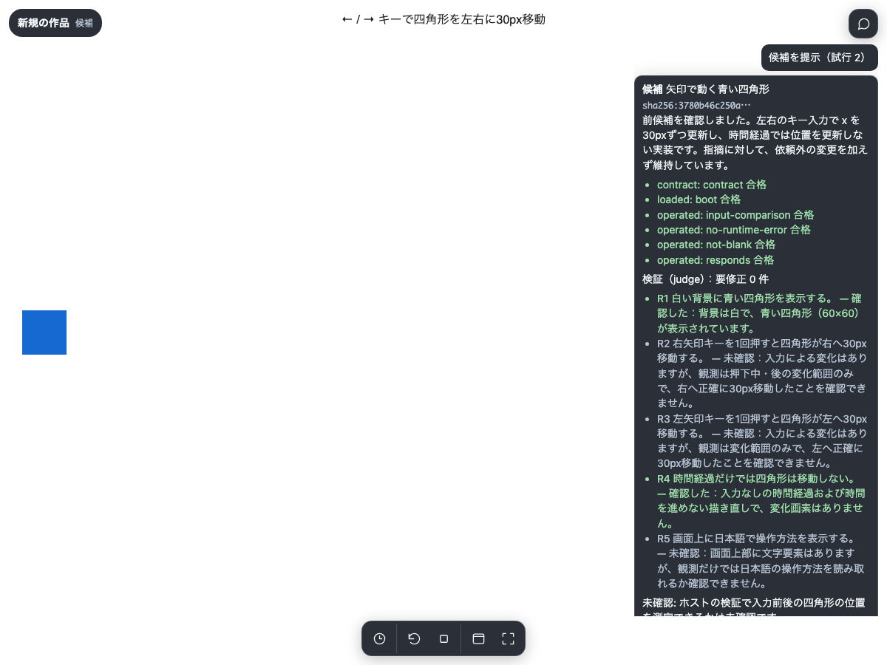

# Canvasアプリ改善の実装・検証記録

2026-11-23。[改善計画](../../.todo/canvas-app-improvement-plan-2026-11-23.md)の実装開始依頼を受け、C01〜C05とC07の実装・回帰試験、C06の容量測定を実施した。保持期間・自動削除・DB移行は未決定である。

以下は初回実装時の記録である。再レビューで見つかった4件の改修結果は、末尾の「再レビュー後の追加4件の改修」を参照する。

## 実装した内容

| 項目 | 結果 |
| --- | --- |
| C01 入力 | 通常commandの本文注入と、taskの原依頼・確認質問・回答・訂正を接続。順序・参照digestを保持し、実行前と結果採用前に再照合。利用者6発言・全20発言・各4,000文字・payload 16 KiBを超える入力は切り捨てず拒否 |
| C02 状態 | jobIdを安定キーとしてCanvas runを照会。失敗・取消・期限切れ・中断も初回表示と再読込で追跡。通信断からの再取得、古い画面応答の除外、受付・通知の冪等性を確認 |
| C03 版 | 会話に提示した参照と画面のrevision/digestを固定。Canvasの単一writer内で照合と基準の取得を行う。受付後に版が変わると、最新版へ切り替えず競合として終了 |
| C04 検証 | 同じseed・時刻の入力あり走行と、入力なしの2走行を比較。時間だけの変化を操作応答としない。既存HostReviewerをjudge方式で接続し、要件ごとの合格・不足・未確認を表示。未評価の修正版を評価済み候補より優先しない |
| C05 検索 | 題名検索、25件のページ、続きの取得を追加。会話用の対象参照は所有者・会話・有効期限・提示版を照合し、検索結果からの編集にも版固定を適用 |
| C06 容量 | 合成作品を1・10・100・1,000件追加して測定。保存方式・保持・削除の仕様変更は行っていない |
| C07 試験 | 恒久的な部分・結合試験とCanvas専用ブラウザー試験を追加。登録・実行domainの正式検証、Artifactの機能試験、実モデルの限定した通し確認を実施 |

通常の制作は初回＋修正2回以内、reviewも最大3回。生成と判定を合算して最大6推論とし、taskでは親から渡された残予算との小さい方を使う。失敗した生成呼出しも数える。期限・取消を共有し、遅い結果は採用しない。

保存は既存の必須検査と利用者の確定を維持する。意味評価が未確認の場合はその旨を表示し、LLMの意味評価による新しい保存禁止条件は追加していない。

## 契約・互換性・配布物

- 公開済みのCanvas v1定義7件、binding、artifactと旧schemaを維持し、`canvas.app@2`、`canvasProduceV2`、`canvas.find@1`、payload version 2を追加した。新規DB・旧版登録済みDBで更新と再登録の冪等性を確認した。
- 実行前の旧payload v1は、欠けた原文・版を推測せず`canvas_request_version_expired`で終了する。旧版の新規制作は受付可能、版参照を持たない旧版の編集は依頼の送り直しを求める。保存済み作品・版・候補・受領記録の形式は維持する。
- 配布元`eumenes_canvas`の基準commitは`09e3814650ac11cebdfb909ce054fbc6f12f0150`。未コミットの変更を完全なsource patchとして同梱した。基準commitへの適用と変更13ファイルの一致を確認した。
- 配布物は`eumenes-canvas-0.1.1-0b2fbc83f612.tgz`。SHA-256は`0b2fbc83f612c6805a80d94f7e3c66739c24974c382e37947b36ecebc0697282`。型宣言・exportを生成し、EumenesのPlaywrightを再利用する。[来歴](../../../vendor/canvas/provenance.json)に各hashを記録した。
- 同じソースからの再生成で同じ配布物hashを確認。インストール済み版・lockfile・配布物と、不要tarballが残っていないことを検査した。旧tarballは依存更新後に除去した。

## 固定応答・ブラウザー検証

| 検証 | 結果 |
| --- | --- |
| Canvas配布元の制作・保存・復元・回復・review loop | 58件成功、型検査成功。要件判定・正規化・プロンプトの追加20件も成功 |
| EumenesのCanvas結合・画面監視・登録・入力参照 | 29件成功 |
| dialogueの確認質問・回答・HTTP・ライフサイクル | 35件成功 |
| Artifact機能試験 | backend 340件・Web 78件成功 |
| Canvas専用ブラウザー試験 | 4件成功。操作・保存r1/r2・再読込・r1からr3への復元・表示拡大と復帰・狭い画面の検索・失敗後の初回表示を確認 |
| 配布物とvendor整合 | 2件成功 |
| capabilities / tool-runtime正式verify | 380件成功、live 2件skip。入力hash前後一致、integrityErrors 0 |

ブラウザー試験は実Chromium・実Workerで行い、HTTP待受を作らず、同じAPI・配信関数へ要求を渡す。音声は消音した。時間だけの変化、実入力による変化を検査し、条件付き・複数手順・途中エラーの観測も追加した。単なる画像差を作品の全要件の合格とは扱わない。

正式verifyは製品DB・鍵・`.env`・運用ログを含めない固定コピーで実行した。各workspace依存とDesignSystem出力もコピー側に分離した。検証中の入力は変更していない。[正式report](domain-report.json)、[作業ツリーとの照合](source-correspondence.json)、[集計](summary.json)に根拠を残す。最終domain検証には利用者発言数の事前検査、追加E2E観測ケース、旧tarballの整理まで含めた。

照合した37ファイルのうち、Canvas本体・配布物を含む36ファイルが一致した。共有の`scripts/domains.ts`には固定後の別作業の登録変更があるため、その後の登録変更まで検証済みとはしない。

`artifact`を含む正式ゲートは、別作業の`packages/artifact-ui/src/ui-studio-source.test.tsx`の書式違反で停止した。この差分は変更していない。上表のArtifact機能試験と、固定コピーの全体型検査・Canvas変更範囲のlintは成功したが、Artifactの正式ゲート全体の合格とは扱わない。その後の元checkoutの型検査では、並行作業中のagency 3ファイルに7件の型不整合があり、元checkout全体の合格は宣言しない。

先行した固定コピーは、別試験が使用する公開fixtureまで除外したため失敗した。4つの公開fixtureを補って正式verifyを実行し直した。ブラウザー検証もDesignSystemの生成後に実行した。これらの準備失敗を製品の合格結果には含めていない。

## 稼働環境での限定した通し確認

利用者が再起動したbackendと、保存済みの推論設定を利用した。こちらからサーバーの起動・停止・再起動は行っていない。

1. 専用会話`canvas-improvement-live-20261123`へCLI対話モードで依頼した。会話→Canvas受付→生成→観測→要件判定→修正→候補提示まで進み、2候補・4推論で終了した。
2. 必須検査は合格。選択された候補の意味評価はR1/R4が合格、R2/R3/R5は未確認となり、画面にも未確認を表示した。正確な30pxの移動など、全要件の充足を確認したとはしない。
3. 稼働APIに接続した専用ブラウザーで、候補・プレビューの表示と右矢印による画面の変化を確認した。保存は確定していない。
4. 権限なしのChromiumでは`ERR_BLOCKED_BY_LOCAL_NETWORK_ACCESS_CHECKS`を再現した。検証用contextに`local-network-access`を許可すると表示・操作が成功した。利用者のブラウザー設定は変更していない。利用者の環境でも必要に応じて同権限を確認する。
5. HTTPエラー処理修正後、利用者の再起動を経て、存在しないrun=404、版参照なし=400、同じ受付キーへの別本文=409を稼働APIで確認した。その後、Makerの利用者6発言上限をジョブ受付前にも適用した。この最後の事前検査は固定試験済みで、稼働反映は次回backend再起動時となる。

[live結果](live.json)、[HTTP結果](live-http.json)。fixture、限定したlive、利用者による受入は別であり、実利用ブラウザーでの手動受入は未実施である。

## 容量測定と残る判断

作品コード約4 KiB・各作品3版の合成データを使い、各規模で保存と復元を3回ずつ測った。測定対象は追加作品に保存用のひな型1作品を加えた数である。初期run・候補は各1件で、失敗候補や実行履歴を大量に増やした試験ではない。

| 追加作品数 | 初期ファイル容量 | 読込 | 保存の最大値 | 復元の最大値 |
| --- | --- | --- | --- | --- |
| 1 | 24,028 B | 2.34 ms | 0.45 ms | 0.47 ms |
| 10 | 145,898 B | 2.98 ms | 0.58 ms | 0.59 ms |
| 100 | 1,364,679 B | 3.28 ms | 1.91 ms | 2.40 ms |
| 1,000 | 13,553,380 B | 10.39 ms | 44.72 ms | 36.87 ms |

[測定条件と全結果](capacity.json)。3標本の参考値であり、実運用のSLO達成を判定する材料としては不足する。この範囲ではJSON方式を直ちに移行する根拠は得ていない。

C06の運用目標、失敗run・未保存候補・受領記録の保持期間、容量上限の扱いは未決定。保存済み作品・版履歴は削除していない。履歴量・コードサイズ・同時書込みを増やした追加測定と、保持方針の判断を次に行う。条件付き・複数手順の実モデル作品を増やす品質受入も、今回の限定したliveと区別して残す。

## 再レビュー後の追加4件の改修

R01〜R04を改修し、採用の境界を含む回帰試験を追加した。[追加改修の集計とソース照合](rereview.json)、[正式domain report](rereview-domain-report.json)を参照する。初回のreport・配布物hash・検証結果は上書きしていない。

- R01: 撤回が結果確定より先にcommitされた場合は失敗にし、候補の表示・プレビュー・保存を拒否する。Canvas取消の書込失敗と再起動も試験した。採用元のない旧候補は直接制作と推測せず拒否し、保存済み作品と受領記録は保持する。
- R02: 操作世代を各取得後に照合する。実ブラウザーでも旧run取得中の新規送信を再現し、新しいPOSTの候補が表示されることを確認した。追加の境界試験では、初期一覧取得中に新しい依頼が完了すると古い候補で上書きされることも再現した。操作追跡の登録を初期一覧取得前へ移し、同じ試験で上書きが起きないことを確認した。
- R03: 判定開始時に消費を記録し、取消・期限・失敗後にも残す。開始前の取消、計上の書込失敗、通知重複を試験した。親taskへの取消状態と消費2回の返却も結合確認した。
- R04: Canvasの既存上限を再利用し、履歴0・5件を許可、6・7件を受付前に拒否する。依頼本文を合わせて利用者発言最大6件となる。

配布元の型検査と72試験、ホスト結合39件、Artifact機能試験backend 340件・Web 78件、Canvas専用ブラウザー6件が成功。正式verifyは390件成功・live 2件skip、入力hash前後一致、integrityErrors 0。別作業のcontext生成物、書式・lintの警告7件をreportに残した。Artifactを含む正式ゲートは既知の書式違反で停止している。

配布物は`eumenes-canvas-0.1.2-92cb8c200232.tgz`、SHA-256は`92cb8c2002328cca6d5197155618024099b0729e56009398d1228b607a144628`。source patchを基準commitへ適用し16ファイルの一致を確認し、再生成でも同じ配布物hashとなった。追加vendor配布物の整合検査は成功したが、vendor全体の未参照tarball検査は別のmemory配布物2件で失敗した。これらは変更していない。

固定コピーとCanvas関係27ファイルの一致を確認した。共有の`package.json`・`bun.lock`・`scripts/domains.ts`には、その後の別作業の変更があるため、現行作業ツリー全体まで検証済みとはしない。Canvasの依存先・インストール済み版は検証した配布物と一致する。追加改修の実モデル生成・製品データ更新・サーバー操作は未実施。稼働反映にはbackend再起動が必要である。
