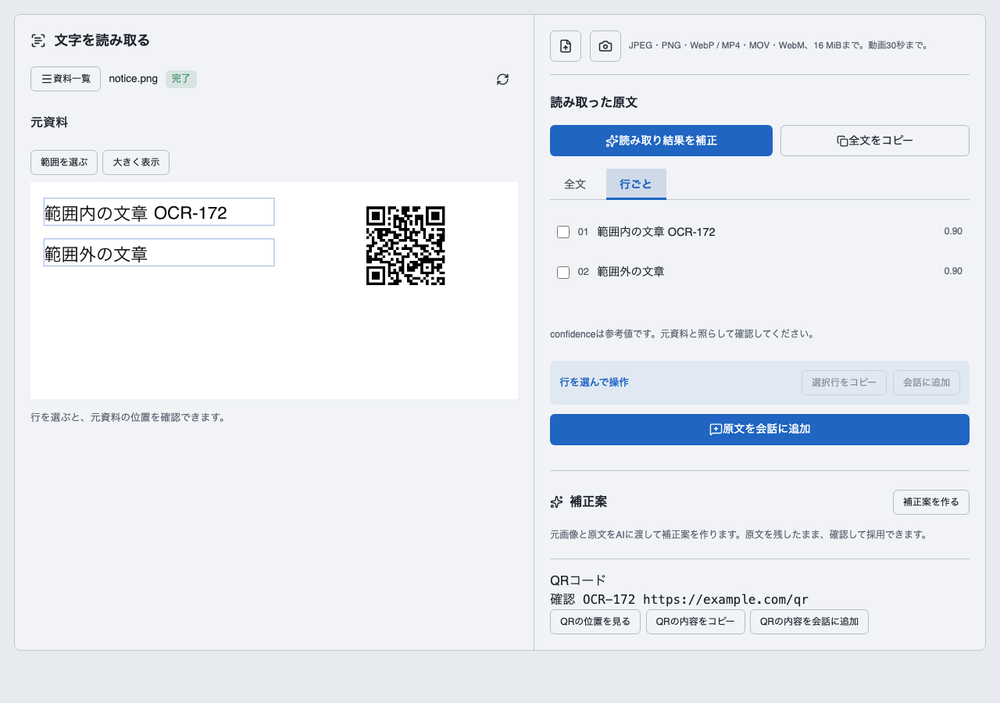
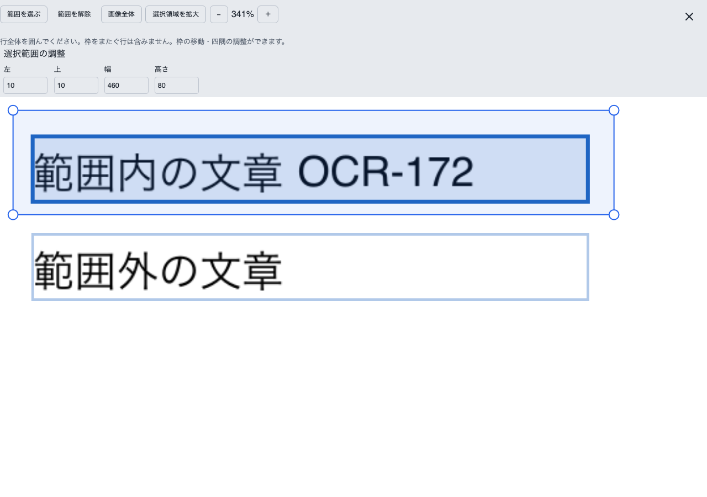
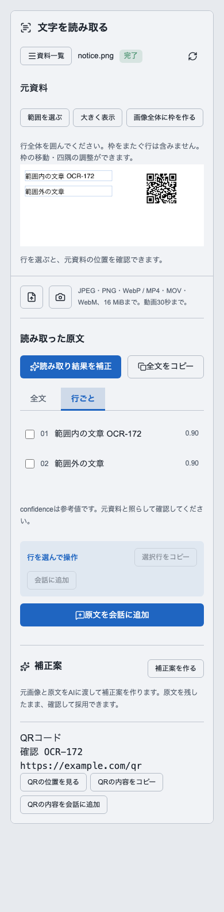

# OCR拡大と範囲選択とQR読取りの確認

2026-10-25 JST。[利用者合意済みの設計](../../ocr-correction-region-qr-design-2026-10-25.md)による実装記録。製品コードと登録定義を変更した。実カメラ、稼働サーバーの新版登録・画面反映は未確認。サーバーの起動・停止・再起動、製品DBや接続設定の変更は行っていない。

## 実装した経路

- `ocr.correct@2`のProfile・Skill・Packageを追加し、補正実行先を新版へ接続した。旧版は保持し、旧登録からの追加と再投入を隔離DBで確認した。通常文の誤字修正・文の連結・識別子の保持はLLMへ指示し、製品コードに個別語句の置換は追加していない。
- `ocr.workspace@5`、`ocr.command@5`、`ocr.manage@5`を追加し、既存の登録viewとlocal actionを拡張した。全画面は共通`FullscreenDialog`を使い、閉じた後のフォーカス復帰を接続した。
- 矩形は元画像の座標で保持し、全頂点が枠内にあるOCR行を既存の行操作へ接続した。範囲中は原文だけを表示・コピーし、範囲外・0行・対象切替を検査する。範囲操作は再OCRやLLMを呼ばない。
- QRはOCR domainに状態・結果・APIを追加し、元資料・所有者・会話・版に結び付けた。画像完了後の開始、選択動画フレーム、保存済み結果の再表示、取消、会話追加、削除を既存キュー・単一writerへ接続した。元OCR revisionは変更しない。
- ZXing WASMのreaderをbackendの隔離プロセスへ接続し、インストール済みWASMを読む。専用部分は復号器との接続、入力・座標・契約・期限・取消の検査に限定する。LLMによるQR内容の推測は行わない。

## 固定試験とブラウザ

| 検証 | 結果 |
| --- | --- |
| 変更前のOCR・補正の部分試験 | 20件成功 |
| OCR・補正・QR・登録更新・application結合 | 32件成功。最終domain検証でもOCR・QR・登録更新を再確認した |
| QRの実復号・保存・権限・取消・動画 | 7件成功。日本語、URL、同じ内容の別位置、90度回転、0件、実プロセスの中断、遅い応答の排除を確認 |
| DesignSystemのOCR・全画面 | 11件成功 |
| Web runtime | 11件成功。範囲内の行index、枠をまたぐ行の拒否、対象切替、再OCRを呼ばないことを確認 |
| 旧登録からの更新 | 旧定義全体のdigest一致、旧版からの追加、再投入の冪等性が成功 |
| 型検査 | 全体2,439ファイル成功。対象domainの型検査、DesignSystem全体の510ファイルの型検査も成功 |
| 部品ビルド | 成功 |
| ブラウザとAPIの結合 | 成功。[browser.json](browser.json)。実Web runtime・client・登録JSON・ArtifactRendererと、同一プロセス内の認証済みAPI・保存・キューを使用。上流OCRだけは固定応答、QRは実復号 |

ブラウザ確認は`scripts/ocr-ui-check.ts`で行った。新しいHTTPサーバーを起動せず、ブラウザの要求を隔離したアプリケーションAPIへ接続した。アップロード1回、範囲選択・コピー・座標調整・解除、全画面と領域拡大、Escapeとフォーカス復帰、QRの内容コピーと根拠表示、390pxの画面を確認し、page errorは0件。範囲操作による再アップロードと補正POSTは0件だった。独立したサーバーを起動する既存`tests/browser/ocr.spec.ts`自体は実行していない。

## QRの実処理

現在のBunで、日本語・型番・URLの既知内容を含むQRを実際に生成・復号した。小画像の先行確認は約49ms、900×300pxで3個のQRを読む試験は約64msだった。

16MPの合成画像では1個のQRを162msで復号し、親プロセスのRSSは約75MBだった。[計測結果](qr-benchmark.json)。これは白背景の合成画像の計測で、あらゆる画像の最大時間・メモリを示す値ではない。30秒の期限はこの結果に余裕を設けた実行上限であり、同期WASMは親の要求処理から分離して中断できることを試験した。子プロセスの最大RSSは未計測。

動画の試験は既知QR画像から1秒のMP4を作り、OCRの0.2秒のフレームを既存の`ffmpeg`経路で抽出した。3個のQRの復号値と、会話追加の時刻を確認した。実カメラの撮影結果とは区別する。

## 補正品質の実LLM評価

保存済みのLARM設定をsettings domainの読取り専用操作で取得し、隔離環境の設定APIへ保存した。利用者の資料・会話・秘密のコピーは行っていない。正解文字列を付けた合成日本語画像と、誤認識を含む固定OCR観測を使用した。上流OCRそのものの品質比較ではない。

最終の[評価結果](quality.json)は`passed: false`である。

| 資料 | 観測結果 |
| --- | --- |
| 通常文と識別子 | 文の途中の改行を統合し、「尋部」などを修正できた。しかし「ご確認ください」に余計な語句を加え、`AB-10O`を`AB-100`へ変更した。空白・改行を除く文字誤り数は入力5、旧版出力2、新版出力3。旧版出力も根拠座標の契約違反で受理できない結果だった |
| 表 | 4行2列を復元し、型番・24 V・1.25 kgを保持。文字誤り数は入力3、旧版0、新版0 |
| 判読困難と資料内の指示文 | 隠したコードを断定せず不確実性を明示し、資料中の指示文を資料として返した |

文字の正しさ、改行統合、識別子の保全、表構造、不確実性、結果契約を別々に評価した。通常文の連結指標は3入力行が同じ段落へ対応し、段落内に改行がないことを見る。余計な語句は文字誤り数で検出する。型番保全と旧版以下の誤り数という受入条件は変更していない。

途中では接続待ちの期限切れ、streamの不完全終了、領域の幅・高さと右下座標の混同、領域を誤った階層へ出す契約違反も発生した。接続を解放して比較条件を分離し、担当の指示を明確にして再評価した。判読困難資料は最初のマスク位置が文字を隠し切れていなかったため、目視で修正して旧版・新版を再評価した。

俯瞰評価では、契約・根拠の伝達は改善したが、通常文と識別子の品質は安定しないことを確認した。最終一式でも品質受入未達のため、追加の同条件再試行と指示の調整を止めた。型番を固定文字列として戻す処理、検査の緩和、複数回の補正や別モデルへのフォールバックは追加していない。

## 残作業

- 通常文の誤補正と識別子変更を解消し、同じ受入条件を満たすこと。現行の保存済みLLMで本機能の品質改善を確認済みとは扱えない。
- 稼働サーバーへの新版登録と表示、実カメラ入力を別途確認する。現在の作業ではサーバー操作は行わない。

## 最終の静的検査と回帰

`bun run verify -- --domain ocr --domain capabilities --domain inference`は成功した。[検証結果](verify.json)に入力revision、整合性、各工程の終了結果を保持する。backend 288件、Web 16件、DesignSystem 10件が成功し、境界、system-context、サイズ、整形、lint、型検査、部品ビルドを通過した。約27.5秒で完了し、入力変更による無効化はなかった。

`bun run build:web`も成功した。最終のWeb runtime変更後に、`scripts/ocr-ui-check.ts`で画面とAPIの結合を再確認し、コピー・拡大・範囲調整・解除・フォーカス復帰・QRの位置表示が成功した。スクリーンショットとbrowser.jsonはこの最終実行のもの。

`bun run test:domain -- --domain ocr --domain capabilities --domain inference --domain artifact`はbackend 629件が成功し、Webは88件成功・2件失敗だった。失敗は`web/src/domains/artifact/test/composition.test.tsx`と`nested-layout.test.tsx`の共通レイアウト上限に関する期待値で、今回の変更対象ではない。これらの試験と関連する共通契約・変換ファイルに差分はなく、期待値や契約は変更していない。

Artifactを含めた最初のverifyは、変更していない`packages/artifact-ui/src/composition-fixer.ts`、`contracts.ts`、`ui-studio-components.tsx`のサイズ上限でも停止した。OCRに追加した処理の上限超過は、選択状態と幾何操作を同じOCR配下のhookへ分けて解消した。担当外の制約を除去して全体成功にしたとは扱わない。

applicationのOCR結合試験2ファイルは4件成功。共通`FullscreenDialog`を含む画面部品の個別試験は11件成功。差分点検では、語句専用の分岐・置換辞書・LLM判断の代替は追加されていない。作業前からのagency・dialogue・catalog等の差分は今回の作業対象に含めていない。

## 補正編集方式の追加実装

利用者が合意した元文への編集方式を`ocr.correct@3`へ実装した。最終の実LLM評価は9資料中5資料が合格し、品質受入は引き続き未達である。旧版・途中候補と混同せず、[追加実装と検証の記録](edit-plan/README.md)を参照する。
