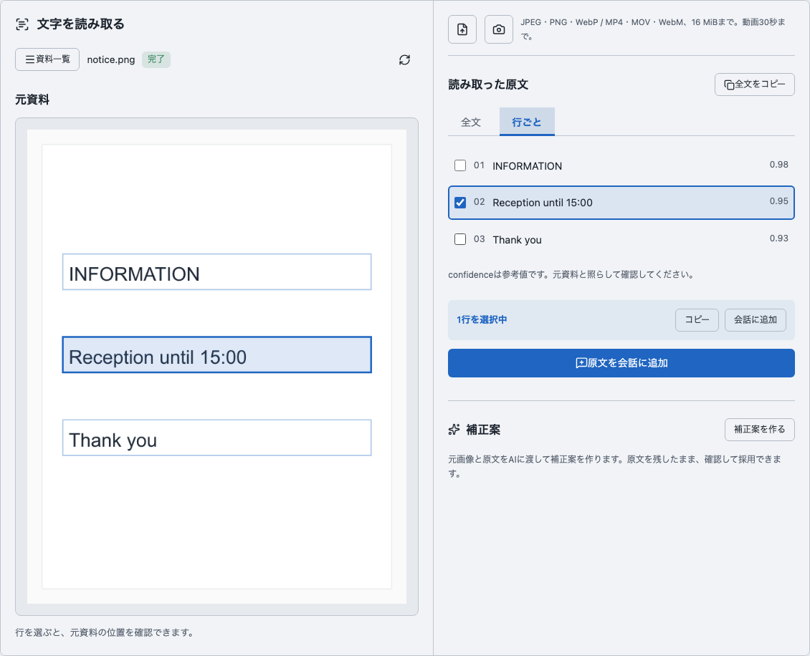

# OCRアーティファクトのデザイン反映

2026年10月17日。[承認された画像案](../../design/ocr-2026-10-17-redesign/README.md)を既存の登録viewへ実装し、配布用ビルドを作成した。利用者の再起動後、稼働中Webへの反映も確認した。配布ビルドと稼働中Webの結果は下記に区別して記録する。

## 実装

- OcrMediaに資料名・状態・元資料の見出しを整理し、明るい原本表示領域を設けた。行とpolygonの選択色を共通のprimary色へ合わせた。
- OcrPanelの結果表示を同じOCR部品内のOcrResultへ分けた。全文／行ごとの切替により、原文が二重に並ばない。行選択はタブを切り替えても保持する。
- 選択行のコピー・会話追加を操作帯へまとめ、原文全体の会話追加と区別した。読み上げ名と既存のevent引数は維持した。
- 補正案は別領域とし、明示的な採用・原文復帰・根拠表示等を維持した。採用後は全文タブへ切り替え、採用中の補正案を表示・コピーする。原文コピーと原文の会話追加は補正案と区別する。
- Artifactの既存2view構成に限って左右を約54:46で配置した。表示領域が760px未満では縦に並ぶ。他のArtifact構成は変えない。

API、DB、認証、LLM指示、ツールチェーンの版・登録・操作schemaは変更していない。判断の正本は既存resourceであり、追加したUI状態は表示タブだけ。発話・単語・個別シナリオを判定する分岐は追加していない。

## 確認画面

以下は生成したデザイン画像ではなく、実装した配布ビルドのブラウザ表示。試験用の原本・OCR結果をブラウザの通信境界で固定し、稼働中backendの資料・会話・設定は変更していない。

[狭幅の縦並び](narrow.png)、[空状態](empty.png)、[ブラウザ結果](browser.json)。

## 検証

| 対象 | 結果 |
| --- | --- |
| 変更前のOcrPanel試験 | 既存の認証表示3件をベースラインとして確認 |
| OcrPanel部分試験 | 6件成功。表示切替・選択行の保持・コピーと会話追加の区別・補正案採用時の既定表示・動画時刻・認証表示を確認 |
| 型検査 | DesignSystem 452ファイル成功 |
| 配布ビルド | `bun run build:web` 成功。既存の大きいchunkに対する警告は残る |
| domain検証 | `bun run verify -- --domain ocr --domain artifact` を実行。boundaries・context・size・format・lint・型検査・DesignSystem build・対象型検査・backend 258件・Web 87件・DesignSystem 6件は成功。ただし2回とも他作業のソース変更を検知して全体結果がinvalidated。verify全体を成功とは扱わない |
| 配布ビルドのブラウザ確認 | 起動済みWebを入口に、HTMLとassetだけをブラウザ内で配布ビルドから応答。新しいサーバーは起動していない。コピー2種類、選択行の会話追加、行とpolygon、履歴、動画時刻、補正案作成・採用・原文復帰、狭幅、空状態を確認。page errorなし |
| 再起動後の稼働中Web | 利用者が再起動を実施した後、実際の開発assetで同じブラウザ操作を確認。原本・OCR結果・補正案は固定データ。配布ビルドによるassetの差替えなし。コピー・選択・会話追加・履歴・動画時刻・補正案作成と採用と原文復帰・狭幅・空状態が成功し、page errorなし。実backendへの変更なし |
| 狭幅 | 実表示領域602pxで1列、scrollWidthも602px。横方向のはみ出しなし |
| 既存の対象E2E | `tests/browser/ocr.spec.ts` に全文／行ごと切替の操作を追加。独立したfixtureサーバーを起動する同ファイル自体は未実行。代わりに上記の起動済みWebと配布ビルドによるブラウザ確認を実施 |

verifyの最初の実行後にタブの幅だけを調整したため、最終版で2回目を実施した。自分の製品コードは検証中に編集していない。再度のinvalidated後は同じ操作を繰り返していない。

## 配布ビルドと稼働中Webの区別

既存の `vite.config.ts` は `hmr: false`・`watch: null` で、起動中プロセスが持つモジュールは自動更新されない。配布ビルドのブラウザ確認と、稼働中Webの更新確認は別に実施した。利用者が「ビルドしていいけど、再起動は私がします」と指定し、その後「再起動しました」と連絡した。こちらではサーバーの停止・起動・再起動を行っていない。

再起動後の[画面](running/desktop.png)、[狭幅](running/narrow.png)、[空状態](running/empty.png)、[結果JSON](running/browser.json)。実際の開発assetを使用し、結果JSONの `productionBuildRenderedViaBrowserRoutes` は `false`。幅1130pxで2列、狭幅602pxで1列かつ横のはみ出しなし。

再起動前後の確認途中では、行選択の待機がタイムアウトした実行もあった。再起動完了を利用者から受けた後、新しいブラウザで最初から実施し、主要操作を通して成功した。製品コードの変更や期待値の緩和は行っていない。いずれのUI試験も固定データを使うため、実gatewayの解析・取消・認証を再実施した結果ではない。実接続については[Mac gateway確認](../ocr-mac-gateway-2026-10-17/README.md)を参照する。
